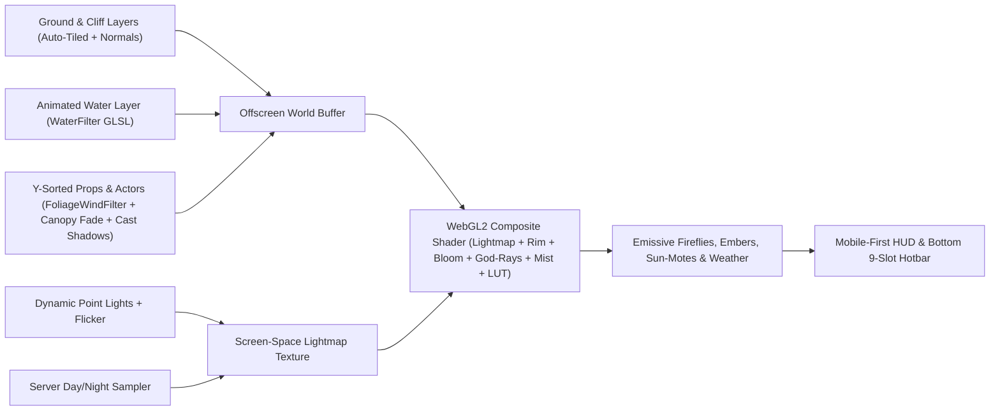

# DungeonCrawler 2D — Master Roadmap (`overworld`)

A fresh, mobile-first, server-authoritative 2D action-RPG & light-survival overworld game built on **PixiJS v8 (WebGL2/WebGPU)** with a **Lush HD-Pixel Atmosphere** (Core Keeper / Eastward / Sea of Stars style), deterministic infinite terrain, enterable dark torch-lit dungeons, true 36-slot Minecraft-style inventory, tactile combat, and hybrid Web Audio.

---

## Core Design Pillars

1. **Lush HD-Pixel Visuals & Real WebGL2 Atmosphere**: Crisp nearest-neighbor pixel art enhanced with smooth real-time 2D lightmaps, directional sun/moon shadows, generated normal-map relief lighting, flickering warm torch/campfire bloom, animated reflective water shaders, coherent foliage wind-wave shaders, canopy god-rays, drifting cloud shadows, valley ground mist, and dusk fireflies.
2. **Mobile-First Browser UX**: Designed for portrait & landscape phones from day one (`100dvh`, `viewport-fit=cover`, auto-fullscreen on mobile first touch + manual fullscreen toggle, floating touch thumbstick, large touch-friendly bottom hotbar, direct pointer drag-and-drop with tap-to-move fallback, quality scaling presets) while remaining effortless on desktop keyboard/mouse.
3. **Server-Authoritative Multiplayer (`@dc2d/*`)**: Clean 4-package monorepo (`@dc2d/engine`, `@dc2d/content`, `@dc2d/game-server`, `@dc2d/client`) supporting WebSocket co-op, client-side prediction, synced Day/Night & weather, plus seamless deterministic local preview when offline.
4. **Deterministic Infinite Overworld + Enterable Dark Dungeons**: Seeded noise + macro biome fields generate `32×32` chunks on demand in milliseconds; persistence stores only world deltas (chopped resources, looted chests, placed campfires/torches/stations). Caves and ancient dungeon entrances transition into pitch-black torch-lit multi-floor interiors.
5. **Action-RPG + Light Survival (Valheim-lite)**: Chop trees, mine ore/stone, forage herbs/flint, hunt wildlife, cook at campfires for rested/well-fed buffs (no punitive starvation deaths), place campfires/torches/chests/workbenches, and forge tiered equipment.
6. **True Minimalist 36-Slot Inventory Model**: Slots `0..8` are the larger, always-visible **bottom hotbar** (rendered cleanly at the bottom of the gameplay screen, never duplicated inside the inventory modal); slots `9..35` are the `3×9` backpack. Weapons, bows, tools, and armor have `maxStack = 1` (no stack counts). The inventory screen contains ONLY backpack + 4 armor slots + stats, dragging straight onto the bottom hotbar; crafting lives in its own dedicated panel showing craftable/discovered recipes cleanly.
7. **Hybrid Web Audio Engine**: Layered biome & time-of-day soundscapes, surface-aware footsteps, crisp melee/bow/harvest/UI SFX, and adaptive atmospheric music.
8. **Composable Effects Engine & Real-Time AI Crafting**: Preserve the data-driven spirit of `archive/v1`'s effects system inside `@dc2d/engine` while expanding it flexibly — composable primitives (`modify_health`, `modify_stat`, `apply_status`, `remove_status`, `spawn_area`, triggers, projectiles, custom visuals), elemental area reactions, cross-referenced content registries, and validated AI invention pipelines so AI can craft novel items, recipes, and interactions safely in real time.

---

## Package Architecture & Render Pipeline

- `@dc2d/engine` — Pure, platform-free TypeScript (`zod` only): seeded noise, infinite chunk generator, biome/elevation samplers, continuous sliding collision, Day/Night sampler, true 36-slot inventory ops, combat math, and Zod wire protocol.
- `@dc2d/content` — Pure TypeScript data & schemas: items (with explicit `maxStack`), recipes, palettes, wildlife/enemy definitions, biome tables, quality presets.
- `@dc2d/game-server` — Node + `ws`: authoritative 20 Hz simulation, delta persistence, synced Day/Night & weather, chunk delta streaming, co-op sessions.
- `@dc2d/client` — PixiJS v8 + HTML HUD + Web Audio: renderer adapters isolated inside `packages/client/src/render/`, mobile touch + desktop controls, true drag/drop hotbar & minimalist HUD.

---

## Phased Delivery Plan

### Phase 0 — Clean Orphan Monorepo Foundation ✅
- Fresh `overworld` orphan branch keeping tooling (`eslint.config.js`, `tsconfig.base.json`, `vitest.config.ts`), `AGENTS.md`, `docs/LESSONS.md`, and `packages/client/public/` art/font assets.
- Zero Three.js / Phaser dependencies; PixiJS v8 installed cleanly.
- Strict modular limits (`<=250` lines/file, `<=35` lines/fn, max nesting 3, `<=12` files/folder, domain-based names, zero baseline exemptions).

### Phase 1 — Infinite Forest & Core-Keeper / Eastward Shader Showcase ✅
- **1A Engine & Server**: Seeded 2D value/fBm/ridge noise; deterministic `32×32` chunk generator (`DeepWater`, `ShallowWater`, `Sand`, `Grass`, `MeadowGrass`, `ForestFloor`, `DirtPath`, `CliffStone`, `MossStone`); elevation tiers `0..2` with walkable stairs; sunlit spawn glade with warm campfire, river & cliffs; continuous sliding collision; Day/Night clock (`480s` cycle) + WebSocket multiplayer server (`@dc2d/game-server`).
- **1B PixiJS v8 HD-Pixel Renderer & WebGL2 Shaders**:
  - Multi-variant pixel-art terrain tiles + organic auto-tile edge blends + generated tangent-space normal maps.
  - Multi-tile Oak/Pine trees (blocking trunk + Y-sorted canopy that fades behind the player), bushes, swaying tall grass, boulders, wildflowers, animated crackling campfires, torches, and knight character sprites.
  - **Custom WebGL2 GLSL Shaders**:
    - Animated water shader (dual-layer ripples, shoreline foam, sun/moon sparkles, warm firelight reflections).
    - Coherent world-space foliage wind-wave shader across trees, bushes, and tall grass.
    - Offscreen lightmap + **WebGL2 Composite Filter** delivering day/night ambient tinting, directional normal-map rim highlights, flickering radial point lights, **selective bloom** on fire/torches/fireflies, **diagonal canopy sunbeams / god-rays**, drifting **cloud shadows**, low **ground mist**, and **filmic color grading + vignette**.
  - Directional sun/moon **cast shadows** skewing smoothly with time of day.
  - Pooled GPU particles (sun-motes, falling leaves, dusk/night fireflies, rising embers & smoke).
  - Mobile-first floating thumbstick, desktop WASD/scroll-zoom, and collapsible time-of-day + quality preset (`High / Balanced / Performance`) debug bar.

### Phase 2 — Mobile-First Controls & True 36-Slot Inventory / Bottom Hotbar ✅
- Mobile auto-fullscreen on initial touch gesture + manual fullscreen toggle in the HUD bar; touch-only floating movement joystick (leaving desktop mouse free).
- Server-authoritative **36-slot array** (`0..8` hotbar, `9..35` backpack) synced cleanly over WebSocket.
- Non-stackable gear (`maxStack: 1` for swords, bows, axes, pickaxes, armor pieces) — never renders stack counts (`×2`) on equipable gear; stackables combine cleanly up to `maxStack`.
- **Larger Always-Visible Bottom Hotbar (`0..8`)**: sized generously for both thumbs and mouse clicking, remaining visible and droppable even while the Inventory modal is open.
- **Minimalist Inventory Modal (`[Tab]` / Backpack button)**: strictly `27`-slot Backpack grid + `4` Armor slots + character stats (`HP`, `Stamina`, `Defense`, `Speed`). **No duplicate hotbar row inside the modal, no green equipped highlights, and no quick-craft clutter.**
- Unified pointer drag-and-drop (backpack <-> backpack swap/stack, backpack <-> bottom hotbar, backpack <-> armor, armor <-> bottom hotbar) plus tap-source -> tap-target mobile fallback.
- Dedicated **Crafting & Storage Panel** (hand recipes + nearby station recipes with clean craftability filtering).

### Phase 3 — Custom Layered Characters & Visible Multiplayer Equipment ✅
- 3D Blender-baked modular HD-pixel hero rig (`tools/sprite-studio/`) with 8-directional idle/walk/run layers, articulated 2-segment IK arms and held gear, dedicated `Hero_Walk` vs `Hero_Run` animation clips, distance-driven `GaitClock` syncing stride frames and footsteps, movement-driven facing with combat aim snap, and a localhost **Sandbox Pose Tuner** (`/?sandbox=1&tuner=1`).
- **Base Character Creator**: selectable body/gender silhouette, skin tone, hair color, and expandable hair styles saved per player and synced over WebSocket.
- **Visible Multiplayer Gear Layers**: real-time layered equipment rendering for both local and remote players — helmets/hoods, chestplates/tunics, leggings/pants, boots, plus extensible layers for gloves, capes, and held weapons/tools/shields.

### Phase 4 — Hybrid Web Audio, Tactile Action Combat, Wildlife & Overworld POIs 🚧
- **Hybrid Web Audio Engine**: Zero-latency mobile audio unlock, drop-in sample overrides with full Web Audio synthesis fallback, Dawn/Day birdsong ↔ Dusk/Night crickets ambient beds, reactive combat-tension swell, terrain-matched footsteps, spatial river/campfire audio, pitch-varied hit/swing/UI SFX, toggleable Music/SFX volume sliders, plus a standalone localhost **Sound Studio** (`/sound-studio.html`) linked from the Title Screen.
- **Melee Combat & Composable Gore/Blood/Goo**: Directional 3-hit weapon combos (Sword, Axe, Pickaxe, Torch), slash arc VFX, brief hitstop, knockback, stamina-cost dodge-roll with `0.24s` server i-frames, and an orthogonal `GoreStyle` (`splatter`, `thin-streak`, `drip`, `chunk-spray`, `explode-away`) × `GoreSubstance` (`blood`, `slime`, `ichor`, `straw`, `bone`) particle + fading decal system wired into live overworld scenes.
- **Shield & Bow**: Dedicated 5th **Shield / Off-Hand** slot (`wooden-shield` auto-clipping the Lantern to the hip), directional block & timed parry stagger; hold-to-draw bow with clean above-head charge bar, rotated charge-scaled arrows, and elemental arrow hooks *(deferred to Phase 7 Composable Effects)*.
- **Overworld Wildlife & Cognitive/Ecological AI *(4B)***: 3D-baked animated spritesheets for all 9 wildlife and POI guard archetypes (`wolf`, `bear`, `spider`, `boar`, `slime`, `goblin`, `orc`, `skeleton`, `golem`), elevation-aware LOS & vision cones, corner-peeking last-known-position investigation, scent trail tracking, dead-body non-aggression & bear scavenging/feeding, coordinated Wolf Pack flank-ring circling, Wild Boar windup + momentum charge, Forest Spider shadow-ambush, and splattering Forest Slimes.
- **Deterministic Overworld POIs *(4C)***: Stamped `7×7` Bandit Camps (wooden palisade fences, tents, campfire, loot chest, goblin/orc guards) and `7×7` Ancient Forest Ruins (mossy pillars, chests, skeleton/golem guards) with `[E]`/tap interactive 27-slot POI chests, magnetic dropped enemy loot, and zero `[DEAD]` labels.
- **Remaining to complete Phase 4**:
  - **Enemy & Wildlife Audio + Distance Attenuation**: Per-species procedural/sample vocalizations & combat cues (bear roars/swipes, boar snorts/charge squeal/hooves, wolf growls/pack howl, spider hiss/skitter, slime squelch/pop, goblin/orc/skeleton/golem aggro/hurt/death) plus distance-based volume attenuation (currently stereo-panned only).
  - **Combat Feel, i-Frames & Gore Completeness**: Brief post-hit player i-frames (currently only dodge-roll `0.24s` and respawn `2.0s` set `invulnTimer`) + visible dodge/i-frame feedback; wire `bleedTimer` (`drip` trails) onto wildlife damaged by arrows (`worldEcology.ts`); emit `thin-streak` on appropriate slash/pierce attacks (currently unused); wire `GoreSystem.spawn`, `stepBleedDrips`, and dodge i-frames into the Sandbox (`sandboxMode.ts` / `sandboxCombat.ts`).
  - **Cognitive/Ecological AI Readability & Polish (4B)**: Diegetic visual/audio AI state tells (`alert`, `investigate`, `ambush`, `feed`, `flank`) on animated sprites (currently animated sprites show no state icon/concealment/feeding animation), noise-event attraction (swings/hits/sprinting pulling nearby creatures), bear territorial warning & feeding-vs-threat balance, and wolf pack coordination cues.

### Phase 5 — Gathering, Light Survival & Gear Tiers
- Harvestable trees (wood + stumps with regrowth timers), boulders/ore veins (stone, flint, copper, iron), and herbs/berries with hit shake & chip particles.
- Authoritative **Chunk Delta Store** saving chopped resources, looted chests, and player-placed campfires, torches, wooden chests, workbenches, and forges.
- Campfire cooking (`raw-meat` -> `cooked-meat`, herb teas/salves) granting timed **Well-Fed** and **Rested** stamina/regen buffs near warm campfires.
- Four clear gear progression tiers: **Wood & Flint -> Copper & Leather -> Iron & Grizzly -> Shadowsteel & Runic** with tiered weapons, tools, shields, and armor sets.

### Phase 6 — Multi-Biome World, Dynamic Weather & Enterable Underground Dungeons
- Seamless deterministic outer biomes radiating from the Verdant Forest hub: **Whispering Woods** (dense bioluminescent twilight canopy), **Misty Wetlands** (lily pads, bog mist, slimes), **Craggy Highlands** (multi-tier stone cliffs, ore veins, mountain wind), and **Sunken Ruins** (flooded stonework, ancient guardians).
- Server-synced **Dynamic Weather**: Clear, Overcast, Light Rain, Thunderstorm (angled GLSL rain streaks, animated puddle splash ripples, lightning flashes casting temporary crisp shadows, wet specular sheen on ground/props).
- **Enterable Underground Dungeons**: Cave arches and sunken staircases transitioning players into dark, multi-floor procedural dungeons illuminated strictly by carried/placed torches, wall sconces, lava/crystal glow, traps, mini-boss arenas, and floor bosses (The Warden).

### Phase 7 — Composable Effects Engine & Real-Time AI Crafting
- **Data-Driven Composable Effects (`@dc2d/engine`)**: Composable primitives (`modify_health`, `modify_stat`, `apply_status`, `remove_status`, `spawn_area`, triggers, projectiles, custom visuals), elemental arrow & weapon hooks, and elemental area reactions (fire, frost, poison, shock, wet).
- **Cross-Referenced Content Registries**: Runtime-validated registries for items, recipes, statuses, and effect graphs so scripted and generated content share one authoritative simulation path.
- **Real-Time AI Crafting & Invention Pipeline**: Schema-validated AI crafting able to invent balanced novel items, consumables, recipes, and interactions safely during play.

### Phase 8 — Co-op Polish, Progression & QA Benchmarks
- **Multiplayer & QoL**: Party invites, revive hold-interaction, compact minimap & POI compass, XP/perk milestones, and full desktop/mobile Playwright visual regression & frame-time benchmarks across Quality Presets (`High / Balanced / Performance`).
