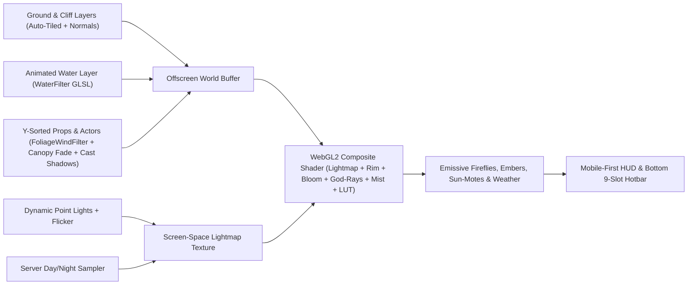

# DungeonCrawler 2D — Master Roadmap (`overworld`)

A fresh, mobile-first, server-authoritative 2D action-RPG, stealth-survival & DCC-inspired floor-descent overworld game built on **PixiJS v8 (WebGL2/WebGPU)** with a **Lush HD-Pixel Atmosphere** (Core Keeper / Eastward / Sea of Stars style), deterministic infinite terrain, enterable dark torch-lit dungeons, true 36-slot Minecraft-style inventory, tactile combat, and hybrid Web Audio.

---

## Core Design Pillars

1. **Lush HD-Pixel Visuals & Real WebGL2 Atmosphere**: Crisp nearest-neighbor pixel art at a unified pixel density (zero mixels) enhanced with smooth real-time 2D lightmaps, directional sun/moon shadows, generated normal-map relief lighting, flickering warm torch/campfire bloom, animated reflective water shaders, coherent foliage wind-wave shaders, canopy god-rays, drifting cloud shadows, valley ground mist, and dusk fireflies.
2. **Mobile-First Browser UX**: Designed for portrait & landscape phones from day one (`100dvh`, `viewport-fit=cover`, auto-fullscreen on mobile first touch + manual fullscreen toggle, floating touch thumbstick, large touch-friendly bottom hotbar, direct pointer drag-and-drop with tap-to-move fallback, quality scaling presets) while remaining effortless on desktop keyboard/mouse.
3. **Server-Authoritative Multiplayer (`@dc2d/*`)**: Clean 4-package monorepo (`@dc2d/engine`, `@dc2d/content`, `@dc2d/game-server`, `@dc2d/client`) supporting WebSocket co-op, client-side prediction, synced Day/Night & weather, plus seamless deterministic local preview when offline.
4. **DCC-Inspired Floor Descent & Deterministic Infinite Worlds**: Seeded noise + macro biome fields generate `32×32` chunks on demand in milliseconds; each floor runs under an authoritative multi-day **Floor Collapse Countdown Timer**, housing **Safe Rooms / Town Hubs** (NPCs, bounties, quests), landmarks, bosses, and **Floor Stairwells** leading deeper before collapse.
5. **Action-RPG + Full Stealth + Valheim-Lite Camp Survival**: Sneak through shadow/brush with a dynamic light-level visibility meter, throw distractions, land silent takedowns, chop trees, mine ore/stone, forage herbs/flint, cook at campfires for rested/well-fed buffs, and place campfires, torches, storage chests, workbenches, beds, and simple palisades/shelters.
6. **True Minimalist 36-Slot Inventory Model**: Slots `0..8` are the larger, always-visible **bottom hotbar** (rendered cleanly at the bottom of the gameplay screen, never duplicated inside the inventory modal); slots `9..35` are the `3×9` backpack. Weapons, bows, tools, and armor have `maxStack = 1` (no stack counts). The inventory screen contains ONLY backpack + armor slots + stats, dragging straight onto the bottom hotbar; crafting lives in its own dedicated panel showing craftable/discovered recipes cleanly.
7. **Hybrid Web Audio Engine**: Layered biome & time-of-day soundscapes, surface-aware footsteps, organic vocal-tract creature synthesis + Sound Studio live hot-reload overrides, crisp melee/bow/harvest/UI SFX, and adaptive atmospheric music.
8. **Composable Effects Engine & Real-Time System-AI Crafting / Reward Boxes**: Preserve the data-driven spirit of `archive/v1`'s effects system inside `@dc2d/engine` while expanding it flexibly — composable primitives (`modify_health`, `modify_stat`, `apply_status`, `remove_status`, `spawn_area`, triggers, projectiles, custom visuals), elemental area reactions, cross-referenced content registries, and validated System-AI invention pipelines generating novel items, recipes, achievements, and reward boxes safely in real time.

---

## Package Architecture & Render Pipeline

- `@dc2d/engine` — Pure, platform-free TypeScript (`zod` only): seeded noise, infinite chunk generator, biome/elevation samplers, continuous sliding collision, Day/Night sampler, true 36-slot inventory ops, combat math, and Zod wire protocol.
- `@dc2d/content` — Pure TypeScript data & schemas: items (with explicit `maxStack`), recipes, palettes, wildlife/enemy definitions, biome tables, quality presets.
- `@dc2d/game-server` — Node + `ws`: authoritative 20 Hz simulation, delta persistence, synced Day/Night & weather, chunk delta streaming, co-op sessions.
- `@dc2d/client` — PixiJS v8 + HTML HUD + Web Audio: renderer adapters isolated inside `packages/client/src/render/`, mobile touch + desktop controls, true drag/drop hotbar & minimalist HUD.

---

## Phased Delivery Plan

### Phase 0 — Clean Orphan Monorepo Foundation ✅
- Fresh `overworld` orphan branch keeping tooling (`eslint.config.js`, `tsconfig.base.json`, `vitest.config.ts`), `AGENTS.md`, `docs/LESSONS.md`, and `packages/client/public/` art/font assets.
- Zero Three.js / Phaser dependencies; PixiJS v8 installed cleanly.
- Strict modular limits (`<=250` lines/file, `<=35` lines/fn, max nesting 3, `<=12` files/folder, domain-based names, zero baseline exemptions).

### Phase 1 — Infinite Forest & Core-Keeper / Eastward Shader Showcase ✅
- **1A Engine & Server**: Seeded 2D value/fBm/ridge noise; deterministic `32×32` chunk generator (`DeepWater`, `ShallowWater`, `Sand`, `Grass`, `MeadowGrass`, `ForestFloor`, `DirtPath`, `CliffStone`, `MossStone`); elevation tiers `0..2` with walkable stairs; sunlit spawn glade with warm campfire, river & cliffs; continuous sliding collision; Day/Night clock (`480s` cycle) + WebSocket multiplayer server (`@dc2d/game-server`).
- **1B PixiJS v8 HD-Pixel Renderer & WebGL2 Shaders**:
  - Multi-variant pixel-art terrain tiles + organic auto-tile edge blends + generated tangent-space normal maps.
  - Multi-tile Oak/Pine trees, bushes, swaying tall grass, boulders, wildflowers, animated crackling campfires, torches, and knight character sprites.
  - **Custom WebGL2 GLSL Shaders**: animated reflective water, coherent foliage wind-wave, offscreen lightmap + **WebGL2 Composite Filter** (ambient tinting, normal-map rim highlights, selective bloom, canopy god-rays, drifting cloud shadows, valley ground mist, filmic grading), directional sun/moon **cast shadows**, and pooled GPU fireflies/embers/sun-motes.
  - Mobile-first floating thumbstick, desktop WASD/scroll-zoom, and collapsible time-of-day + quality preset (`High / Balanced / Performance`) debug bar.

### Phase 2 — Mobile-First Controls & True 36-Slot Inventory / Bottom Hotbar ✅
- Mobile auto-fullscreen on initial touch gesture + manual fullscreen toggle; touch-only floating movement joystick (leaving desktop mouse free).
- Server-authoritative **36-slot array** (`0..8` hotbar, `9..35` backpack) with non-stackable gear (`maxStack: 1`), **Larger Always-Visible Bottom Hotbar**, minimalist Inventory modal (`27` backpack + armor slots + stats), unified pointer drag-and-drop + mobile tap fallback, and dedicated **Crafting & Storage Panel**.

### Phase 3 — Custom Layered Characters & Visible Multiplayer Equipment ✅
- 3D Blender-baked modular HD-pixel hero rig (`tools/sprite-studio/`) with 8-directional idle/walk/run layers, articulated 2-segment IK arms and held gear, dedicated `Hero_Walk` vs `Hero_Run` animation clips, distance-driven `GaitClock` syncing stride frames and footsteps, movement-driven facing with combat aim snap, and a localhost **Sandbox Pose Tuner** (`/?sandbox=1&tuner=1`).
- **Base Character Creator** (body/gender silhouette, skin tone, hair color, hairstyles) + **Visible Multiplayer Gear Layers** synced over WebSocket.

### Phase 4 — Combat Core, HD-Pixel Gore, Spatial Creature Audio & Sound Studio ✅ *(v0.11.3 mini-release)*
- **Hybrid Web Audio Engine**: Zero-latency mobile audio unlock, drop-in sample overrides + live **Sound Studio** (`localStorage` + cross-tab hot-reload) overrides, **Vocal-Tract Growl (`vocal`)** organic formant + flutter synth, Dawn/Day birdsong ↔ Dusk/Night crickets ambient beds, reactive combat-tension swell, terrain-matched footsteps, spatial river/campfire audio, pitch-varied combat/UI SFX, 9-species enemy/wildlife vocalizations (`alert`/`attack`/`charge`/`hurt`/`death`) with distance attenuation (`2.5`–`22` tiles), plus the standalone **Sound Studio** (`/sound-studio.html`) with `+ Vocal Growl` and all 45 creature presets.
- **Melee Combat, Starter Gear & Composable Gore/Blood/Goo**: Directional 3-hit sword combos, axe/pickaxe/torch swings, slash arc VFX, brief hitstop, knockback, stamina-cost dodge-roll (`0.24s` dodge i-frames) + `0.42s` post-hit player i-frames, default spawn armor (`chest`/`legs`/`feet` equipped; helmet optional in backpack), and orthogonal `GoreStyle` × `GoreSubstance` particles + decals (bespoke blade arcs, chunky slime goop, bone/rubble corpse piles with emissive sparks, diffuse water plumes, opaque ground-sorted corpses, and Sandbox parity).
- **Shield & Bow**: Dedicated 5th **Shield / Off-Hand** slot (`wooden-shield` auto-clipping Lantern to the hip), directional block & timed parry stagger; hold-to-draw bow with charge gauge and rotated charge-scaled arrows *(elemental hooks deferred to Phase 12)*.
- **Baseline Wildlife, POIs & Initial Indicators**: 3D-baked spritesheets for all 9 wildlife and POI guard archetypes (`wolf`, `bear`, `spider`, `boar`, `slime`, `goblin`, `orc`, `skeleton`, `golem`), initial perception/scent/chase behaviors, stamped `7×7` Bandit Camps & Ancient Ruins with `[E]` chests and magnetic loot, and an initial pass of overhead AI state icons *(full AI & stealth overhaul promoted to Phase 6)*.

### Phase 5 — Zero-Mixel HD-Pixel World Art Pass 🚧 *(Next Up)*
- Eliminate mixel mismatches between the `32px`-grid Cairo/3D-baked hero & creatures and older procedural world art.
- Re-author crisp, palette-coherent **Oak & Pine trees** (trunks + layered canopies), **bushes**, **tall grass tufts**, **wildflowers**, **boulders & stumps**, **campfires/torches**, **Bandit Camp tents & wooden palisades**, **Ancient Ruin pillars**, **chests**, and matching item/HUD icons with unified pixel size and tuned relief normal maps.

### Phase 6 — Full Stealth RPG, Hearing/Vision & Ecological AI Overhaul
- **Full Stealth Mechanics**: Dedicated crouch/sneak mode (lower speed & near-zero footstep noise), bush/tall-grass & shadow concealment, dynamic **light-level visibility meter** (driven by Day/Night lightmap + carried torch state + nearby campfires/torches), thrown distractions (pebbles/rocks creating investigate noise points), and **silent takedowns / backstab criticals** on unaware targets.
- **3-Stage Perception & Bug-Free Diegetic Markers**: Split perception cleanly into **Heard / Suspicious (`?`)** -> **Spotted / Aggroed (brief crisp `!` pop, never stuck)** -> **Distinct Attack Windup / Telegraph**, fixing all flicker, stuck-marker, and offset bugs in `aiStateIndicators.ts`.
- **Ecological & Hive-Mind AI Overhaul**:
  - **Wolf Pack Hive-Mind**: Alerting one wolf immediately howls and rallies all nearby wolves regardless of spawn group; shared per-target encirclement with organic radius/angle jitter (never two overlapping uniform rings); wolves positioned *behind* the player's facing vector dart in for quick bites and peel back into cover.
  - **Creature Tuning**: Bear territorial bluff/warning vs hunger/scavenging balance, Boar wall-stun & charge recovery feel, Spider true cover-ambush/pounce, Slime cohesion, and noise propagation from sprinting/swings/combat.

### Phase 7 — Weapon-Specific Attack Animations, Movesets & Combat Polish
- Distinct per-weapon attack animations, hitboxes, stamina costs, and gore matching:
  - **Sword**: agile 3-hit slash -> backhand -> finisher lunge combo.
  - **Axe**: deliberate heavy sideways chop (single swing cadence, doubles seamlessly as tree-chopping stroke).
  - **Pickaxe**: heavy overhead downward slam (single swing cadence, doubles cleanly as stone/ore mining stroke).
  - **Torch**: short flame sweep / ignite thrust.
  - Extensible archetype slots prepared for future **Spear** thrust, **Dagger** rapid stab + stealth-crit multiplier, and **Greatsword** cleave.

### Phase 8 — Gathering, Light Survival, Valheim-Lite Camp Building & Persistent World Deltas
- Harvestable trees (wood + regrowing stumps), boulders/ore veins (`stone`, `flint`, `copper`, `iron`), and herbs/berries with hit shake & debris bursts.
- **Valheim-Lite Camp Building**: Craft and place **campfires**, standing **torches**, **storage chests**, **workbenches**, **beds (set custom respawn point)**, and simple **wooden palisades / shelters**.
- **Light Survival & Cooking**: Campfire cooking (`raw-meat` -> `cooked-meat`, herb teas/salves) granting timed **Well-Fed** and **Rested** stamina/HP regen buffs near warm hearths (zero punitive starvation deaths).
- **Authoritative Persistence Store**: Save chunk deltas (chopped resources, looted POI chests, placed camp structures/beds) and player progression cleanly across server restarts.

### Phase 9 — Exploration, Diverse Overworld POIs, Fog-of-War Map & Safe-Room Town Hubs
- **Rich Overworld Landmarks**: Expand far beyond the first two `7×7` POIs — roadside **shrines**, **ruined watchtowers**, **abandoned camps**, **crossroads signposts**, **hidden foraging groves**, **corrupted clearings**, and **mini-boss lairs**.
- **Fog-of-War Overworld Map**: Reveal explored tiles with clickable/readable landmark pins, placed campfire/bed markers, and **Stairwell** directional hints.
- **Safe Rooms & Town Hubs *(DCC-Inspired)***: Restorative sanctuaries with persistent NPCs (Floor Guide mentor, blacksmith, merchant, **Bounty / Quest Board**), hand-authored floor side-quests, and safe shared crafting/stash space.

### Phase 10 — Gear Tiers, Progression, Floor Bosses & DCC Floor Countdown Loop
- **Gear Tiers & Loot Depth**: Four distinct progression tiers (**Wood & Flint -> Copper & Leather -> Iron & Grizzly -> Shadowsteel & Runic**) with meaningful drop tables and light skill/XP milestones.
- **DCC Floor Collapse Countdown & Stairwell Descent**: Authoritative multi-day **Floor Countdown Timer** ticking across the floor's day/night cycle; explore, gear up, and locate/unlock the **Floor Stairwell** (guarded by a **Floor Boss** or stairwell seal) and descend before the floor collapses.

### Phase 11 — Multi-Biome Floors, Dynamic Weather & Enterable Pitch-Black Dungeons
- **Seamless Outer Biomes & Floor Themes**: **Verdant Overworld**, **Whispering Woods** (bioluminescent twilight canopy), **Misty Wetlands** (lily pads, bog mist, slimes), **Craggy Highlands** (multi-tier stone cliffs, ore veins, mountain wind), and **Sunken Ruins** (flooded stonework, ancient guardians).
- **Server-Synced Dynamic Weather**: Clear, Overcast, Light Rain, and Thunderstorm (angled GLSL rain streaks, animated puddle splash ripples, lightning flashes casting temporary crisp shadows, wet specular sheen).
- **Enterable Pitch-Black Dungeons & Deeper Floors**: Stairwells and cave arches transitioning players into multi-floor dark interiors lit strictly by carried/placed torches, wall sconces, lava/crystal glow, traps, mini-boss arenas, and iconic Floor Bosses (The Warden & beyond).

### Phase 12 — Composable Effects Engine & Real-Time System-AI Crafting / Reward Boxes
- **Data-Driven Composable Effects (`@dc2d/engine`)**: Composable primitives (`modify_health`, `modify_stat`, `apply_status`, `remove_status`, `spawn_area`, triggers, projectiles, custom visuals), elemental weapon/arrow hooks, and elemental area reactions (`fire`, `frost`, `poison`, `shock`, `wet`).
- **System-AI Crafting & Achievement Reward Boxes *(DCC-Inspired)***: Cross-referenced runtime registries powering validated AI item/recipe invention plus **DCC-style Achievement & Sponsor Reward Boxes** rolling chaotic-yet-balanced loot safely during play.

### Phase 13 — Co-op Polish, Adaptive Music & QA Benchmarks
- **Adaptive Soundtrack & Audio Polish**: Context-reactive music across exploration, night, stealth tension, boss battles, and deep floors, plus harvest/build/stealth SFX and final curated creature audio.
- **Multiplayer & Performance Gate**: Party invites, co-op downed revive hold-interaction, shared floor-countdown sync, and automated desktop/mobile Playwright visual regression & frame-time benchmarks across Quality Presets (`High / Balanced / Performance`).
