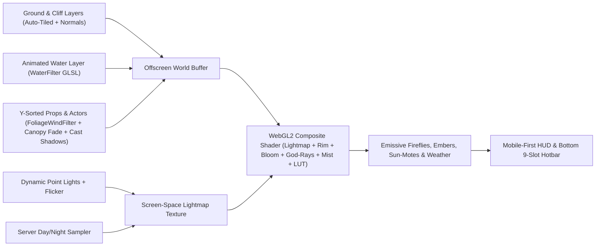

# DungeonCrawler 2D — Master Roadmap (`overworld`)

A fresh, mobile-first, server-authoritative 2D action-RPG, stealth-survival & DCC-inspired floor-descent overworld game built on **PixiJS v8 (WebGL2/WebGPU)** with a **Lush HD-Pixel Atmosphere** (Core Keeper / Eastward / Sea of Stars style), deterministic infinite terrain, enterable dark torch-lit dungeons, true 36-slot Minecraft-style inventory, tactile combat, and hybrid Web Audio.

---

## Core Design Pillars

1. **Lush HD-Pixel Visuals & Real WebGL2 Atmosphere**: Crisp nearest-neighbor pixel art at a unified pixel density (zero mixels) enhanced with smooth real-time 2D lightmaps, directional sun/moon shadows, generated normal-map relief lighting, flickering warm torch/campfire bloom, animated reflective water shaders, coherent foliage wind-wave shaders, canopy god-rays, drifting cloud shadows, valley ground mist, and dusk fireflies.
2. **Mobile-First Browser UX**: Designed for portrait & landscape phones from day one (`100dvh`, `viewport-fit=cover`, auto-fullscreen on mobile first touch + manual fullscreen toggle, floating touch thumbstick, large touch-friendly bottom hotbar, direct pointer drag-and-drop with tap-to-move fallback, quality scaling presets) while remaining effortless on desktop keyboard/mouse.
3. **Server-Authoritative Multiplayer (`@dc2d/*`)**: Strict acyclic 4-tier monorepo (`@dc2d/contracts` -> `@dc2d/content` -> `@dc2d/engine` -> `@dc2d/game-server` / `@dc2d/client`) supporting WebSocket co-op, client-side prediction, synced Day/Night & weather, plus seamless deterministic local preview when offline.
4. **DCC-Inspired Floor Descent & Deterministic Infinite Worlds**: Seeded noise + macro biome fields generate `32×32` chunks on demand in milliseconds; each floor runs under an authoritative multi-day **Floor Collapse Countdown Timer**, housing **Safe Rooms / Town Hubs** (NPCs, bounties, quests), landmarks, bosses, and **Floor Stairwells** leading deeper before collapse.
5. **Action-RPG + Full Stealth + Valheim-Lite Camp Survival**: Sneak through shadow/brush with a dynamic light-level visibility meter, throw distractions, land silent takedowns, chop trees, mine ore/stone, forage herbs/flint, cook at campfires for rested/well-fed buffs, and place campfires, torches, storage chests, workbenches, beds, and simple palisades/shelters.
6. **True Minimalist 36-Slot Inventory Model**: Slots `0..8` are the larger, always-visible **bottom hotbar** (rendered cleanly at the bottom of the gameplay screen, never duplicated inside the inventory modal); slots `9..35` are the `3×9` backpack. Weapons, bows, tools, and armor have `maxStack = 1` (no stack counts). The inventory screen contains ONLY backpack + armor slots + stats, dragging straight onto the bottom hotbar; crafting lives in its own dedicated panel showing craftable/discovered recipes cleanly.
7. **Hybrid Web Audio Engine**: Layered biome & time-of-day soundscapes, surface-aware footsteps, organic vocal-tract creature synthesis + Sound Studio live hot-reload overrides, crisp melee/bow/harvest/UI SFX, and adaptive atmospheric music.
8. **Composable Effects Engine & Real-Time System-AI Crafting / Reward Boxes**: Preserve the data-driven spirit of `archive/v1`'s effects system inside `@dc2d/engine` while expanding it flexibly — composable primitives (`modify_health`, `modify_stat`, `apply_status`, `remove_status`, `spawn_area`, triggers, projectiles, custom visuals), elemental area reactions, cross-referenced content registries, and validated System-AI invention pipelines generating novel items, recipes, achievements, and reward boxes safely in real time.

---

## Package Architecture & Render Pipeline

- `@dc2d/contracts` — Tier-1 zero-dependency leaf domain contracts: `GroundKind` / `PropKind` const-tuples, shared unions (`ItemRarity`, `ArmorSlot`, `WeaponArchetype`, `BiomeKind`, `WildlifeKind`, `EffectRule`), `RecipeDef`, and `PropSpec`.
- `@dc2d/content` — Tier-2 declarative data catalogs & visual palettes (`ITEM_CATALOG`, `RECIPE_CATALOG`, `BIOME_CATALOG`, `PROP_SPECS`, quality & outline presets).
- `@dc2d/engine` — Tier-3 pure, platform-free simulation rules (`zod`, `@dc2d/contracts`, `@dc2d/content`): seeded noise, infinite chunk generator, biome/elevation samplers, continuous sliding collision, Day/Night sampler, true 36-slot inventory ops, combat math, and Zod wire protocol.
- `@dc2d/game-server` — Tier-4 Node + `ws`: authoritative 20 Hz simulation, delta persistence, synced Day/Night & weather, chunk delta streaming, co-op sessions.
- `@dc2d/client` — Tier-4 PixiJS v8 + HTML HUD + Web Audio: renderer adapters isolated inside `packages/client/src/render/`, mobile touch + desktop controls, true drag/drop hotbar & minimalist HUD.

---

## Phased Delivery Plan

### Phase 0 — Clean Orphan Monorepo Foundation ✅
- Fresh `overworld` orphan branch keeping tooling (`eslint.config.js`, `tsconfig.base.json`, `vitest.config.ts`), `AGENTS.md`, `docs/LESSONS.md`, and `packages/client/public/` art/font assets.
- Zero Three.js / Phaser dependencies; PixiJS v8 installed cleanly.
- Strict modular limits (`<=250` lines/file, `<=35` lines/fn, max nesting 3, `<=12` files/folder, domain-based names, zero baseline exemptions).

### Phase 1 — Infinite Forest & Core-Keeper / Eastward Shader Showcase ✅
- **1A Engine & Server**: Seeded 2D value/fBm/ridge noise; deterministic `32×32` chunk generator (`DeepWater`, `ShallowWater`, `Sand`, `Grass`, `MeadowGrass`, `ForestFloor`, `DirtPath`, `CliffStone`, `MossStone`); elevation tiers `0..2` with walkable stairs; sunlit spawn glade with warm campfire, river & cliffs; continuous sliding collision; Day/Night clock (`480s` cycle) + WebSocket multiplayer server (`@dc2d/game-server`).
- **1B PixiJS v8 HD-Pixel Renderer & WebGL2 Shaders**:
  - Multi-variant pixel-art terrain tiles + organic auto-tile edge blends + generated tangent-space normal maps.
  - Multi-tile Oak/Pine trees, bushes, swaying tall grass, boulders, wildflowers, animated crackling campfires, torches, and knight character sprites.
  - **Custom WebGL2 GLSL Shaders**: animated reflective water, coherent foliage wind-wave, offscreen lightmap + **WebGL2 Composite Filter** (ambient tinting, normal-map rim highlights, selective bloom, canopy god-rays, drifting cloud shadows, valley ground mist, filmic grading), directional sun/moon **cast shadows**, and pooled GPU fireflies/embers/sun-motes.
  - Mobile-first floating thumbstick, desktop WASD/scroll-zoom, and collapsible time-of-day + quality preset (`High / Balanced / Performance`) debug bar.

### Phase 2 — Mobile-First Controls & True 36-Slot Inventory / Bottom Hotbar ✅
- Mobile auto-fullscreen on initial touch gesture + manual fullscreen toggle; touch-only floating movement joystick (leaving desktop mouse free).
- Server-authoritative **36-slot array** (`0..8` hotbar, `9..35` backpack) with non-stackable gear (`maxStack: 1`), **Larger Always-Visible Bottom Hotbar**, minimalist Inventory modal (`27` backpack + armor slots + stats), unified pointer drag-and-drop + mobile tap fallback, and dedicated **Crafting & Storage Panel**.

### Phase 3 — Custom Layered Characters & Visible Multiplayer Equipment ✅
- 3D Blender-baked modular HD-pixel hero rig (`tools/sprite-studio/`) with 8-directional idle/walk/run layers, articulated 2-segment IK arms and held gear, dedicated `Hero_Walk` vs `Hero_Run` animation clips, distance-driven `GaitClock` syncing stride frames and footsteps, movement-driven facing with combat aim snap, and a localhost **Sandbox Pose Tuner** (`/?sandbox=1&tuner=1`).
- **Base Character Creator** (body/gender silhouette, skin tone, hair color, hairstyles) + **Visible Multiplayer Gear Layers** synced over WebSocket.

### Phase 4 — Combat Core, HD-Pixel Gore, Spatial Creature Audio & Sound Studio ✅ *(v0.11.3 mini-release)*
- **Hybrid Web Audio Engine**: Zero-latency mobile audio unlock, drop-in sample overrides + live **Sound Studio** (`localStorage` + cross-tab hot-reload) overrides, **Vocal-Tract Growl (`vocal`)** organic formant + flutter synth, Dawn/Day birdsong ↔ Dusk/Night crickets ambient beds, reactive combat-tension swell, terrain-matched footsteps, spatial river/campfire audio, pitch-varied combat/UI SFX, 9-species enemy/wildlife vocalizations (`alert`/`attack`/`charge`/`hurt`/`death`) with distance attenuation (`2.5`–`22` tiles), plus the standalone **Sound Studio** (`/sound-studio.html`) with `+ Vocal Growl` and all 45 creature presets.
- **Melee Combat, Starter Gear & Composable Gore/Blood/Goo**: Directional 3-hit sword combos, axe/pickaxe/torch swings, slash arc VFX, brief hitstop, knockback, stamina-cost dodge-roll (`0.24s` dodge i-frames) + `0.42s` post-hit player i-frames, default spawn armor (`chest`/`legs`/`feet` equipped; helmet optional in backpack), and orthogonal `GoreStyle` × `GoreSubstance` particles + decals (bespoke blade arcs, chunky slime goop, bone/rubble corpse piles with emissive sparks, diffuse water plumes, opaque ground-sorted corpses, and Sandbox parity).
- **Shield & Bow**: Dedicated 5th **Shield / Off-Hand** slot (`wooden-shield` auto-clipping Lantern to the hip), directional block & timed parry stagger; hold-to-draw bow with charge gauge and rotated charge-scaled arrows *(elemental hooks deferred to Phase 13)*.
- **Baseline Wildlife, POIs & Initial Indicators**: 3D-baked spritesheets for all 9 wildlife and POI guard archetypes (`wolf`, `bear`, `spider`, `boar`, `slime`, `goblin`, `orc`, `skeleton`, `golem`), initial perception/scent/chase behaviors, stamped `7×7` Bandit Camps & Ancient Ruins with `[E]` chests and magnetic loot, and an initial pass of overhead AI state icons *(full AI & stealth overhaul promoted to Phase 6)*.

### Phase 5A — Baked 3D Hero Arms, Hand-Socket Weapons, 360° Bow & Anti-Aliased Borderlands Outlines ✅
- **Baked 3D Hero Arms & Sleeves**: Real 3D `Body_*_Arms` and `Armor_Chest_Sleeves_*` baked in `tools/sprite-studio/` across locomotion (`idle`, `walk`, `run`, `jump`, `fall`, `dodge`, `downed`, `swim`) with per-frame `handSockets` (`px`, `py`, `angle`, `behind`) exported to `player-rig.json`, eliminating elbow/z-sorting seams on melee carry, shield, axe, pickaxe, and torch animations.
- **Fix Side Body-Through-Clothes Clipping & Polish Silhouette**: Removed `Body_*_Arms` from torso/leggings Holdout masks and increased hip/pelvis clearances, added slender feminine legs & waist proportions, enlarged `48 px/m` eye sclera/iris/pupil readability, toned down `Hair_Spiky`, and sculpted high arching `Hair_Ponytail` visible from south.
- **360° Cursor-Aimed Bow Overlay**: Keeps exact cursor aiming for bows by swapping to the armless torso sheet (`CharacterSpriteSet.armless`) while aiming a bow and mounting the rotating 360° Bow + gripped hands overlay.
- **Unified Configurable Anti-Aliased Borderlands Outlines**: Centralized uniform `48 px/tile` outline presets (`subtle`, `borderlands`, `bold`) in `@dc2d/content` (`outlineConfig.ts`), driving smoothed Euclidean + `+1.0px` AA-fringe outlines across hero (`actorSolidPx = 2.0`), held gear, creatures, and world props (`propSolidPx = 1.3`, `foliageSolidPx = 1.0`).

### Phase 5B — Zero-Mixel HD-Pixel World Art Pass ✅
- **Unified 3× HD-Pixel World Props (`48 px/tile`, `HD_PROP_SCALE = 1 / 3`)**: Replaced coarse legacy `16px` props with crisp `hdFoliageTextures.ts` & `hdPropTextures.ts` artwork (tapered gnarled Y-branched Oak trunks & leafy canopies, Pine trunks & needle tiers, 3 bushes, 3 curved tall-grass tufts, 3 wildflowers, 3 boulders, wide cut tree stumps, animated 4-frame campfires & torches, and matching `32×32` outlined HUD/hotbar item icons in `itemIcons.ts`).

### Phase 5C — World Feel, Deep-Water Swimming, Lever Sway & Scalable Customization ✅
- **Player Disconnect Smoke Poof**: Authoritative `playerLeave` event bursting a configurable-duration (`PLAYER_LEAVE_SMOKE_DURATION_SEC = 4.0`) dissipating smoke cloud + spatial *POOF* sound effect.
- **Browser Shortcut Guard**: Intercepts `Ctrl/Meta` browser combos (`Ctrl+S`, `Ctrl+O`, `Ctrl+P`, `Ctrl+F`, `Ctrl+D`, etc.) during gameplay while preserving DevTools and text-input clipboard keys.
- **Large Centered Real Map**: Activating the `Map` hotbar item or pressing `[M]` opens a large centered `360×360` parchment Overworld Map with `1×/2×/3×` zoom, compass rose, markers, `Escape` / close button, and non-blocking pointer input so WASD stays active.
- **Torch Fire Particles & Metallic Golem Sparks**: Continuous rising flame/ember particles on standing torches (`lights` filter) plus radial white-gold clash sparks (`GoreSystem.spawnClashSparks`) & metallic ring harmonics on stone/golem strikes.
- **Deep-Water Swimming (Players & Wildlife)**: Removed the `DeepWater` wall in `collision.ts` & `pathfinding.ts`; players & swimming wildlife cross rivers at reduced swim speed (`0.56` base, `0.36` when fatigued), with gentle stamina drain (`7/s` moving, `+4/s` treading still — never sudden drowning), `Hero_Swim` clip, waterline clip masks, bobbing, and concentric water ripples.
- **Base-Anchored Lever-Arc Foliage Sway**: Disabled horizontal grass shader shift (`grassWindStrength = 0`) and upgraded `chunkProps.ts` so tall grass and wildflowers pivot like physical levers around their pinned `(0.5, 0.94)` soil roots with wind gusts and directional walk-through push bending.
- **Scalable Hero Customization & Two-Tone Gradient Hair**: On-demand lazy 64-entry LRU layer loading in `playerAssets.ts`, data-driven `ItemDef.visualLayer` metadata in `catalog.ts`, `18` expanded solid & **6 two-tone vertical gradient** `HAIR_PALETTES`, and gradient CSS swatches + async preview refresh in `CharacterPanel` & `TitleScreen`.

### Phase 5D — Combat Feel, Mobile UX, HUD Settings, Arrow Physics & Liquid Gore ✅
- **Zoom & Handheld Depth Stability**: Raised desktop default zoom to `4.0×` (`ZOOM_STOPS = [1.5, 2.0, 3.0, 4.0, 6.0]`) and zoomed mobile out 2 stops (`2.0×`); stabilized handheld sword/lantern/shield body-occlusion layering across 3D idle animations; upgraded creatures/POIs to uniform `2px` outlines, 2× roaring hearth campfires + pixel-fire torches, base-free grass/wildflowers, and one-command Blender layer bakes (`npm run player:bake`).
- **Mobile-First Controls & Toggleable Auto-Aim**: Shifted the attack button left for comfortable 360° bow thumb drag with context labels (`HEAL`, `EAT`, `BOW`, `CHOP`, `MINE`, `MAP`, `ATK`); added left-side quick swipe-to-roll in any 360° vector, direct tap-to-open chests in range, `100°` forward melee cone snap, and `<=5°` velocity-lead bow aim assist.
- **Minimalist HUD, Vertical Stamina & Unified Settings**: Moved stamina to a left-edge vertical blue → yellow → red drain bar, shrunk mobile hotbar flush to screen bottom, simplified top-left/right chrome (backpack icon, FPS pill off by default on mobile, compass X/Y, and unified Settings modal with Hero/Respawn/Title Screen, Video/Quality/Gore/Zoom/FPS/Debug Hitboxes, Audio sliders, and Auto-Aim), and made inventory drag-and-drop snap cleanly across cell gaps (removing tap-to-select).
- **Swept Arrow Hurtboxes, Recoverable Arrows & Smooth Liquid Gore**: Fixed projectile tunneling & torso/foot hurtbox alignment with swept segment-vs-ellipse checks (`hitboxDebugLayer.ts` toggle on localhost/`?debug=1`), embedded recoverable arrows in trees/enemies and ground drops vs stone/rock spark ricochets, fixed `Reduced` gore intensity parity vs `Full`, and smoothed liquid splatters/pools/arcs with supersampled wet highlights.

### Phase 6 — Full Stealth RPG, Hearing/Vision & Ecological AI Overhaul ✅ *(Pass 1 + Pass 2 Complete)*
- **Full Stealth Mechanics**: Dedicated crouch/sneak mode (Blender 3D `Hero_CrouchIdle`/`Hero_CrouchWalk` 8-dir clips, `C` toggle + Settings `Hold` option, mobile `SNEAK` & `TORCH` toggle chip, `0.75`-tile footsteps with muffled audio), bush/tall-grass concealment fade & leaf motes, dynamic **light-level visibility meter** (`sampleStealthExposure` w/ Day/Night, canopy shade, torch/campfire light, `0.6s` `attackFlash`), persistent diegetic **Stealth Eye** with Cover leaf & Flame pips, aimed parabolic pebble distractions (`X` / `stone`), loud-movement ripples, golden **Backstab Reticle**, and **2.25×–3.0× silent backstab / `1.65×` bow ambush criticals**.
- **3-Stage Perception, Ecological AI & Multi-Faction Fights**: Smooth `0..1` `suspicion` meter (`?` fill -> `1.8s` look sweep -> timed `0.85s` `!` popup -> windup diamond with locked non-boar telegraph facing), **Wolf Pack Hive-Mind** (`wolfPackAi.ts` howl rally, fire wariness, morale flee), Bear bluff & carcass scavenging, Boar wall-stun, **Spider ambush red eye glints + venom poison + dynamic spring-cloth webs & cocoons**, injured Goblin `< 25%` HP retreat behind Orcs, faction fights, swept arrow physics & manual arrow pickup, and interim deep-water creature wade *(enemy swim sprites deferred to Phase 12)*.

### Phase 7 — Weapon-Specific Attack Animations, Movesets & Combat Polish ✅ *(Pass 1 + Pass 2 Complete)*
- **Authoritative 3-Phase Swing Timeline (`meleeTimeline.ts`, `LocalSwingTracker`)**: Real `Windup -> Active -> Recovery` resolution matching weapon cadence, early windup dodge-cancel (`< windupEnd * 0.75`), **`0.18s` attack/dodge input buffering**, **Held Heavy Strikes** (`>= 0.24s` hold -> `1.65×` dmg/knockback + **Guard Break** stun), and weight-scaled hitstop, camera shake & `Hero_Attack` 3-frame 3D body commitment.
- **Complete 8-Archetype Roster, Recipes & Status Interactions**: Playable **Sword** (`1 -> 2 -> 3` lunge), **Flint Dagger** (`3.0×` stealth backstab), **Wooden Spear** (`1.32–1.46×` reach + **Shield-Poke** while blocking), **Axe** (`chop -> cleave` 2-step), **Pickaxe** (`overheadSlam` + `1.4×` armor-crush vs golem/skeleton + `0.65`-tile AoE crack slam), **Iron Greatsword** (two-handed heavy cleave), **Torch** (`3.2s` Burn DoT, `1.35×` vs spider/slime, water `DOUSED` steam extinguish), **Hunter Bow** (`3D Hero_Bow` + aim line), **Timed Parry (`1.45s`) -> `1.75×` `RIPOSTE!`**, and bare-fist **Unarmed** punches *(dedicated `Hero_Punch` spritesheets deferred to Phase 12)*.

### Phase 8A (Frontier Overhaul) — Biomes, Rarities, Prefixes, 20 POIs, Item Cards & Proximity Chat ✅
*Delivered in commits `cdb79366`..`cb94d6db` — live specs graduated into colocated `README.md`s ([content/src/items](../packages/content/src/items/README.md), [engine/src/world](../packages/engine/src/world/README.md), [game-server/src/sim/exploration](../packages/game-server/src/sim/exploration/README.md), [client/src/ui/chat](../packages/client/src/ui/chat/README.md)).*
- **5 Macro-Biomes & 17-Row GPU Terrain Atlas**: `verdant-forest`, `autumn-woods`, `misty-bog`, `craggy-highlands`, and `cursed-ruinlands` with biome-native harvestables (`BirchTree`, `MapleTree`, `GiantMushroom`, `DeadTree`, `BogReed`, `CursedCrystal`), ambient biome particles, and 5-tier distance/biome `DangerTier` (`1..5`) scaling.
- **20 Overworld POIs, Shrines, Brazier Puzzles & Elite Lairs**: Added `18` new POI kinds (`shrine-swiftness`, `shrine-vigor`, `shrine-shadow`, `ancient-waystone`, 6 environmental micro-scenes, 4 Elite Mini-Boss Lairs, `brazier-vault`, `sun-dial-ruin`, `hermits-hut`, `tinker-camp`), Waystone `?` map beacons, biome entry banners, color-coded `[M]` map pins, and `X/20` discovery tracking.
- **Rarities, Prefixes, Real Gear Stats & Inspection UI**: `5` rarity tiers (`common`..`legendary`), `18` prefixes, `6` combat/stealth perks (`bleed`, `burn`, `poison`, `lifesteal`, `thorns`, `glow`), `4` recolored 3D armor sets (`moss-stalker`, `autumn-ranger`, `iron-knight`, `shadowsteel`), Copper/Iron smelting & frontier crafting recipes, hover/pinned `ItemCardPopover` with equip stat comparison deltas, and distance-filtered proximity chat + overhead speech bubbles.

---

## Deterministic Verification Gate (Mandatory for Phases 8–13)

Every remaining phase spec uses unique `REQ-P<N>-<NN>` identifiers verified across 4 deterministic gates before a phase can be marked `✅ Complete`: **L1** REQ-ID coverage script (`verify:spec`), **L2** static content/asset/contract audit (`verify:content`) + `typecheck` + `lint` + `build`, **L3** real-browser Playwright E2E on Desktop (`1280×720`) & Mobile (`390×844`) against `preview-prod` with zero errors & FPS-cliff budgets, and **L4** visual pixel-entropy + screenshot captures. See [Verification Gate Spec](VERIFICATION-GATE.md).

---

### Phase 8 — Gathering Feedback, Workbench Gating, Camp Building UX & Offline Persistence ✅ *(Pass 1 + Pass 2 Complete)*
- **Physical Gathering, Foraging & HD Camp Props**: Node hit wobble/flash (`propHitVisuals.ts`), decaying node HP bar + `<= 50%` crack overlay, `0.35s` tree tipping fall (`harvestFxLayer.ts`), `"Requires Pickaxe!"` + throttled tool hints, `[E]`/tap-to-forage bushes/flora with stripped berry visual, 4-family gathering SFX (`synthWeaponSfx.ts`), and `48 px/tile` `campPropTextures.ts` upgrades + open/closed chest lids.
- **Clean 3-Tier Station Gating (`Hand` / `Campfire` / `Workbench`)**: `RecipeDef` enforces `requiresWorkbench` (`2.8`-tile proximity radius) on Tier-2+ weapons/armor/shields (including Frontier gear), `storage-chest`, `camp-bed`, and `wood-palisade`, keeping basic tools/campfire/workbench hand-craftable and cooking/elixirs/smelting at `Campfire`, synced in `CraftingPanel`.
- **Placement Ghost, Dismantling & Camp Prompts**: Snapped `0.5`-tile green/red placement ghost (`placementGhostLayer.ts`) with aura rings, rejection reasons, `[R]` rotation & mobile drag/button placement; `100%`-refund `dismantleStructure` (`Hold [E]` / `[Z]` / mobile chip, blocking non-empty chests); neighbor-connecting damageable `Palisade` walls (`80 HP`); contextual `[E]` prompts + Home Bed map pin + `Warming (0..5s)` progress.
- **Distinct Buff Icon Tray & Offline Persistence**: `28×28` SVG icon badges (`ui/hud/buffs/`) with radial timers/tooltips separating `Well-Fed` (`cooked-meat` `240s`, `+15 Max HP`) from `berry` (`45s`), `Invigorated` (`herb-tea`), `Rested`, and `Herbal Salve` HoT; seed-keyed `localStorage` offline persistence (`dc2d_offline_world_v1_<seed>`) + `"Reset Local World"` confirmation in Settings and Title Screen. *(Details & REQ traceability: [Phase 8 Spec](phases/phase-8-gathering-survival-and-camp-building.md)).*

### Phase 9 — Fog-of-War Map, Sanctuary Hubs, NPC Economy & Bounties 🚧 *(Pass 1 Complete; Pass 2 — Havenhold City Spec Locked)*
- **Fog-of-War Overworld Map**: Per-player `8×8`-cell explored bitset persisted across restarts, automatic reveal radius (`18`–`22` tiles), Waystone `?` & Stairwell markers visible through fog, plus Home Bed, Campfire, and Safe-Room pins at `>= 45 FPS`.
- **Fortified Havenhold Sanctuary City (`256×256`) & Outer Safe Rooms**: Expanding Pass 1 into an `8×8`-chunk walled medieval-frontier bastion (`x, y ∈ [-128, 128]`) with `4` City terrain tiles, battlemented perimeter walls & `4` NPC-guarded Cardinal Gates, **Hybrid Pocket Interior Zones** (*The Rusty Flagon* Saloon, *The Iron Anvil* Forge, *The Gilded Scale* Emporium, *The Artisan's Workshop*, *Guild Hall & Vault*, and *Buyable Player Cottage*), roof-cutaway cottages, Blender 5.3 baked 3D architecture, `>= 20` scheduled animated 3D NPCs, **Full Cinematic Dialogue Mode** + Animalese WebAudio voices, `5` multi-step mysteries, Tavern Dice & Garrison Arena minigames, NPC affinity, `12` hidden Lore Tomes, and customizable housing. *(Details & REQ traceability: [Phase 9 Spec](phases/phase-9-fog-of-war-and-safe-room-hubs.md) · [Havenhold Desktop Handoff](HAVENHOLD-SANCTUARY-CITY-HANDOFF.md)).*

### Phase 10 — Crawler Progression, Floor Bosses & DCC Collapse Countdown 📋 *([Spec](phases/phase-10-progression-floor-bosses-and-dcc-countdown.md))*
- **Crawler XP, Milestone Perk Drafts & Mastery Counters**: Unified Crawler XP (`Lv 1..20`) triggering 1-of-3 **DCC Perk Drafts** at milestone levels (`2, 4, 6, 8, 10, 12, 15, 18` from `>= 18` perks) paired with `4` passive mastery tracks (`combat`, `stealth`, `harvesting`, `exploration`, `Lv 1..5`).
- **DCC Floor Collapse Countdown**: Configurable 3-day `FloorClock` (`FLOOR_DURATION_SEC = 1440`) with amber warning (`<= 300s`), `60s` **Collapse Storm** scramble at `00:00` (shrinking safe zone + storm DoT), Softcore respawn on Floor 1 keeping cosmetics/stash/unlocks (losing unbanked floor loot), and optional `HARDCORE_MODE=1` full wipe.
- **Floor Boss & Sealed Stairwell Loop**: Discover and unseal the **Floor Stairwell** by defeating the multi-phase **Floor Boss** (**The Ironbound Warden**) or collecting `3` Floor Seal Keystones to unlock `[E] Descend`.

### Phase 11 — Dynamic Weather & Pitch-Black Multi-Zone Dungeons 📋 *([Spec](phases/phase-11-dynamic-weather-and-pitch-black-dungeons.md))*
- **Server-Synced Dynamic Weather**: `clear`, `overcast`, `rain`, and `thunderstorm` states with GLSL rain streaks, animated puddle ripples, wet specular sheen, lightning shadow flashes + delayed thunder SFX, `-20%` rain footstep noise, and faster `wet` burn extinguish.
- **Multi-Zone Server Architecture (`zoneId`)**: Strict zone isolation for snapshots, AOI, chests, loot, projectiles, webs, and proximity chat across Overworld, Pocket Dungeons, and Deeper Floors.
- **Pitch-Black Pocket Dungeons & Floors 2–3**: Overworld **Cave Arches** & **Ruin Hatches** entering finite `64×64`–`96×96` pitch-black dungeons (`ambient <= 0.04`, ignitable wall sconces, dart/spike traps, boss rooms) plus Stairwell descent into **Floor 2 (Pitch-Black Catacombs)** and **Floor 3 (Abyssal Depths)**.

### Phase 12 — Co-op Polish, Adaptive Music, 3D Rig Polish & QA Benchmarks 📋 *([Spec](phases/phase-12-coop-polish-adaptive-music-and-qa-benchmarks.md))*
- **Co-op Party, Downed Revive & Shared Descent**: `4`-player party invites/HUD frames/emerald map pins, `20s` Downed bleed-out with `2.5s` hold-to-revive, and shared floor-countdown + party stairwell readiness.
- **Adaptive Music & Audio Audit**: `6`-state equal-power crossfading `MusicDirector` (`sanctuary`, `exploration-day`, `exploration-night`, `stealth-tension`, `combat-boss`, `pitch-black-dungeon`) plus Phase 8–11 SFX audit.
- **Deferred 3D Animation Polish**: Blender-baked **`Hero_Punch`** bare-fist combo clips (within `<= 1536×1536` mobile atlas tiers) and enemy deep-water **swim animations** (`wolf`, `bear`, `boar`, `goblin`, `orc`, `spider`).
- **QA Performance & Visual Regression Gate**: Automated Playwright frame-time benchmarks (`High / Balanced / Performance`, Desktop & Mobile, VRAM `< 128 MiB`, textures `<= 2048px`), visual regression baselines (`<= 1.5%` drift), and 2-client co-op E2E suite.

### Phase 13 — Composable Effects Engine, System-AI Crafting & Reward Boxes 📋 *([Spec](phases/phase-13-composable-effects-and-system-ai.md))*
- **Composable Effects & Elemental Reactions (`@dc2d/engine`)**: Zod-validated `EffectGraph` primitives (`modify_health`, `modify_stat`, `apply_status`, `remove_status`, `spawn_area`, `spawn_projectile`, `knockback`, `emit_vfx`) + triggers, craftable elemental arrows (`fire`, `frost`, `poison`, `shock`), and `5` deterministic elemental area reactions (`fire+wet`, `shock+wet`, `fire+poison`, `frost+wet`, `fire+web`).
- **System-AI Invention & Power-Budget Validator**: Runtime `RuntimeItemRegistry` / `RuntimeRecipeRegistry` synced over WebSocket, deterministic procedural System-AI synthesizer (offline/CI) + optional async server LLM adapter (`SYSTEM_AI_API_KEY`) strictly gated by `validateInventedEffectGraph`.
- **DCC Achievements & Sponsor Reward Boxes**: `>= 20` deterministic achievements emitting snarky System-AI banners and awarding tiered **Reward Boxes** (`bronze`..`celestial`) with an interactive opening modal.
