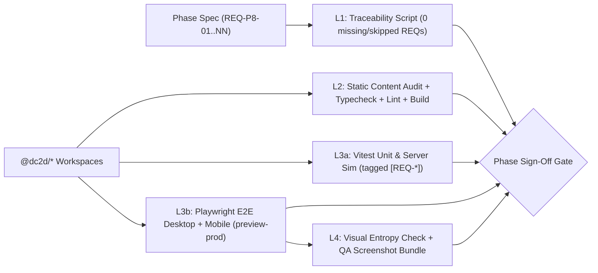

# Deterministic Verification, Completeness & Quality Gate

> **Status**: ✅ Tooling & CI Active (enforced across all Phase 8–13 PRs and release PRs from `develop` into `main`).
> **Applies To**: All remaining development phases (`Phase 8 Pass 2` through `Phase 13`) and all release PRs from `develop` into `main`.

---

## 1. Purpose & Non-Negotiable Rules

No phase in `docs/ROADMAP.md` may be marked complete (`✅`), and no release PR may advance to `main`, unless all **four deterministic verification layers** pass with zero skipped requirements, zero unhandled browser/WebGL errors, and concrete visual evidence:

1. **Zero Silent Omissions**: Every requirement in a phase spec has a unique `REQ-P<N>-<NN>` ID mapped directly to passing, non-skipped automated tests (`npm run verify:spec`).
2. **Zero Dead Content or Unwired Assets**: Every item, recipe, prop, icon, and held weapon/shield is cross-checked statically across `@dc2d/content`, `@dc2d/engine`, and `@dc2d/client` (`npm run verify:content`).
3. **Real-Browser Verification on Desktop & Mobile**: Every interactive UI, input flow, HUD element, world interaction, and persistence boundary is exercised end-to-end in headless Chromium against the built production bundle (`npm run preview-prod`) at both Desktop (`1280×720`) and Mobile (`390×844`, `hasTouch: true`).
4. **Measurable Performance & Visual Integrity**: Automated frame-time checks prevent UI/map FPS cliffs, and deterministic PNG screenshot captures prove non-blank WebGL rendering and layout fidelity.



---

## 2. Machine-Parseable Phase Spec Contract

Every phase specification in `docs/phases/phase-<N>-*.md` must include a `## 5. Requirement Traceability Table` section using the exact 5-column header:

```markdown
| ID | Domain | Measurable Requirement & Pass Criteria | Verification Layer(s) | Automated Test Target |
| :--- | :--- | :--- | :--- | :--- |
```

### Grammar & Validation Rules

- **Requirement ID**: Strictly matches `/^REQ-P(8|9|10|11|12|13)-\d{2}$/` and is sequential per phase starting at `01` (`REQ-P8-01`, `REQ-P8-02`, ...), with zero duplicates.
- **Verification Layer Tokens**: Comma-separated list drawn exclusively from the canonical set:
  - `unit` — Pure `@dc2d/engine`, `@dc2d/content`, or `@dc2d/client` unit test (`*.test.ts`).
  - `sim` — Authoritative `@dc2d/game-server` simulation / persistence / multi-tick integration test (`*.test.ts`).
  - `static` — Cross-package static contract/asset integrity check (`scripts/verify/content-integrity.mjs`).
  - `e2e-desktop` — Playwright browser test on Desktop (`1280×720`) against `preview-prod`.
  - `e2e-mobile` — Playwright browser test on Mobile (`390×844`, `hasTouch: true`) against `preview-prod`.
  - `visual` — Deterministic screenshot capture + non-blank canvas pixel-entropy check (`artifacts/qa/phase-<N>/`).
- **Test Tagging Convention**: Every Vitest (`it(...)` / `test(...)`) and Playwright (`test(...)`) case proving a requirement includes `[REQ-P<N>-<NN>]` (with optional explicit layer suffix `[REQ-P<N>-<NN>][sim]` or `[REQ-P<N>-<NN>][static]`) in its test title (e.g., `it("[REQ-P8-01][sim] rejects Workbench recipes when no Workbench is within 2.8 tiles", ...)`).

---

## 3. The 4 Verification Layers

### Layer 1 — Completeness Gate (`scripts/verify/spec-coverage.mjs`)

1. Reads `docs/phases/phase-<N>-*.md` and extracts every `REQ-P<N>-<NN>` row and its declared `Verification Layer(s)` and `Automated Test Target`.
2. Reads JSON test reports from Vitest (`.verify-reports/vitest.json`), Playwright (`.verify-reports/playwright.json`), static audit (`.verify-reports/content.json`), and visual manifests (`artifacts/qa/*/manifest.json`).
3. Asserts for **every** `REQ-P<N>-<NN>`:
   - At least one matching `[REQ-P<N>-<NN>]` test exists for each declared layer (`unit`/`sim`, `static`, `e2e-desktop`, `e2e-mobile`, `visual`).
   - Every mapped test has status `passed` (`0` failed, `0` skipped, `0` `todo`/`fixme`).
   - Every declared `Automated Test Target` file exists on disk.
4. Prints a per-requirement coverage matrix and exits with code **`1`** if any requirement is uncovered, skipped, or failing.

### Layer 2 — Static Content, Asset, Docs & Code Quality Gate (`scripts/verify/content-integrity.mjs`, `scripts/verify/doc-integrity.mjs`)

1. **Catalog & Live TS Wiring Completeness**: Via live TypeScript imports in `tests/integration/contentIntegrity.test.ts`, verifies every `ITEM_CATALOG` entry has non-empty `description`, valid `ItemRarity`, `32×32` icon painter (`REGISTERED_ITEM_ICON_IDS`), held weapon/tool/shield visual (`REGISTERED_HELD_GEAR_IDS`), and acquisition path (`STARTER_LOADOUT`, `STARTER_ARMOR`, `RECIPE_CATALOG`, `HARVEST_NODE_SPECS`, `ALL_LOOT_TABLE_ITEM_IDS`), plus bidirectional `public/assets/` <-> manifest integrity.
2. **Recipe & Prop Registry Integrity**: Every `RECIPE_CATALOG` entry references valid items; every `PropKind` in `PROP_KIND_VALUES` has an exhaustive `PROP_SPECS` entry (`@dc2d/content`) AND a client chunk render mount (`REGISTERED_PROP_RENDER_KINDS`).
3. **Headless Simulation & Property Fuzzing**: `SimScenario` (`packages/game-server/src/testing/simScenario.ts`) exercises multi-tick & persistence-reboot scenarios, paired with `fast-check` property suites (`tests/properties/*.test.ts`) for kinematics parity, inventory conservation, fuzz finiteness, and multi-seed worldgen reachability.
4. **Documentation Freshness (`npm run verify:docs`)**: Checks Markdown link resolution, backticked file paths, colocated `README.md` indexing, script/doc parity, and manifest-referenced asset directories (`docs/audit/` excluded for historical pre-remediation citations).
5. **Repository Quality Gates**:
   - `npm run typecheck` (strict topological TypeScript across all 5 packages + `tsconfig.qa.json`)
   - `npm run lint` (`eslint` with type-aware AST rules + `scripts/check-folder-size.mjs`: `<= 250` lines/file, `<= 35` lines/function, max nesting `3`, `<= 12` direct source/py files per new folder + colocated `README.md`s)
   - `npm run lint:deadcode` (`knip` zero-unused-files/exports/deps gate)
   - `npm run build` (`@dc2d/game-server` + `@dc2d/client` production bundles)

### Layer 3 — Real-Browser Playwright E2E & Performance Gate (`e2e/`)

Runs against the frozen production bundle (`npm run preview-prod`) with `/?qaDiag=1`, `WORLD_SEED=1337`, isolated `WORLD_SAVE_PATH=none`, `ADMIN_TOKEN=e2e-test-token`, Desktop (`1280×720`) & Mobile (`390×844`, `hasTouch: true`).

#### Hard Global Assertions (Active on Every E2E Test)
- `0` `console.error` events, `0` uncaught `pageerror` exceptions, `0` failed HTTP requests (`status >= 400`)
- `window.__dc2dDiag.getStats()` reports `rendererReady === true`, `chunkCount > 0`, finite `playerPos`, and `0` WebGL shader compile/link errors
- `assertNoHudOverlap(page)` confirms zero clipped or overlapping visible HUD widgets on Desktop and Mobile
- **Frame-Time / FPS Budget**: Opening modals keeps median FPS `>= 0.55×` gameplay baseline and meets baseline SwiftShader (`>= 12 FPS`) / Phase 12 hardware (`>= 45 FPS`) budgets

### Layer 4 — Visual Quality Gate (`artifacts/qa/phase-<N>/`)

1. Deterministic full-page screenshots (`artifacts/qa/phase-<N>/<desktop|mobile>-<req-id>.png`) paired with `manifest.json` (`REQ-P<N>-<NN>`, FPS, entropy result).
2. **Isolated WebGL `<canvas>` Entropy Audit**: Temporarily hides DOM HUD overlays while capturing `#app canvas` (`captureIsolatedCanvasBuf`) so UI chrome never masks blank/corrupt WebGL rendering.

---

## 4. CLI & CI Enforcement

| Command | Scope | When Run |
| --- | --- | --- |
| `npm run ai:loop` | Fast (`<4s`) incremental ESLint, folder check, `verify:docs`, affected `tsc` & `vitest --related` -> `.verify-reports/ai-feedback.json` | Every edit iteration |
| `npm run verify:content` | Layer 2 static catalog, live TS icons/held/props, and public asset audit | Every PR & pre-commit |
| `npm run verify:docs` | Layer 2 Markdown link, path, colocated README, and script parity check | Every PR & pre-commit |
| `npm run verify:e2e` | Layer 3 + 4 Playwright Desktop & Mobile suites against `preview-prod` | Phase sign-off & CI |
| `npm run verify:spec -- phase-<N>` | Layer 1 REQ-ID traceability check against Vitest + Playwright JSON | Phase sign-off & CI |
| `npm run verify:phase -- phase-<N>` / `npm run ai:gate` | Full 4-layer gate (`typecheck`, `lint`, `build`, `test`, `verify:content`, `verify:docs`, `verify:e2e`, `verify:spec`) + `.verify-reports/ai-feedback.json` | Mandatory exit gate |

### CI Enforcement & Phase Graduation
- `.github/workflows/quality.yml` runs `npm audit --omit=dev --audit-level=moderate`, `typecheck`, `lint`, `vitest` (JSON), `verify:content`, `verify:docs`, `build`, `verify:e2e`, and `verify:spec -- all-completed`.
- **Phase Completion & Graduation Rule**: A phase spec's `> **Status**:` line may only change to `✅ Complete` in the same commit where `npm run verify:phase -- phase-<N>` exits `0`, colocated `README.md`s & `docs/ROADMAP.md` reflect shipped reality, and obsolete pre-implementation audit prose is pruned cleanly.
