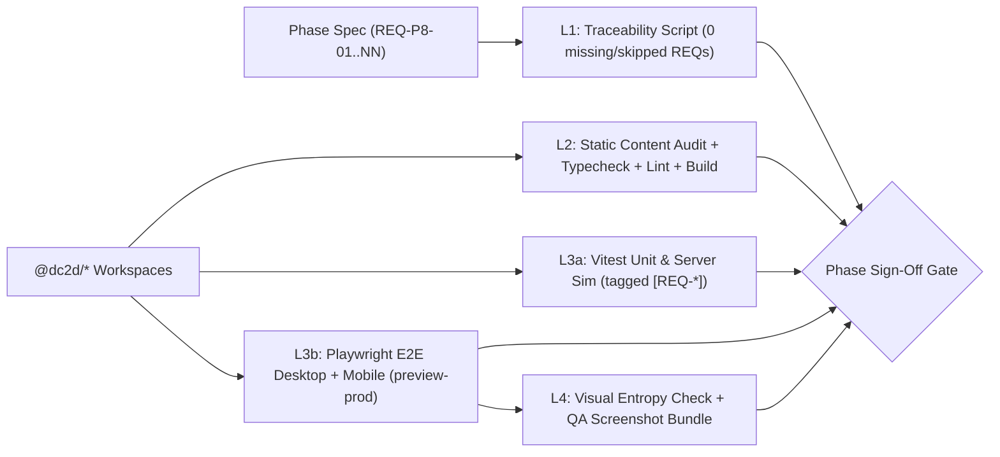

# Deterministic Verification, Completeness & Quality Gate

> **Status**: ✅ Tooling & CI Active (enforced across all Phase 8–13 PRs and release PRs from `develop` into `main`).
> **Applies To**: All remaining development phases (`Phase 8 Pass 2` through `Phase 13`) and all release PRs from `develop` into `main`.

---

## 1. Purpose & Non-Negotiable Rules

No phase in `docs/ROADMAP.md` may be marked complete (`✅`), and no release PR may advance to `main`, unless all **four deterministic verification layers** pass with zero skipped requirements, zero unhandled browser/WebGL errors, and concrete visual evidence:

1. **Zero Silent Omissions**: Every requirement in a phase spec has a unique `REQ-P<N>-<NN>` ID mapped directly to passing, non-skipped automated tests (`npm run verify:spec`).
2. **Zero Dead Content or Unwired Assets**: Every item, recipe, prop, icon, and held weapon/shield is cross-checked statically across `@dc2d/content`, `@dc2d/engine`, and `@dc2d/client` (`npm run verify:content`).
3. **Real-Browser Verification on Desktop & Mobile**: Every interactive UI, input flow, HUD element, world interaction, and persistence boundary is exercised end-to-end in headless Chromium against the built production bundle (`npm run preview-prod`) at both Desktop (`1280×720`) and Mobile (`390×844`, `hasTouch: true`).
4. **Measurable Performance & Visual Integrity**: Automated frame-time checks prevent UI/map FPS cliffs, and deterministic PNG screenshot captures prove non-blank WebGL rendering and layout fidelity.



---

## 2. Machine-Parseable Phase Spec Contract

Every phase specification in `docs/phases/phase-<N>-*.md` must include a `## 5. Requirement Traceability Table` section using the exact 5-column header:

```markdown
| ID | Domain | Measurable Requirement & Pass Criteria | Verification Layer(s) | Automated Test Target |
| :--- | :--- | :--- | :--- | :--- |
```

### Grammar & Validation Rules

- **Requirement ID**: Strictly matches `/^REQ-P(8|9|10|11|12|13)-\d{2}$/` and is sequential per phase starting at `01` (`REQ-P8-01`, `REQ-P8-02`, ...), with zero duplicates.
- **Verification Layer Tokens**: Comma-separated list drawn exclusively from the canonical set:
  - `unit` — Pure `@dc2d/engine`, `@dc2d/content`, or `@dc2d/client` unit test (`*.test.ts`).
  - `sim` — Authoritative `@dc2d/game-server` simulation / persistence / multi-tick integration test (`*.test.ts`).
  - `static` — Cross-package static contract/asset integrity check (`scripts/verify/content-integrity.mjs`).
  - `e2e-desktop` — Playwright browser test on Desktop (`1280×720`) against `preview-prod`.
  - `e2e-mobile` — Playwright browser test on Mobile (`390×844`, `hasTouch: true`) against `preview-prod`.
  - `visual` — Deterministic screenshot capture + non-blank canvas pixel-entropy check (`artifacts/qa/phase-<N>/`).
- **Test Tagging Convention**: Every Vitest (`it(...)` / `test(...)`) and Playwright (`test(...)`) case proving a requirement includes `[REQ-P<N>-<NN>]` in its test title (e.g., `it("[REQ-P8-01] rejects Workbench recipes when no Workbench is within 2.8 tiles", ...)`).

---

## 3. The 4 Verification Layers

### Layer 1 — Completeness Gate (`scripts/verify/spec-coverage.mjs`)

1. Reads `docs/phases/phase-<N>-*.md` and extracts every `REQ-P<N>-<NN>` row and its declared `Verification Layer(s)` and `Automated Test Target`.
2. Reads JSON test reports from Vitest (`.verify-reports/vitest.json`), Playwright (`.verify-reports/playwright.json`), static audit (`.verify-reports/content.json`), and visual manifests (`artifacts/qa/*/manifest.json`).
3. Asserts for **every** `REQ-P<N>-<NN>`:
   - At least one matching `[REQ-P<N>-<NN>]` test exists for each declared layer (`unit`/`sim`, `static`, `e2e-desktop`, `e2e-mobile`, `visual`).
   - Every mapped test has status `passed` (`0` failed, `0` skipped, `0` `todo`/`fixme`).
   - Every declared `Automated Test Target` file exists on disk.
4. Prints a per-requirement coverage matrix and exits with code **`1`** if any requirement is uncovered, skipped, or failing.

### Layer 2 — Static Content, Asset & Code Quality Gate (`scripts/verify/content-integrity.mjs`)

1. **Catalog Completeness**: Every `ITEM_CATALOG` entry has non-empty `description`, valid `ItemRarity`, icon coverage (`itemIcons.ts` / `campItemIcons.ts` / `weaponItemIcons.ts` / `frontierItemIcons.ts`), held weapon/tool/shield visual coverage (`heldWeapons.ts` / `frontierHeldGear.ts`), and at least one acquisition path (`tests/integration/contentIntegrity.test.ts`).
2. **Recipe Integrity**: Every `RECIPE_CATALOG` entry references valid `outputItemId` and `ingredients[].itemId` in `ITEM_CATALOG` and uses valid station flags (`hand` vs `requiresCampfire` vs `requiresWorkbench`).
3. **World Prop Integrity**: Every `PropKind` maps to a non-empty texture key, collision/footprint spec, and map/render handling without missing texture fallbacks.
4. **Contract Hygiene**: Zero hardcoded starter IDs (`"bow"`, `"wooden-shield"`) in combat/input/render branches outside catalog/starter definitions (enforcing `isBowItem()` / `isShieldItem()`).
5. **Repository Quality Gates**:
   - `npm run typecheck` (strict TypeScript across all 4 workspaces)
   - `npm run lint` (`eslint` + `scripts/check-folder-size.mjs`: `<= 250` lines/file, `<= 35` lines/function, max nesting `3`, `<= 12` direct source files per new folder)
   - `npm run build` (`@dc2d/game-server` + `@dc2d/client` production bundles)

### Layer 3 — Real-Browser Playwright E2E & Performance Gate (`e2e/`)

Runs against the frozen production bundle (`npm run preview-prod`) with:
- Deterministic `WORLD_SEED=1337`
- Isolated temporary `WORLD_SAVE_PATH` per test suite (plus explicit server restart tests where persistence is verified)
- `ADMIN_TOKEN=e2e-test-token` enabled strictly for deterministic test setup (`/tp`, `/give`, `/biome`, `/poi`, `/weather`, `/floor`)
- Two mandatory browser projects:
  - **Desktop**: `1280×720`, mouse + keyboard (`WASD`, `E`, `M`, `Tab`, `C`, `Q`, `R`, `Enter`, `Esc`)
  - **Mobile**: `390×844`, `hasTouch: true`, `isMobile: true`, floating thumbstick + touch combat/interact buttons

#### Hard Global Assertions (Active on Every E2E Test)
- `0` `console.error` events
- `0` uncaught `pageerror` exceptions
- `0` WebGL shader compilation, program link, or `GL_INVALID_VALUE` / texture-size errors
- `0` failed HTTP asset requests (`status >= 400`)
- **Frame-Time / FPS Budget**: Opening any modal (`Inventory`, `Crafting`, `[M]` Overworld Map, `Reward Box`) must keep median FPS `>= 0.55×` active gameplay baseline (eliminating 120Hz DOM thrashing or per-frame canvas recomputation regressions on every runner), while meeting baseline headless SwiftShader (`>= 12 FPS`) and Phase 12 hardware (`>= 45 FPS`) budgets.
- **Persistence Survival**: Reloading the browser (`F5`) or restarting the preview server preserves player inventory, structures, chests, beds, fog-of-war, progression, and zone state as specified by each phase.

### Layer 4 — Visual Quality Gate (`artifacts/qa/phase-<N>/`)

1. Each phase E2E suite captures deterministic PNG screenshots (`artifacts/qa/phase-<N>/<desktop|mobile>-<req-id>.png`) of critical UI and world states.
2. **Non-Blank / Non-Corrupt Canvas Audit**: Samples the primary WebGL `<canvas>` and verifies pixel luminance variance / non-zero color entropy (automatically catching WebGL black-square atlas overflows, blank shaders, or invisible sprites).
3. **WebGL Texture Size Guard**: Inspects uploaded GPU textures in Playwright telemetry to verify every uploaded WebGL texture stays `<= 2048×2048` on mobile viewports (`<= 4096×4096` desktop).
4. **QA Visual Manifest**: Writes `artifacts/qa/phase-<N>/manifest.json` linking each screenshot to its `REQ-P<N>-<NN>` ID and FPS measurement for rapid visual inspection.

---

## 4. Planned CLI & CI Enforcement

| Planned Command | Scope | When Run |
| --- | --- | --- |
| `npm run verify:content` | Layer 2 static catalog, recipe, prop, and wiring audit | Every PR & pre-commit |
| `npm run verify:e2e` | Layer 3 + 4 Playwright Desktop & Mobile suites against `preview-prod` | Phase sign-off & CI |
| `npm run verify:spec -- phase-<N>` | Layer 1 REQ-ID traceability check against Vitest + Playwright JSON | Phase sign-off & CI |
| `npm run verify:phase -- phase-<N>` | Runs `typecheck` + `lint` + `build` + `test` + `verify:content` + `verify:e2e` + `verify:spec -- phase-<N>` | Mandatory exit gate before marking phase `✅` |

### CI Enforcement (`.github/workflows/quality.yml`)
When the Verification Gate tooling is implemented, `.github/workflows/quality.yml` will execute:
1. `npm run typecheck`
2. `npm run lint`
3. `npm test` (with JSON output)
4. `npm run verify:content`
5. `npm run build`
6. `npm run verify:e2e` (uploading `artifacts/qa/` on failure/completion)
7. `npm run verify:spec -- all-completed`

### Phase Completion Rule
A phase spec's `> **Status**:` line may only be changed to `✅ Complete` in the same PR/commit where `npm run verify:phase -- phase-<N>` exits `0` with all `REQ-P<N>-*` requirements passing.
