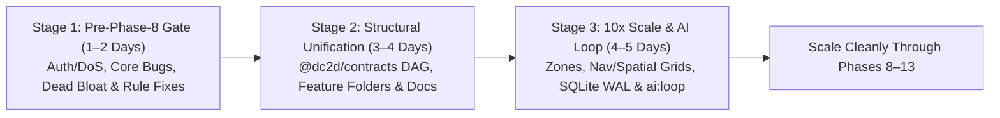

# 00 — Executive Codebase Audit & Scaling Status Report

> **Version Audited**: `dungeoncrawler2d@0.11.10` (`<10%` feature-complete early overworld slice; pre-Phase 8 Pass 2)
> **Audit Scope**: Full-repository static, architectural, security, performance/VRAM, behavioral, tooling, and documentation audit across `@dc2d/engine`, `@dc2d/content`, `@dc2d/game-server`, `@dc2d/client`, `packages/client/public/**`, `scripts/**`, `tools/**`, `infra/**`, `.github/workflows/**`, `e2e/**`, `tests/**`, and all `61` repository Markdown files.
> **Verification Status**: All 7 domain audit reports (`01`–`07`) independently spot-checked against live source files, line numbers, symbol names, and baseline CLI runs with zero unintended working-tree mutations (`world-save.json` untouched).

---

## 1. Current Codebase Health Scorecard

### 1.1 Automated Baseline Gate Results (Verified Live)

| Check / Metric | Command | Result | Exact Baseline Telemetry |
| :--- | :--- | :---: | :--- |
| **TypeScript Strict Check** | `npm run typecheck` | **PASS** | `0` errors across all 4 workspaces (`engine`, `content`, `game-server`, `client`); skips `tests/`, `e2e/`, `scripts/*.mjs` (`RULE-03`) |
| **ESLint & Folder-Size Gate** | `npm run lint` | **PASS** | `0` errors, `0` warnings, `0` legacy folder-size exemptions (`folder-size-baseline.json` is `{}`), **but** 5 folders sit at `12/12` and 25 files sit at `238–250/250` lines |
| **Unit & Sim Test Suite** | `npm test` | **PASS** | `58 / 58` test files passed, **`222 / 222` tests passed** in **`5.69s`** |
| **Production Bundle Build** | `npm run build` | **PASS (Warn)** | Server `dist/main.cjs` + Client built in `610ms` (`1,070` modules); main chunk **`885.70 kB`** (`265.52 kB` gzip, `>500 kB` chunk warning) + **`4.74 MB`** `.js.map` sourcemaps + dev `sound-studio.html` & `sandboxMode` chunks |
| **Static Content Integrity** | `npm run verify:content` | **PASS (Gaps)** | `77` items checked (`958ms`), **but** uses `{[^}]*}` regexes that truncate nested objects and exempts unobtainable `"map"` (`RULE-05`, `DEAD-10`) |
| **Phase Spec Syntax Check** | `npm run verify:spec` | **PASS (Vacuous CI)** | `92` `REQ-P*` rows parsed across `8` phase specs; `verify:spec -- all-completed` currently verifies **`0` REQs** until Phase 8 completes (`DOC-10`) |
| **Public Static Asset Payload** | `packages/client/public/` | **FAIL** | **`40.58 MB` of `43.26 MB` (`93.8%`, `74` files)** has **zero runtime references** yet deploys to S3/CloudFront on every release (`DEAD-01`, `PERF-01`) |
| **Dependency Vulnerability Audit** | `npm audit --omit=optional` | **FAIL** | **`21` advisories** (`1 Critical`, `6 High`, `14 Moderate`), including runtime `zod < 4.6.6` DoS, `shell-quote` Critical injection, and `vite <= 8.1.5` Windows RCE (`SEC-12`) |

### 1.2 Category Grades (`<10%` Current Slice vs `100%` Target Readiness)

| Audit Pillar | Grade | Current Assessment & Primary Risk | Detailed Report |
| :--- | :---: | :--- | :--- |
| **Security, Auth & Infrastructure** | **D+** | Strong Zod wire validation, server-authoritative movement intents, SHA-256 `timingSafeEqual` admin check, and non-root Docker/OAC S3 — undermined by **zero player authentication** (`name`-based profile hijacking & infinite item duping), `100 MiB` WS OOM, `O(C²)` broadcast DoS, sealed-vault bypass, Vite `0.0.0.0` CSRF disk write, and unpinned `@master` GitHub Action with AWS OIDC. | [01-SECURITY-AND-EXPLOITS.md](file:///c:/repos/DungeonCrawler2D/docs/audit/01-SECURITY-AND-EXPLOITS.md) |
| **Performance, Memory, VRAM & Audio** | **C-** | Clean 20 Hz server / PixiJS v8 foundation, but `823.5 MB` decoded hero layer bitmaps at boot, main-thread `625× getImageData` armor recoloring + live-texture LRU eviction, `40.06 MB` dead PNG packs, `96`-chunk cache thrashing at `11+` players, `1.68M`-check A* linear prop scans, and `vocalSynth` Web Audio node leaks block 10× scale. | [02-PERFORMANCE-AND-MEMORY.md](file:///c:/repos/DungeonCrawler2D/docs/audit/02-PERFORMANCE-AND-MEMORY.md) |
| **Functional Correctness & Dead Code** | **C** | Core loop plays well, yet high-tier RPG promises are silently unwired: bows ignore all crits/perks, `bleed` deals `0` damage, `burn`/`poison` ignore `perkValue`, `Workbench` has no recipe gate, tiered tools deal starter harvest damage (`28`), `computeDangerTier` ignores `_biome`, Frontier props lack LOS/stealth/arrow collision, and client prediction rubberbands on speed gear/buffs. | [03-BUGS-AND-DEAD-CODE.md](file:///c:/repos/DungeonCrawler2D/docs/audit/03-BUGS-AND-DEAD-CODE.md) |
| **Architecture & Maintainability** | **C** | Strict `<=250`-line / `<=35`-line caps prevented monoliths, but the mutual `@dc2d/*` import ban between `engine` and `content` duplicated 8 core types, `const enum` forced `as unknown as` casts, adding 1 prop/item requires 9–12 file shotgun surgery, kinematics/swings are triple-duplicated, `WildlifeEntity` is a 62-field flat struct, and `frontier*` milestone names leaked across all 4 packages. | [04-ARCHITECTURE-AND-MAINTAINABILITY.md](file:///c:/repos/DungeonCrawler2D/docs/audit/04-ARCHITECTURE-AND-MAINTAINABILITY.md) |
| **10× Scalability & Module Organization** | **D+** | Five core folders are already at **`12/12` direct files** (`0` headroom for Phase 8), `WorldSim` is locked to a single coordinate plane (blocking Phase 9–11 multi-floor dungeons), `worldDeltas` broadcasts the entire world on every tree chop, and monolithic main-thread `world-save.json` rewrites cannot scale to fog-of-war, hubs, and Phase 13 System-AI items. | [05-SCALABILITY-AND-MODULE-ORGANIZATION.md](file:///c:/repos/DungeonCrawler2D/docs/audit/05-SCALABILITY-AND-MODULE-ORGANIZATION.md) |
| **Deterministic Rules & AI Testing Loop** | **B-** | Good complexity caps and newly scaffolded `verify:*` scripts, **but** `check-folder-size.mjs` counts `*.test.ts` against the 12-file limit (actively punishing test authoring!), ESLint lacks type-aware `switch-exhaustiveness-check`, `captureQaScreenshot` checks full-page DOM entropy (passing on a 100% black WebGL canvas), and no `<4s` headless scenario DSL or prediction-parity fuzz gate exists yet. | [06-DETERMINISTIC-RULES-AND-AI-TESTING-LOOP.md](file:///c:/repos/DungeonCrawler2D/docs/audit/06-DETERMINISTIC-RULES-AND-AI-TESTING-LOOP.md) |
| **Documentation Hygiene & Accuracy** | **C-** | Newer subsystem `README.md`s and Phase 9–13 specs are crisp, but `38` of `61` `.md` files (`62.3%`) are stale, overlapping, or dead — led by `assets/INVENTORY.md` (100% deleted Phaser/`0x72` paths), `infra/README.md` (deleted v1 DynamoDB/EC2 claims), wrong controls in root `README.md`/`ROADMAP.md`, un-retired `docs/frontier/*` & `phase-6..7`, and `16` undocumented core code folders. | [07-DOCUMENTATION-AUDIT.md](file:///c:/repos/DungeonCrawler2D/docs/audit/07-DOCUMENTATION-AUDIT.md) |
| **Overall Pre-Scale Readiness** | **C-** | **Solid vertical-slice prototype, but structural unification, auth/DoS hardening, and AI gate fixes are mandatory before scaling Phases 8–13.** | — |

---

## 2. Complete Issue Count Matrix by Category & Severity

Across all 7 domain reports, **136 structured findings & architectural blueprints** were documented, verified against source, and paired with concrete code/config fixes:

| Domain Report | ID Prefix | Critical | High | Medium | Low | Total |
| :--- | :---: | :---: | :---: | :---: | :---: | :---: |
| **[01 — Security, Exploits & Infrastructure](file:///c:/repos/DungeonCrawler2D/docs/audit/01-SECURITY-AND-EXPLOITS.md)** | `SEC-01`–`SEC-18` | 4 | 8 | 3 | 3 | **18** |
| **[02 — Performance, Memory, GPU/VRAM & Audio](file:///c:/repos/DungeonCrawler2D/docs/audit/02-PERFORMANCE-AND-MEMORY.md)** | `PERF-01`–`PERF-26` | 6 | 11 | 7 | 2 | **26** |
| **[03 — Confirmed & Potential Bugs (Part 1)](file:///c:/repos/DungeonCrawler2D/docs/audit/03-BUGS-AND-DEAD-CODE.md#part-1-confirmed--potential-bugs-bug-01bug-26)** | `BUG-01`–`BUG-26` | 4 | 9 | 10 | 3 | **26** |
| **[03 — Dead Code & Orphaned Assets (Part 2)](file:///c:/repos/DungeonCrawler2D/docs/audit/03-BUGS-AND-DEAD-CODE.md#part-2-unused--dead-code--orphaned-assets-dead-01dead-16)** | `DEAD-01`–`DEAD-16` | 1 | 4 | 6 | 5 | **16** |
| **[04 — Architecture, Coupling & Maintainability](file:///c:/repos/DungeonCrawler2D/docs/audit/04-ARCHITECTURE-AND-MAINTAINABILITY.md)** | `ARCH-01`–`ARCH-10` | 2 | 4 | 4 | 0 | **10** |
| **[05 — Scalability & Module Organization](file:///c:/repos/DungeonCrawler2D/docs/audit/05-SCALABILITY-AND-MODULE-ORGANIZATION.md)** | `SCALE-01`–`SCALE-08` | 3 | 3 | 2 | 0 | **8** |
| **[06 — Deterministic Rules & AI Testing Loop](file:///c:/repos/DungeonCrawler2D/docs/audit/06-DETERMINISTIC-RULES-AND-AI-TESTING-LOOP.md)** | `RULE-01`–`RULE-10` | 3 | 7 | 0 | 0 | **10** |
| **[07 — Documentation Audit & Consolidation](file:///c:/repos/DungeonCrawler2D/docs/audit/07-DOCUMENTATION-AUDIT.md)** | `DOC-01`–`DOC-22` | 2 | 8 | 9 | 3 | **22** |
| **Total Across All Reports** | — | **25** | **54** | **41** | **16** | **136** |

> [!NOTE]
> Several high-leverage root causes manifest across multiple audit lenses (for example, `40.06 MB` of unreferenced `public/assets/packs/` is analyzed for payload/CDN cost in `PERF-01`, exact file inventory in `DEAD-01`, and license drift in `DOC-01`; `BROADCAST_ACTIONS` amplification is analyzed in `SEC-04`, `PERF-21`, and `SCALE-04`; sealed vault `dropFromChest` in `SEC-05` and `BUG-12`; client prediction drift in `BUG-16`, `ARCH-04`, and `RULE-08`). Resolving the shared root causes collapses multiple findings simultaneously.

---

## 3. Top 15 Highest-Priority Findings

1. **`SEC-01` / `SEC-02` [Critical — Auth & Economy]**: **Unauthenticated Name-Keyed Persistence & Infinite Item Duplication** ([worldSim.ts](file:///c:/repos/DungeonCrawler2D/packages/game-server/src/sim/worldSim.ts#L98-L133), [worldPersistenceSync.ts](file:///c:/repos/DungeonCrawler2D/packages/game-server/src/sim/survival/worldPersistenceSync.ts#L23-L34)) — `savedProfiles` and `bedsByOwner` key solely by `name.trim().toLowerCase()`. Any client can hijack any player's character/inventory by connecting with their broadcast display name, or clone full inventories infinitely via mid-session `setAppearance` name swaps or dual tabs. **Fix**: Issue a 256-bit `resumeToken` stored as a SHA-256 `tokenHash` under an immutable `accountId` with a single-active-session lock.
2. **`SEC-03` / `SEC-04` / `PERF-21` [Critical — Server Availability & Net]**: **`100 MiB` WebSocket OOM & Out-of-Tick `O(C²)` Broadcast Amplification** ([wsServer.ts](file:///c:/repos/DungeonCrawler2D/packages/game-server/src/net/wsServer.ts#L174-L186), [wsServer.ts](file:///c:/repos/DungeonCrawler2D/packages/game-server/src/net/wsServer.ts#L229-L268)) — Default `ws` `maxPayload` (`100 MiB`) crashes the `1 GB` Fly.io VM in 1–2 frames, `attachClient` spawns `SimPlayer` entities before `hello`, and `BROADCAST_ACTIONS` (`toggleTorch`, `selectHotbar`, etc.) synchronously serializes and broadcasts full world snapshots to all `C` clients outside the 20 Hz tick loop. **Fix**: Cap `maxPayload: 16 * 1024`, enforce per-IP connection/packet rate limits, defer `addPlayer` until `hello`, and coalesce all broadcasts strictly into the 20 Hz tick loop.
3. **`SEC-05` / `SEC-08` / `BUG-12` [Critical — Gameplay Exploit & Anti-Cheat]**: **Sealed Brazier Vault Bypass & Global Player/Chest ESP Leak** ([lootManager.ts](file:///c:/repos/DungeonCrawler2D/packages/game-server/src/sim/wildlife/lootManager.ts#L78-L89), [snapshotFilter.ts](file:///c:/repos/DungeonCrawler2D/packages/game-server/src/net/snapshotFilter.ts#L80-L103)) — `LootManager.dropFromChest` omits `chest.sealed`, allowing any client to pop all 27 locked vault slots onto the ground without lighting braziers; meanwhile `snapshotFilter.ts` leaks all 27 item slots of unopened/sealed chests and broadcasts exact coordinates/stealth state of **every player across the entire world**. **Fix**: Enforce `!chest.sealed` in `dropFromChest`, redact `chest.slots` until opened & unsealed, and AOI/stealth-cull remote `players`.
4. **`BUG-01` / `BUG-02` / `BUG-03` / `BUG-04` [Critical — Broken RPG Core Loops]**: **Bows Ignore Crits/Perks, `bleed`/`burn`/`poison` Ignore Stats, & Fake Workbench / Tool Tiers** ([combatSimHelpers.ts](file:///c:/repos/DungeonCrawler2D/packages/game-server/src/sim/combat/combatSimHelpers.ts#L190-L231), [gearEffects.ts](file:///c:/repos/DungeonCrawler2D/packages/game-server/src/sim/combat/gearEffects.ts#L77-L80), [statusEffects.ts](file:///c:/repos/DungeonCrawler2D/packages/game-server/src/sim/combat/statusEffects.ts#L16-L107), [crafting.ts](file:///c:/repos/DungeonCrawler2D/packages/engine/src/inventory/crafting.ts#L65-L86)) — Bows ignore `critChance`, `critMult`, and all on-hit perks; `bleed` deals `0` HP damage; `burn`/`poison` hardcode `4`/`3` dmg instead of `perkValue`; `Workbench` has zero recipe gate (`requiresWorkbench` doesn't exist); and Copper/Frostbite axes & pickaxes deal starter `28` harvest damage. **Fix**: Wire `resolvePlayerGear` + `applyPlayerOnHitPerks` onto projectiles, store per-application status tick damage (including `bleed`), add `requiresWorkbench` + `nearWorkbench`, and read per-item `harvestPower`.
5. **`BUG-07` / `BUG-08` / `BUG-09` [Critical — Worldgen, AI & Sanctuaries]**: **`computeDangerTier` Ignores `_biome`, Frontier Props Lack Physics/Stealth/LOS, & Friendly Sanctuaries Unwired** ([macroBiome.ts](file:///c:/repos/DungeonCrawler2D/packages/engine/src/world/biomes/macroBiome.ts#L37-L39), [aiSensing.ts](file:///c:/repos/DungeonCrawler2D/packages/engine/src/combat/aiSensing.ts#L46-L98), [stealthRules.ts](file:///c:/repos/DungeonCrawler2D/packages/engine/src/combat/stealthRules.ts#L48-L58), [projectileSim.ts](file:///c:/repos/DungeonCrawler2D/packages/game-server/src/sim/wildlife/projectileSim.ts#L37-L38)) — `computeDangerTier` returns `distanceDangerTier(wx, wy)`, suppressing all `minTier: 2` POIs across `~3M` tiles (`r = 220..999`) of Autumn Woods & Misty Bog; arrows fly straight through boulders, ore veins, and birch/maple trees while enemies see through Hermit Huts; and `Hermit's Hut` / `Tinker's Camp` sanctuaries allow PvP kills and endless enemy aggro. **Fix**: Return `Math.max(biomeBaseDangerTier(biome), distanceDangerTier(wx, wy))`, centralize exhaustive `PROP_SPECS` physics/perception traits, and unify `isInWorldSanctuary(cache, x, y)`.
6. **`DEAD-01` / `PERF-01` / `DOC-01` [Critical — Payload & Asset Hygiene]**: **`40.58 MB` (`93.8%` of `public/`) of Dead Assets Shipped to Production S3** (`packages/client/public/assets/packs/**` + 26 legacy files, `player-rig.json`, `sprite-manifest.json`) — `48` unused RPG Maker PNG sheets (`40.06 MB`), `.pxo` editor files, legacy atlases, and pretty-printed manifests (`70–83%` whitespace/dead shoulder sockets) deploy with `Cache-Control: no-cache`, while `assets/INVENTORY.md` documents a deleted Phaser asset tree. **Fix**: Purge dead `public/` files, minify manifests & strip dead `sockets`, serve versioned `.webp` sheets as `immutable`, delete `assets/INVENTORY.md`, and add an orphan-asset CI check.
7. **`PERF-04` / `PERF-05` / `BUG-23` [Critical — Client RAM/VRAM & Hero Compositor]**: **`823.5 MB` Eager Hero Layer Decode, `625× getImageData` Main-Thread Recolor, & Live-Texture Eviction Crash** ([playerAssets.ts](file:///c:/repos/DungeonCrawler2D/packages/client/src/render/character/playerAssets.ts#L144-L169), [armorLayerRecolor.ts](file:///c:/repos/DungeonCrawler2D/packages/client/src/render/character/atlas/armorLayerRecolor.ts#L46-L68), [characterSprites.ts](file:///c:/repos/DungeonCrawler2D/packages/client/src/render/character/characterSprites.ts#L124-L131)) — Preloads and pins all `16` unpacked `1152×11712` sheets (`51.47 MB` RGBA each = `823.5 MB`; `8.2 GB` at 10× scale), blocks the main thread for `50–180 ms` per outfit, and destroys GPU `TextureSource`s still bound to visible `PlayerView`s once `>32` outfits appear without bumping `cacheRevision`. **Fix**: Tight-pack `.webp` layers at bake time (`4.6×` smaller), lazy-load armor layers on demand, upload via `BufferImageSource` / GPU recolor shader, and reference-count active `CharacterSpriteSet`s.
8. **`PERF-19` / `PERF-20` / `SCALE-03` [Critical — Engine & Multi-Zone Scaling]**: **`96`-Chunk Cache Thrashing, `67,272`-Sample `findChunkPoi` Stalls, `1.68M`-Check A*, & Single-Plane `WorldSim`** ([collision.ts](file:///c:/repos/DungeonCrawler2D/packages/engine/src/world/collision.ts#L14), [poiStamper.ts](file:///c:/repos/DungeonCrawler2D/packages/engine/src/world/poiStamper.ts#L151-L158), [pathfinding.ts](file:///c:/repos/DungeonCrawler2D/packages/engine/src/combat/pathfinding.ts#L116-L128), [minimapOverlay.ts](file:///c:/repos/DungeonCrawler2D/packages/client/src/ui/map/minimapOverlay.ts#L172-L188)) — `WorldChunkCache` caps at `96` chunks (thrashing every server tick at `11+` spread players and freezing the client for `200–600 ms` at `1×` map zoom = `225` chunks), `findChunkPoi` runs up to `67,272` noise-heavy tile samples on hilly chunks, and `evaluatePropCost` linearly scans `500–1,400` obstacles per A* cell. **Fix**: Introduce multi-floor `ZoneManager` + `SpatialHashGrid`, pre-sample `1,024` chunk tiles with a 2D prefix sum for `O(1)` POI flatness checks, bake a per-chunk walkability/cost grid (`>130×` faster A*), and decouple `MinimapTileCache`.
9. **`ARCH-01` / `ARCH-02` / `ARCH-03` / `SCALE-01` [Critical — Package DAG & Composable Effects]**: **Mutual `engine` <-> `content` Import Ban, `const enum` Erasure, & 11-File Shotgun Surgery Blocking Phase 13** ([eslint.config.js](file:///c:/repos/DungeonCrawler2D/eslint.config.js#L8-L11), [types.ts](file:///c:/repos/DungeonCrawler2D/packages/engine/src/world/types.ts#L6-L64), [worldDeltaSchemas.ts](file:///c:/repos/DungeonCrawler2D/packages/engine/src/net/worldDeltaSchemas.ts#L6-L14)) — Forbidding both `engine` and `content` from importing each other caused 8 duplicate drifted domain unions (`WeaponArchetype` vs `ItemWeaponArchetype` vs `HeldArchetype`), manual 37-element `RUNTIME_PROP_KINDS` `as unknown as` casts, 11-file manual edits per prop/item, and blocks typing Phase 13's `RuntimeItemRegistry` & `EffectGraph`. **Fix**: Establish a clean acyclic DAG (`@dc2d/contracts` -> `@dc2d/content` -> `@dc2d/engine` -> `{game-server, client}`), replace `const enum` with `as const` tuples, enforce exhaustive `satisfies Record<PropKind, PropSpec>` registries, and land the bounded `EffectGraph` VM now.
10. **`SCALE-02` / `ARCH-06` / `ARCH-10` [Critical — Module Organization & Naming]**: **5 Core Folders at `12/12` Capacity, 25 Files at `238–250/250` Lines, & `frontier*` Junk-Drawer Sprawl** (`client/src/net`, `render/character`, `render/world`, `engine/src/world`, `sim/wildlife`, `sim/frontier/poiInteractions.ts`) — Phase 8 files literally cannot be added to 5 core directories without failing `npm run lint`, which already drove contributors to dump `tryExecutePlayerDodge` inside `sim/frontier/poiInteractions.ts` and split catalogs across `10` `frontier*` files violating `AGENTS.md`. **Fix**: Reorganize into vertical feature-sliced domain folders (`<=10` prod files/folder), decompose `WorldSim`/`CombatWorld` and `creatureBehaviors` into vertical systems/per-species modules, extract `@dc2d/studio` dev tools, and eliminate all `frontier*` names.
11. **`BUG-16` / `BUG-17` / `ARCH-04` [High — Client/Server Prediction Parity]**: **Triple-Duplicated Kinematics & Swing Timelines Causing Live Speed/Heavy-Swing Rubberbanding** ([worldPrediction.ts](file:///c:/repos/DungeonCrawler2D/packages/client/src/net/worldPrediction.ts#L109-L142), [localSwingTracker.ts](file:///c:/repos/DungeonCrawler2D/packages/client/src/net/localSwingTracker.ts#L83-L100), [combatSimHelpers.ts](file:///c:/repos/DungeonCrawler2D/packages/game-server/src/sim/combat/combatSimHelpers.ts#L55-L82)) — Client prediction ignores `player.moveSpeedMult` (`+22%` Swiftness, `+12%` set bonuses, `-8%` tower shield), weapon-weight windup speed tiers, `bowDrawSpeedMult`, `Swift` prefix stamina delta, and spear `shieldPoke`, snapping players back 20 times/sec. **Fix**: Move shared pure `stepCharacterKinematics` and `swingStepper` into `@dc2d/engine` and enforce parity via property-based fuzz testing (`RULE-08`).
12. **`SEC-09` / `SEC-10` / `SEC-12` [High — Dev Security, CI Supply Chain & Dependencies]**: **Vite `0.0.0.0` Unauthenticated CSRF Disk Write, Unpinned `setup-flyctl@master` with AWS OIDC, & 21 Vulnerable npm Packages** ([vite.config.ts](file:///c:/repos/DungeonCrawler2D/packages/client/vite.config.ts#L16-L99), [deploy-production.yml](file:///c:/repos/DungeonCrawler2D/.github/workflows/deploy-production.yml#L64-L78), [package.json](file:///c:/repos/DungeonCrawler2D/package.json)) — Any webpage or LAN peer can POST to `http://localhost:5173/__dev/save-pose-tuning` to overwrite repo JSON or read monorepo files; `deploy-production.yml` runs unpinned `@master` third-party code after exporting live prod AWS OIDC credentials + `FLY_API_TOKEN`; and `zod < 4.6.6` / `vite <= 8.1.5` / `shell-quote` carry active CVEs. **Fix**: Bind Vite to `127.0.0.1` + require `Sec-Fetch-Site: same-origin` & `X-DC2D-Dev-Save: 1`, SHA-pin all GitHub Actions across isolated least-privilege jobs, bump `zod`/`vite`/`vitest`, and replace `concurrently`.
13. **`SCALE-05` / `PERF-22` / `PERF-25` / `BUG-13` [High — Persistence & Delta Scaling]**: **Monolithic Main-Thread `world-save.json`, Ephemeral `regrowAtSec` Bug, Eager Untouched Chests, & Global `worldDeltas` Remount Storm** ([persistenceStore.ts](file:///c:/repos/DungeonCrawler2D/packages/game-server/src/sim/survival/persistenceStore.ts#L89-L97), [resourceHarvester.ts](file:///c:/repos/DungeonCrawler2D/packages/game-server/src/sim/survival/resourceHarvester.ts#L85), [worldDeltas.ts](file:///c:/repos/DungeonCrawler2D/packages/engine/src/survival/worldDeltas.ts#L174-L186)) — Server uptime reset freezes depleted node regrowth for days after a restart; untouched POI chests are cloned every 50 ms forever; every tree chop broadcasts all world deltas and forces clients to remount every historical delta chunk; and `world-save.json` is tracked in git (`SEC-18`, `BUG-14`). **Fix**: Untrack `world-save.json`, persist monotonic `worldClockSec`, materialize/save only mutated chests, diff per-chunk deltas (moving to chunk-subscribed ops), and migrate persistence to Node 22 built-in `node:sqlite` (WAL mode).
14. **`RULE-01` / `RULE-05` / `RULE-07` / `RULE-08` / `RULE-09` / `RULE-10` [Critical — Autonomous AI Quality Loop]**: **Anti-Test Folder Cap, Broken `{[^}]*}` Content Regex, HUD-Masked Blank-WebGL E2E Check, & Missing `<4s` AI Feedback Loop** ([check-folder-size.mjs](file:///c:/repos/DungeonCrawler2D/scripts/check-folder-size.mjs#L9-L31), [contentAuditHelpers.mjs](file:///c:/repos/DungeonCrawler2D/scripts/verify/contentAuditHelpers.mjs#L21), [gameHarness.ts](file:///c:/repos/DungeonCrawler2D/e2e/helpers/gameHarness.ts#L84-L86)) — Counting `*.test.ts` toward `MAX_DIRECT_FILES = 12` blocks adding unit tests in full folders, `contentAuditHelpers.mjs` truncates nested `ItemDef` braces, and `page.screenshot()` passes entropy checks even if WebGL renders solid black because HTML HUD chrome supplies color variance. **Fix**: Exempt `*.test.ts` (cap prod files `<=10`, include `.py`, require `README.md`), replace regex scraping with live TypeScript Vitest assertions + `knip`, isolate WebGL `<canvas>` pixel entropy + `window.__dc2dDiag` VRAM/audio/overlap telemetry, and add `SimScenario` + `fast-check` parity tests behind `npm run ai:loop` (`<4s`) & `npm run ai:gate` emitting `.verify-reports/ai-feedback.json`.
15. **`DOC-02` / `DOC-03` / `DOC-06` / `DOC-07` / `DOC-08` / `DOC-09` [Critical/High — Documentation Drift & Sprawl]**: **Contradictory Controls, Deleted `archive/v1` Lessons, Legacy EC2/DynamoDB Ops Claims, & Un-Retired Spec Graveyards** (`README.md`, `docs/LESSONS.md`, `infra/README.md`, `docs/frontier/*`, `docs/phases/phase-6..7`) — Root `README.md` and `ROADMAP.md` teach wrong keybindings (`C` for Craft vs Crouch, `Q`/`X` swapped), `LESSONS.md` feeds AI agents 7 rules for deleted `v1` `finiteFloor.ts` modules, `infra/README.md` documents non-existent `players.json`/DynamoDB/ADMIN-OPERATIONS, and `11` shipped `docs/frontier/*` + `phase-6..7` specs contradict live biome radii, POI counts (`19` vs `20`), and `DangerTier` math. **Fix**: Graduate shipped mechanics into colocated `README.md`s, delete `assets/INVENTORY.md` + `docs/frontier/*` + `phase-6..7`, prune `v1` bullets from `LESSONS.md`, align controls/seed docs, and enforce `npm run verify:docs` in CI.

---

## 4. Recommended Phased Remediation Roadmap

### Stage 1 — Immediate Pre-Phase-8 Gate: Security, Broken Promises, Bloat & Perverse Rules *(Do First)*
- **Security & Ops Blockers**:
  - Replace name-keyed persistence with hashed `resumeToken` + `accountId` & single-session lock (`SEC-01`, `SEC-02`); `git rm --cached packages/game-server/data/world-save.json` (`SEC-18`, `BUG-14`).
  - Set `maxPayload: 16 * 1024`, per-IP connection/rate limits, `Origin` allowlist, per-IP admin lockout + fail-closed non-prod admin, and remove synchronous `BROADCAST_ACTIONS` snapshots from `dispatchMessage` (`SEC-03`, `SEC-04`, `SEC-06`, `SEC-07`, `PERF-21`).
  - Fix `dropFromChest` `!chest.sealed` check and redact unopened/sealed chest slots + remote out-of-AOI/stealthed players (`SEC-05`, `SEC-08`, `BUG-12`, `BUG-18`).
  - Lock Vite dev server to `127.0.0.1` + CSRF headers on `/__dev/save-pose-tuning`, SHA-pin all GitHub Actions in split least-privilege jobs, bump `zod`/`vite`/`vitest`, replace `concurrently`, and gate prod `sourcemap`/`soundStudio` (`SEC-09`, `SEC-10`, `SEC-12`, `SEC-16`, `PERF-02`).
- **Core Gameplay Bug Fixes**:
  - Fix bow crits/perks (`BUG-01`), `bleed`/`burn`/`poison` `perkValue` ticking (`BUG-02`), `requiresWorkbench` station gating (`BUG-03`), tool `harvestPower` scaling (`BUG-04`), `computeDangerTier` biome floor (`BUG-07`), world sanctuaries (`BUG-09`), elevation-aware collision (`BUG-10`), persisted `worldClockSec` regrowth (`BUG-13`), and relative paths in `tools/sprite-studio/bake*.mjs` (`BUG-22`).
  - Fix Low-preset `Filter.enabled = false` bypass (`PERF-08`, `BUG-24`), `ResizeObserver` canvas rect caching (`PERF-13`), `pointerover` hover delegation (`PERF-14`), `vocalSynth` `onended` disconnects + voice polyphony cap (`PERF-17`, `BUG-26`), and `TitleScreen` interval cleanup.
- **Dead Payload & Rule Unblocking**:
  - Purge the `40.58 MB` of unreferenced files in `packages/client/public/` + minify `player-rig.json` & `sprite-manifest.json` + delete dead modules/exports (`DEAD-01`–`DEAD-15`, `PERF-01`, `PERF-03`).
  - Immediately update `scripts/check-folder-size.mjs` to exempt `*.test.ts` (capping prod files `<=10` and counting `.py`) and enable type-aware ESLint (`switch-exhaustiveness-check`, `no-unused-vars: "error"`) + `knip` (`RULE-01`, `RULE-02`, `RULE-06`).

### Stage 2 — Structural Unification & Documentation Consolidation *(Before Expanding Content)*
- **Acyclic Package & Registry Unification**:
  - Introduce `@dc2d/contracts` (or allow `@dc2d/engine -> @dc2d/content`), eliminate all 8 duplicate domain unions, and replace `export const enum` (`GroundKind`, `PropKind`) with `as const` tuples (`ARCH-01`, `ARCH-02`).
  - Co-locate all prop physics, LOS, stealth, web-anchor, arrow-surface, and harvest traits into an exhaustive `PROP_SPECS satisfies Record<PropKind, PropSpec>` registry (`ARCH-03`, `BUG-08`, `SCALE-01`) and introduce the bounded `EffectGraph` VM so Phases 8–12 author buffs/perks on Phase 13's runtime foundation (`SCALE-01`).
  - Extract shared pure `stepCharacterKinematics` and `swingStepper` into `@dc2d/engine` so server, client prediction, and sandbox execute identical math (`ARCH-04`, `BUG-16`, `BUG-17`), and refactor `WildlifeEntity`/`PlayerCombatState` into composable `ActorVitals` + `StatusBag` + discriminated `CreatureArchetypeState` (`ARCH-05`).
- **Feature-Sliced Module & Doc Cleanup**:
  - Split saturated `12/12` folders and `245–250`-line files into vertical feature-sliced domain directories, eliminate all `10` `frontier*` names (`RULE-04`), and isolate `sandbox`/`poseTuner`/`soundStudio` from the production client (`ARCH-06`, `ARCH-09`, `ARCH-10`, `SCALE-02`, `SCALE-07`).
  - Execute the Documentation Consolidation Plan: delete `12` dead/shipped spec files (`assets/INVENTORY.md`, `docs/frontier/*`, `docs/phases/phase-6..7`), prune `v1` lessons from `docs/LESSONS.md`, fix controls/seed/EC2 drift in `README.md`/`ROADMAP.md`/`infra/README.md`/`VERIFICATION-GATE.md`, add the `12` missing subsystem `README.md`s, and wire `npm run verify:docs` (`DOC-01`–`DOC-22`).

### Stage 3 — 10× Population/Content Scaling & Autonomous AI Self-Testing Infrastructure
- **Multi-Zone, Spatial, Nav & Persistence Engine**:
  - Wrap simulation state in `ZoneManager` + per-floor `ZoneSim` instances (unlocking Phases 9–11 multi-floor dungeons), add a `16×16` `SpatialHashGrid` for `O(k_local)` AI/AOI/projectile queries, pre-sample `1,024` tiles + 2D prefix sums in `generateChunk`, and bake per-chunk walkability/cost grids for `>130×` faster A* (`SCALE-03`, `SCALE-08`, `PERF-19`, `PERF-20`, `PERF-23`).
  - Replace full-world `worldDeltas` resends with chunk-subscribed incremental delta ops + lazy POI chest materialization, and migrate `world-save.json` to Node 22 `node:sqlite` (WAL mode) with schema migrations (`SCALE-04`, `SCALE-05`, `PERF-22`, `PERF-25`).
- **GPU Atlas & Hero Pipeline**:
  - Tight-pack `.webp` hero layers at bake time, lazy-load equipment layers on demand, move armor recolor/sel-out off the main thread (`BufferImageSource` / GPU shader) with ref-counted `CharacterSpriteSet`s, pack procedural props & cliff tiles into shared GPU atlases, frustum-cull offscreen chunks, and add `MinimapTileCache` (`PERF-04`–`PERF-11`, `PERF-16`, `SCALE-06`).
- **Zero-Human-Intervention AI Self-Testing & Self-Correcting Loop**:
  - Convert workspaces + `tests/` + `e2e/` + `scripts/` to incremental `tsc --build` (`<0.6s`) + `ruff check tools/`, replace regex scraping in `verify:content` with live TypeScript registry assertions, and isolate WebGL `<canvas>` pixel entropy + `window.__dc2dDiag` VRAM/audio/HUD-overlap assertions in Playwright (`RULE-03`, `RULE-05`, `RULE-09`).
  - Ship `SimScenario` (`<25ms` multi-tick + persistence reboot DSL), `fast-check` property suites (Client-vs-Server Prediction Parity, Item Conservation, No-`NaN`/Unstuck, 50-Seed Reachability), and `npm run ai:loop` (`<4s`) / `npm run ai:gate` (`~25s`) emitting structured `.verify-reports/ai-feedback.json` counterexamples (`RULE-07`, `RULE-08`, `RULE-10`).

---

## 5. Complete Audit Index (`docs/audit/`)

- **[00-STATUS-REPORT.md](file:///c:/repos/DungeonCrawler2D/docs/audit/00-STATUS-REPORT.md)** — Executive Scorecard, Matrix, Top 15 Priorities & Phased Roadmap *(this document)*
- **[01-SECURITY-AND-EXPLOITS.md](file:///c:/repos/DungeonCrawler2D/docs/audit/01-SECURITY-AND-EXPLOITS.md)** — Auth, Duplication Exploits, WS DoS, Anti-Cheat, Dev CSRF, CI/CD Supply Chain, Cloud & Dependencies (`SEC-01`–`SEC-18`)
- **[02-PERFORMANCE-AND-MEMORY.md](file:///c:/repos/DungeonCrawler2D/docs/audit/02-PERFORMANCE-AND-MEMORY.md)** — Asset Bloat, Hero RAM/VRAM, PixiJS v8 Lifecycle, Shaders, DOM Reflow, Web Audio & 20 Hz Server Scaling (`PERF-01`–`PERF-26`)
- **[03-BUGS-AND-DEAD-CODE.md](file:///c:/repos/DungeonCrawler2D/docs/audit/03-BUGS-AND-DEAD-CODE.md)** — Confirmed Gameplay/Prediction/Worldgen Bugs (`BUG-01`–`BUG-26`) & Dead Code / Orphaned Assets (`DEAD-01`–`DEAD-16`)
- **[04-ARCHITECTURE-AND-MAINTAINABILITY.md](file:///c:/repos/DungeonCrawler2D/docs/audit/04-ARCHITECTURE-AND-MAINTAINABILITY.md)** — Package DAG Inversion, `const enum`, Shotgun Surgery, Triple Duplication, God-Structs & Naming Hygiene (`ARCH-01`–`ARCH-10`)
- **[05-SCALABILITY-AND-MODULE-ORGANIZATION.md](file:///c:/repos/DungeonCrawler2D/docs/audit/05-SCALABILITY-AND-MODULE-ORGANIZATION.md)** — Unified Manifests, `EffectGraph` VM, Feature-Sliced Folder Tree, Multi-Zone Sim, Delta Protocol & SQLite WAL (`SCALE-01`–`SCALE-08`)
- **[06-DETERMINISTIC-RULES-AND-AI-TESTING-LOOP.md](file:///c:/repos/DungeonCrawler2D/docs/audit/06-DETERMINISTIC-RULES-AND-AI-TESTING-LOOP.md)** — ESLint/TS/Folder Rules, `SimScenario` DSL, `fast-check` Prediction Parity, WebGL Entropy & `ai:loop` JSON Diagnostics (`RULE-01`–`RULE-10`)
- **[07-DOCUMENTATION-AUDIT.md](file:///c:/repos/DungeonCrawler2D/docs/audit/07-DOCUMENTATION-AUDIT.md)** — Complete 61-File Markdown Inventory, Dead/Drifted/Overlapping Docs & `verify:docs` Lifecycle Plan (`DOC-01`–`DOC-22`)
