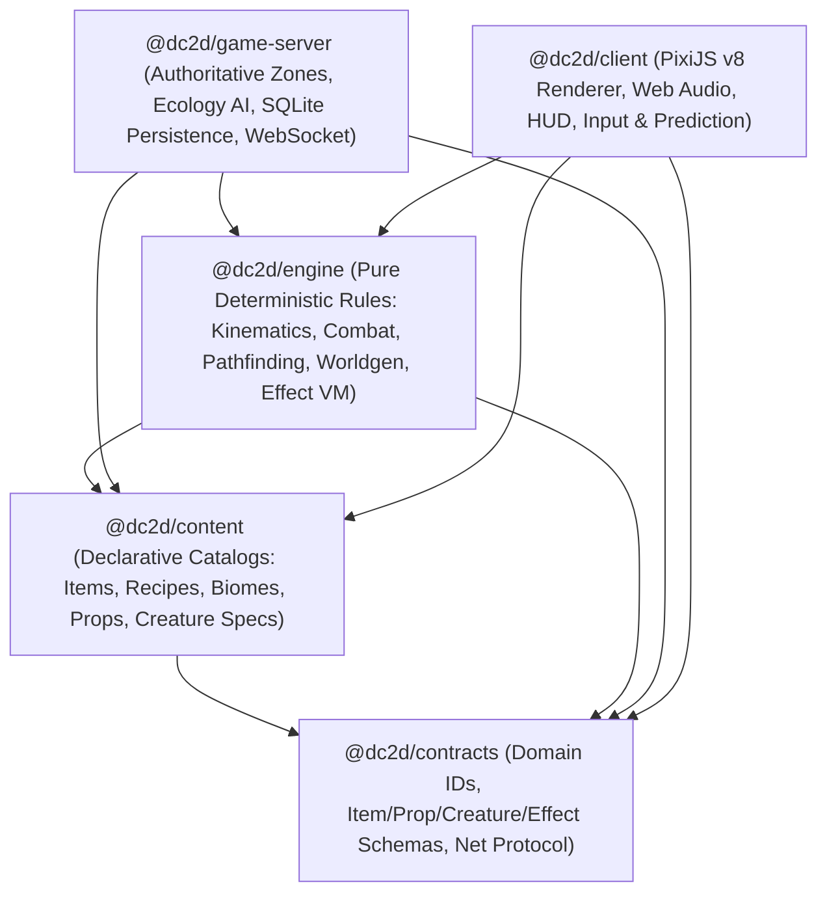

# 04 — Code Architecture, Coupling & Maintainability Audit

> **Scope**: Monorepo package boundaries (`@dc2d/content`, `@dc2d/engine`, `@dc2d/game-server`, `@dc2d/client`), cross-package type contracts, client/server/sandbox simulation parity, entity & player state modeling, domain naming hygiene (`AGENTS.md`), and production/dev-tool isolation at **<10% game completion (`v0.11.10`)**.

---

## Executive Summary

DungeonCrawler2D has strong foundational instincts—strict ESLint complexity/line-count caps, Zod wire validation, headless server simulation, and procedural asset pipelines. However, **several well-intentioned early constraints have inverted the dependency graph and created severe structural friction** just as the project prepares to scale from 1 overworld floor (77 items, 37 props, 9 creatures) into Phases 8–13 (gathering/camps, fog-of-war/hubs, floor bosses, multi-floor pitch-black dungeons, co-op parties, and System-AI runtime item/effect synthesis).

Five systemic architectural problems dominate maintainability risk today:

1. **Inverted / Mutually Banned Foundation Packages (`ARCH-01`)**: `@dc2d/engine` and `@dc2d/content` are both forbidden from importing any `@dc2d/*` package ([eslint.config.js](file:///c:/repos/DungeonCrawler2D/eslint.config.js#L8-L11)). Because neither owns shared domain types, **8 core domain unions and interfaces are copy-pasted across both packages** and have already drifted, while Phase 13's `RuntimeItemRegistry` cannot be typed in `@dc2d/engine` without breaking the boundary.
2. **Cross-Package `const enum` Erasure (`ARCH-02`)**: `GroundKind` and `PropKind` use `export const enum` under `isolatedModules: true`, forcing manual 37-element string array duplication and `as unknown as` type-erasure casts in network schemas.
3. **9-to-12-File Shotgun Surgery (`ARCH-03`)**: Adding a single prop, weapon, or status effect requires coordinated manual edits across 9–12 files in 3 packages. Several Frontier props (`BirchTree`, `MapleTree`, `GiantMushroom`, `HermitHut`, `RunicForge`, `BrazierLit`, `CopperVein`, `IronVein`) already silently lack LOS, stealth cover, projectile-material, or spider-web rules because files were missed.
4. **Triple-Implemented Simulation Logic (`ARCH-04`)**: Movement multipliers, melee swing timelines, bow draw, and inventory mutations are re-implemented separately in `game-server`, `client/src/net` (prediction), and `client/src/sandbox`—with **active client/server desync bugs** already present in live play.
5. **62-Field Mutable God-Structs & Cap-Driven Fragmentation (`ARCH-05`, `ARCH-06`, `ARCH-10`)**: Species-specific AI timers, nav state, and status timers are flattened onto a single 62-field `WildlifeEntity` interface, while 25 source files sit at `240–250` lines right against the 250-line ESLint ceiling, causing unrelated logic (like player dodge-roll) to be dumped into milestone-named folders (`sim/frontier/poiInteractions.ts`).

---

## Issue Summary Matrix

| ID | Severity | Title | Primary Locations | Impact on Phases 8–13 |
| :--- | :--- | :--- | :--- | :--- |
| `ARCH-01` | **Critical** | Mutual `@dc2d/*` import ban between `engine` and `content` forces duplicate types & blocks Phase 13 | [eslint.config.js](file:///c:/repos/DungeonCrawler2D/eslint.config.js#L59-L77), [types.ts](file:///c:/repos/DungeonCrawler2D/packages/engine/src/world/types.ts#L66-L73), [biomeCatalog.ts](file:///c:/repos/DungeonCrawler2D/packages/content/src/biomes/biomeCatalog.ts#L3-L25) | Silent type drift; blocks `InventedItemDef` & `EffectGraph` sharing |
| `ARCH-02` | **High** | `export const enum` across `isolatedModules` forces manual runtime arrays & `as unknown as` casts | [types.ts](file:///c:/repos/DungeonCrawler2D/packages/engine/src/world/types.ts#L6-L64), [worldDeltaSchemas.ts](file:///c:/repos/DungeonCrawler2D/packages/engine/src/net/worldDeltaSchemas.ts#L6-L14) | Runtime Zod validation drops newly added `PropKind` deltas silently |
| `ARCH-03` | **Critical** | 9–12 file shotgun surgery per new Prop, Item, Weapon, or Status Effect | `content`, `engine`, `game-server`, `client` (see matrix below) | Exponential bug rate as props (`54+`) and items (`600+`) scale 10x |
| `ARCH-04` | **High** | Client, Server, and Sandbox triple-duplicate kinematics, swing timelines, inventory, and scene shaders | [worldPrediction.ts](file:///c:/repos/DungeonCrawler2D/packages/client/src/net/worldPrediction.ts#L109-L135), [combatSimHelpers.ts](file:///c:/repos/DungeonCrawler2D/packages/game-server/src/sim/combat/combatSimHelpers.ts#L49-L82), [sandboxSim.ts](file:///c:/repos/DungeonCrawler2D/packages/client/src/sandbox/sandboxSim.ts#L1-L243) | Active rubber-banding with speed buffs, heavy swings, & Swift weapons |
| `ARCH-05` | **High** | Monolithic mutable god-structs (`WildlifeEntity` 62 fields, `PlayerCombatState` 44 fields) & adapter shims | [creatureSpecs.ts](file:///c:/repos/DungeonCrawler2D/packages/game-server/src/sim/wildlife/creatureSpecs.ts#L65-L127), [combatActions.ts](file:///c:/repos/DungeonCrawler2D/packages/game-server/src/sim/combatActions.ts#L14-L58), [protocol.ts](file:///c:/repos/DungeonCrawler2D/packages/engine/src/net/protocol.ts#L122-L142) | Untenable at 90+ fields when bosses, quests, & 7 elemental statuses arrive |
| `ARCH-06` | **High** | Milestone naming bleed (`frontier*`) & cap-evading "junk-drawer" modules violating `AGENTS.md` | [poiInteractions.ts](file:///c:/repos/DungeonCrawler2D/packages/game-server/src/sim/frontier/poiInteractions.ts#L31-L45), 10 `frontier*` files/dirs | Splits every catalog in two (`BASE` vs `FRONTIER`); hides core mechanics |
| `ARCH-07` | **Medium** | Stringly-typed coordinates & composite keys in Prop, Chest, and Brazier IDs (negative-zero bug) | [worldDeltas.ts](file:///c:/repos/DungeonCrawler2D/packages/engine/src/survival/worldDeltas.ts#L34-L43), [chunkGenerator.ts](file:///c:/repos/DungeonCrawler2D/packages/engine/src/world/chunkGenerator.ts#L74), [eliteScaling.ts](file:///c:/repos/DungeonCrawler2D/packages/game-server/src/sim/wildlife/loot/eliteScaling.ts#L86-L90) | Cross-chunk prop delta misrouting near `(0, 0)` & multi-zone ID collisions |
| `ARCH-08` | **Medium** | Out-of-tick synchronous `SimPlayer` mutations from `wsServer` & in-place `Object.assign` in `CombatWorld` | [combatSim.ts](file:///c:/repos/DungeonCrawler2D/packages/game-server/src/sim/combatSim.ts#L216-L242), [worldSim.ts](file:///c:/repos/DungeonCrawler2D/packages/game-server/src/sim/worldSim.ts#L40) | Mid-tick state races between WebSocket handlers and 20 Hz simulation ticks |
| `ARCH-09` | **Medium** | Dev-only authoring suites (`sandbox`, `poseTuner`, `soundStudio`, `window.admin`) shipped in prod bundle | [vite.config.ts](file:///c:/repos/DungeonCrawler2D/packages/client/vite.config.ts#L108-L113), [main.ts](file:///c:/repos/DungeonCrawler2D/packages/client/src/main.ts#L167-L196) | Bloats production S3 deployment and exposes dev tooling & admin helpers |
| `ARCH-10` | **Medium** | 25 files pinned at `240–250` code lines driving horizontal `*Helpers.ts` fragmentation | [combatSim.ts](file:///c:/repos/DungeonCrawler2D/packages/game-server/src/sim/combatSim.ts), [creatureAi.ts](file:///c:/repos/DungeonCrawler2D/packages/game-server/src/sim/wildlife/creatureAi.ts), [worldSim.ts](file:///c:/repos/DungeonCrawler2D/packages/game-server/src/sim/worldSim.ts) | Every 5-line feature addition forces unnatural helper splits |

---

## Detailed Findings & Refactoring Blueprints

### `ARCH-01` (Critical) — Mutual `@dc2d/*` Import Ban Between `engine` and `content` Causes Systemic Type Drift & Blocks Phase 13

#### Evidence
In [eslint.config.js](file:///c:/repos/DungeonCrawler2D/eslint.config.js#L8-L11) and lines `59–77`, both `packages/engine/**/*.ts` and `packages/content/**/*.ts` enforce `banDc2d` (`"@dc2d/*"` is completely banned in both). Because neither package can reference types from the other:

1. **Eight domain concepts are defined twice with subtle, unchecked divergences**:
   - **Biome IDs**: `BiomeKind` in [types.ts](file:///c:/repos/DungeonCrawler2D/packages/engine/src/world/types.ts#L66-L71) vs `ContentBiomeId` in [biomeCatalog.ts](file:///c:/repos/DungeonCrawler2D/packages/content/src/biomes/biomeCatalog.ts#L3-L8).
   - **Danger Tiers**: `DangerTier` in [types.ts](file:///c:/repos/DungeonCrawler2D/packages/engine/src/world/types.ts#L73) vs `ContentDangerTier` in [biomeCatalog.ts](file:///c:/repos/DungeonCrawler2D/packages/content/src/biomes/biomeCatalog.ts#L10).
   - **Creature Roster Union**: `EntityKind` (`9` species + `"dummy"`) in [aiSensing.ts](file:///c:/repos/DungeonCrawler2D/packages/engine/src/combat/aiSensing.ts#L6-L11) vs hardcoded inline union `"goblin" | "boar" | ... | "orc"` in [biomeCatalog.ts](file:///c:/repos/DungeonCrawler2D/packages/content/src/biomes/biomeCatalog.ts#L20).
   - **Gore Styles**: `GoreStyle` in [combatRules.ts](file:///c:/repos/DungeonCrawler2D/packages/engine/src/combat/combatRules.ts#L7-L8) vs `GoreStyle` in [catalog.ts](file:///c:/repos/DungeonCrawler2D/packages/content/src/items/catalog.ts#L12).
   - **Armor Slots**: `ArmorSlotKey` in [slotModel.ts](file:///c:/repos/DungeonCrawler2D/packages/engine/src/inventory/slotModel.ts#L7) vs `ArmorSlot` in [catalog.ts](file:///c:/repos/DungeonCrawler2D/packages/content/src/items/catalog.ts#L11).
   - **Gear Perks**: `GearPerkKind` in [gearStats.ts](file:///c:/repos/DungeonCrawler2D/packages/engine/src/inventory/gearStats.ts#L5) vs `ItemPerkKind` in [prefixes.ts](file:///c:/repos/DungeonCrawler2D/packages/content/src/items/prefixes.ts#L3).
   - **Crafting Recipes**: `CraftRecipe` in [crafting.ts](file:///c:/repos/DungeonCrawler2D/packages/engine/src/inventory/crafting.ts#L15-L21) vs `RecipeDef` in [recipes.ts](file:///c:/repos/DungeonCrawler2D/packages/content/src/recipes/recipes.ts#L9-L15).
   - **Weapon Archetypes**: `WeaponArchetype` (`8` values: `"sword" | "axe" | "pickaxe" | "torch" | "unarmed" | "spear" | "dagger" | "greatsword"`) in [weaponMovesets.ts](file:///c:/repos/DungeonCrawler2D/packages/engine/src/combat/weapons/weaponMovesets.ts#L5-L9) vs `ItemWeaponArchetype` (`7` values: `"sword" | "axe" | "pickaxe" | "torch" | "spear" | "dagger" | "greatsword"` — omits `"unarmed"` and omits `"bow"`) in [catalog.ts](file:///c:/repos/DungeonCrawler2D/packages/content/src/items/catalog.ts#L9) vs `HeldArchetype` (`7` values: `"sword" | "dagger" | "spear" | "axe" | "pickaxe" | "greatsword" | "bow"` — adds `"bow"`, omits `"torch"` and `"unarmed"`) in [frontierHeldGear.ts](file:///c:/repos/DungeonCrawler2D/packages/client/src/render/character/atlas/frontierHeldGear.ts#L6).
2. **Engine rules must accept callback lookups or hardcode item string IDs**: `crafting.ts`, `armorOps.ts`, and `gearStats.ts` in `@dc2d/engine` cannot import `ItemDef` or `getItemDef`, forcing callers in `client` and `game-server` to pass ad-hoc projections (`(itemId) => getItemDef(itemId)?.armorSlot ?? null`), while [weaponMovesets.ts](file:///c:/repos/DungeonCrawler2D/packages/engine/src/combat/weapons/weaponMovesets.ts#L111-L115) hardcodes string IDs (`"flint-dagger"`, `"wooden-spear"`, `"iron-greatsword"`) inside `ITEM_TO_ARCHETYPE` in `@dc2d/engine`—duplicating `weaponArchetype` already declared on `ItemDef` in `@dc2d/content`!
3. **Direct blocker for Phase 13**: [phase-13-composable-effects-and-system-ai.md](file:///c:/repos/DungeonCrawler2D/docs/phases/phase-13-composable-effects-and-system-ai.md#L25-L44) specifies `InventedItemDef` (extending `ItemDef`) and `RuntimeItemRegistry` inside `@dc2d/engine` + Zod schemas in `@dc2d/engine/src/net/protocol.ts`. Under the current mutual ban, `@dc2d/engine` cannot reference `ItemDef` or fall back to static `ITEM_CATALOG`.

#### Proposed Fix: Introduce Zero-Dependency `@dc2d/contracts` (Layered DAG)
Establish a strict, acyclic 4-tier architecture where pure domain types, IDs, and Zod schemas live in `@dc2d/contracts` (zero runtime side effects, platform-free), `@dc2d/content` depends only on `@dc2d/contracts`, and `@dc2d/engine` depends on `@dc2d/contracts` (and optionally `@dc2d/content` for pure deterministic simulation rules):



- **Alternative (zero new workspace)**: Keep 4 packages and change `eslint.config.js` so `@dc2d/content` is the leaf (`banDc2d` stays on `content`), and allow `@dc2d/engine` to import `@dc2d/content`! Move shared primitive types (`BiomeKind`, `DangerTier`, `ArmorSlot`, `WeaponArchetype`, `EffectGraph`) to `@dc2d/content` (or rename `@dc2d/content` schemas) so `@dc2d/engine` reads `getItemDef` / `RuntimeItemRegistry` directly without callback shims or duplicate unions.

---

### `ARCH-02` (High) — `export const enum` Across `isolatedModules: true` Forces Manual Array Duplication & Type-Erasure Casts

#### Evidence
[tsconfig.base.json](file:///c:/repos/DungeonCrawler2D/tsconfig.base.json#L10) sets `"isolatedModules": true` (required by Vite/esbuild single-file transpilation). Yet [types.ts](file:///c:/repos/DungeonCrawler2D/packages/engine/src/world/types.ts#L6-L64) declares `export const enum GroundKind` and `export const enum PropKind`.
- Under `isolatedModules`, `const enum` cannot be safely iterated via `Object.values()` across transpiler boundaries.
- Consequently, [worldDeltaSchemas.ts](file:///c:/repos/DungeonCrawler2D/packages/engine/src/net/worldDeltaSchemas.ts#L6-L14) manually re-lists all 37 string literals in `RUNTIME_PROP_KINDS` and casts:
  ```ts
  const PropKindSchema = z.enum(RUNTIME_PROP_KINDS) as unknown as z.ZodType<PropKind>;
  ```
- Similarly, [contentAuditHelpers.mjs](file:///c:/repos/DungeonCrawler2D/scripts/verify/contentAuditHelpers.mjs#L48) resorts to regex-scraping `export const enum PropKind \{([\s\S]*?)\}` from raw source text.
- Because `as unknown as z.ZodType<PropKind>` erases compile-time checking, adding a new `PropKind` in `world/types.ts` compiles cleanly even when omitted from `RUNTIME_PROP_KINDS`—causing Zod to reject valid world chunks/deltas at runtime!

#### Proposed Fix: Const-Tuple + Derived Value Object & Union
Replace `export const enum` with a single `as const` tuple + frozen lookup object (`PropKind.PineTree` syntax remains 100% preserved at call sites!):

```ts
export const PROP_KINDS = [
  "PineTree", "OakTree", "Stump", "Boulder", /* ... */
] as const;

export type PropKind = (typeof PROP_KINDS)[number];

export const PropKind = Object.freeze(
  Object.fromEntries(PROP_KINDS.map((k) => [k, k])) as { readonly [K in PropKind]: K },
);

// In worldDeltaSchemas.ts — zero duplication, zero `as unknown as` casts:
export const PropKindSchema = z.enum(PROP_KINDS);
```

---

### `ARCH-03` (Critical) — 9–12 File Shotgun Surgery Per New Prop, Item, or Status Effect

#### Evidence
Capabilities of domain entities are scattered across ad-hoc `Set`, `switch`, and `Partial<Record<...>>` tables across 3 packages instead of being co-located on a unified definition.

**Case Study 1 — Adding 1 `PropKind` touches 11 files across `engine`, `game-server`, and `client`:**
1. [types.ts](file:///c:/repos/DungeonCrawler2D/packages/engine/src/world/types.ts#L26-L64) (`PropKind` enum)
2. [worldDeltaSchemas.ts](file:///c:/repos/DungeonCrawler2D/packages/engine/src/net/worldDeltaSchemas.ts#L6-L14) (`RUNTIME_PROP_KINDS`)
3. [propFootprints.ts](file:///c:/repos/DungeonCrawler2D/packages/engine/src/world/propFootprints.ts#L15-L58) (`STRUCTURE_FOOTPRINTS` + `PROP_COLLISION_OFFSET_Y`)
4. [harvestRules.ts](file:///c:/repos/DungeonCrawler2D/packages/engine/src/survival/harvestRules.ts#L28-L82) (`HARVEST_NODE_SPECS`)
5. [aiSensing.ts](file:///c:/repos/DungeonCrawler2D/packages/engine/src/combat/aiSensing.ts#L24-L53) (`LOS_BLOCKING_PROPS` + `foliageOcclusionSpec`)
6. [stealthRules.ts](file:///c:/repos/DungeonCrawler2D/packages/engine/src/combat/stealthRules.ts#L29-L66) (`COVER_PROPS`, `CANOPY_PROPS`, `propLightContrib`)
7. [webGeometry.ts](file:///c:/repos/DungeonCrawler2D/packages/game-server/src/sim/webs/webGeometry.ts#L9-L17) (`ANCHOR_PROPS` for spider webs)
8. [projectileSim.ts](file:///c:/repos/DungeonCrawler2D/packages/game-server/src/sim/wildlife/projectileSim.ts#L19-L26) (`WOOD_PROPS` / `STONE_PROPS` arrow impact behavior)
9. [propTextures.ts](file:///c:/repos/DungeonCrawler2D/packages/client/src/render/textures/propTextures.ts) (+ `biomePropTextures.ts` / `frontierPoiTextures.ts`)
10. [chunkProps.ts](file:///c:/repos/DungeonCrawler2D/packages/client/src/render/world/chunkProps.ts#L18-L90) (`PROP_TEX_BY_KIND`, `TREE_TEXTURES`, `isTreeProp`)
11. [castShadows.ts](file:///c:/repos/DungeonCrawler2D/packages/client/src/render/shaders/castShadows.ts) / `lightingSystem.ts` (shadow/point-light emitters)

**Confirmed regressions already caused by this shotgun surgery:**
- `BirchTree`, `MapleTree`, and `GiantMushroom` were added to `PropKind` and `chunkProps.ts`, but **omitted from**:
  - `CANOPY_PROPS` in [stealthRules.ts](file:///c:/repos/DungeonCrawler2D/packages/engine/src/combat/stealthRules.ts#L31-L34) (standing under birch/maple canopy gives zero stealth shade!),
  - `foliageOcclusionSpec` in [aiSensing.ts](file:///c:/repos/DungeonCrawler2D/packages/engine/src/combat/aiSensing.ts#L45-L53) (birch/maple trees give zero AI sight occlusion!),
  - `ANCHOR_PROPS` in [webGeometry.ts](file:///c:/repos/DungeonCrawler2D/packages/game-server/src/sim/webs/webGeometry.ts#L9-L17) (forest spiders cannot anchor webs to birch or maple trees!), and
  - `WOOD_PROPS` in [projectileSim.ts](file:///c:/repos/DungeonCrawler2D/packages/game-server/src/sim/wildlife/projectileSim.ts#L19-L22) (arrows do not stick into birch/maple trees!).
- `BogReed` gives zero stealth cover in [stealthRules.ts](file:///c:/repos/DungeonCrawler2D/packages/engine/src/combat/stealthRules.ts#L48-L51) (`COVER_PROPS` only has `PropKind.TallGrass` and `PropKind.Bush`).
- `BrazierLit` emits zero stealth-revealing light in [stealthRules.ts](file:///c:/repos/DungeonCrawler2D/packages/engine/src/combat/stealthRules.ts#L53-L58) (`propLightContrib` only checks `PropKind.Torch` and `PropKind.Campfire`).
- `HermitHut` and `RunicForge` were omitted from `LOS_BLOCKING_PROPS` in [aiSensing.ts](file:///c:/repos/DungeonCrawler2D/packages/engine/src/combat/aiSensing.ts#L24-L30) (enemies have X-ray vision straight through solid Hermit Huts!).

**Case Study 2 — Adding 1 Armor/Weapon Item duplicates visual & combat metadata across 10 files:**
- Armor hex colors are defined **twice**: once in `ItemDef.visualLayer` ([catalog.ts](file:///c:/repos/DungeonCrawler2D/packages/content/src/items/catalog.ts#L41-L94), [frontierArmor.ts](file:///c:/repos/DungeonCrawler2D/packages/content/src/items/frontierArmor.ts)) AND again in `ARMOR_VISUAL_STYLES` ([palettes.ts](file:///c:/repos/DungeonCrawler2D/packages/content/src/character/palettes.ts#L63-L119)).
- Rollable loot items must be manually appended to `GEAR_BY_RARITY` in [lootTables.ts](file:///c:/repos/DungeonCrawler2D/packages/content/src/items/lootTables.ts#L27-L33).
- Ranged prefix eligibility checks `opts.id.includes("bow")` in [prefixes.ts](file:///c:/repos/DungeonCrawler2D/packages/content/src/items/prefixes.ts#L61) instead of `item.weaponArchetype === "bow"` (will break on `"heavy-crossbow"` or `"slingshot"`!).
- Mobile action labels hardcode item ID sets (`HEAL_OR_EAT_ITEMS`, `ITEM_ACTION_LABELS`) in [mobileCombatControls.ts](file:///c:/repos/DungeonCrawler2D/packages/client/src/input/mobileCombatControls.ts#L14-L35) instead of reading `ItemDef` action metadata.

#### Proposed Fix: Exhaustive Single-Descriptor Registries (`satisfies Record<Kind, Spec>`)
Co-locate all simulation capabilities of a prop or item into a single declarative `PropSpec` / `ItemDef` in `@dc2d/content` (`PROP_REGISTRY satisfies Record<PropKind, PropSpec>`), and enforce compile-time exhaustiveness (`Record<PropKind, PropRenderSpec>`) on the single client render registry. (Full schema design in [05-SCALABILITY-AND-MODULE-ORGANIZATION.md](file:///c:/repos/DungeonCrawler2D/docs/audit/05-SCALABILITY-AND-MODULE-ORGANIZATION.md) `SCALE-01`.)

---

### `ARCH-04` (High) — Client, Server & Sandbox Triple-Duplication of Simulation & Rendering Pipelines

#### Evidence
Core simulation mechanics live in `game-server` and `client` instead of `@dc2d/engine`, resulting in **three diverging implementations**:

| Domain Logic | Server Implementation | Client Network Implementation | Sandbox Implementation | Verified Active Drift / Bug |
| :--- | :--- | :--- | :--- | :--- |
| **Movement Speed Multipliers** | [combatSimHelpers.ts](file:///c:/repos/DungeonCrawler2D/packages/game-server/src/sim/combat/combatSimHelpers.ts#L49-L82) (`computeMoveMultiplier`) | [worldPrediction.ts](file:///c:/repos/DungeonCrawler2D/packages/client/src/net/worldPrediction.ts#L123-L135) (`movementMultiplier`) | [sandboxSim.ts](file:///c:/repos/DungeonCrawler2D/packages/client/src/sandbox/sandboxSim.ts#L85-L125) | `worldPrediction.ts` **completely ignores** `player.moveSpeedMult` (boots, daggers, Swiftness Shrine/Draught!), uses flat `0.55` during `swingKind === "heavy"` vs server's `0.85/0.72/0.58` windup curve + `0.38` active lunge, and ignores spear shield-poke (`0.42`)! Causes continuous rubber-banding whenever speed gear/buffs are active. |
| **Melee Swing & Stamina Timeline** | [meleeTimeline.ts](file:///c:/repos/DungeonCrawler2D/packages/game-server/src/sim/combat/meleeTimeline.ts#L51-L132) | [localSwingTracker.ts](file:///c:/repos/DungeonCrawler2D/packages/client/src/net/localSwingTracker.ts#L26-L106) | [sandboxCombat.ts](file:///c:/repos/DungeonCrawler2D/packages/client/src/sandbox/sandboxCombat.ts#L30-L120) | `LocalSwingTracker.tryStart` uses base `move.staminaCost` and ignores `resolveItemStats(slot).staminaCost` (`Swift` prefix `-2` stamina) and spear shield-poke (`0.24s` duration vs normal light swing). |
| **Inventory & Hotbar Mutations** | [playerInventory.ts](file:///c:/repos/DungeonCrawler2D/packages/game-server/src/sim/playerInventory.ts#L39-L119) | [clientInventory.ts](file:///c:/repos/DungeonCrawler2D/packages/client/src/net/clientInventory.ts#L37-L194) | N/A | Optimistic `ClientInventory` re-implements slot swapping, armor equipping, and crafting deductions separately from server `PlayerInventoryManager`. |
| **PixiJS World Lighting/Shader Graph** | N/A | [worldScene.ts](file:///c:/repos/DungeonCrawler2D/packages/client/src/render/world/worldScene.ts#L52-L125) | [sandboxMode.ts](file:///c:/repos/DungeonCrawler2D/packages/client/src/sandbox/sandboxMode.ts#L165-L190) | Both construct identical 7-container camera layer stacks (`groundLayer`, `shadowLayer`, `goreLayer`, `worldLayer`, `lightingSystem`, `ambientParticles`, `dayNight`). Any Phase 9/11 fog-of-war or weather layer must be wired twice. |

#### Proposed Fix: Shared Pure Stepper Functions in `@dc2d/engine` + Shared `SceneStageGraph`
1. Extract `computeCharacterMoveMultiplier(state: MoveModifierInput): number` and `stepCharacterKinematics(...)` into `@dc2d/engine/src/combat/kinematics.ts`. Both `game-server`, `worldPrediction.ts`, and `sandboxSim.ts` call the **exact same function**.
2. Extract `tryBeginMeleeSwing` and `stepMeleeSwing` into `@dc2d/engine/src/combat/weapons/swingStepper.ts`, accepting resolved weapon stats (`staminaCost`, `attackSpeedMult`, `shieldRaised`) so client prediction and server hitboxes remain tick-identical.
3. Extract PixiJS container/shader composition from `WorldScene` and `SandboxMode` into `packages/client/src/render/stage/worldViewportGraph.ts`.

---

### `ARCH-05` (High) — Monolithic Mutable God-Structs (`WildlifeEntity`, `PlayerCombatState`, `PlayerSnapshot`)

#### Evidence
- **`WildlifeEntity`** in [creatureSpecs.ts](file:///c:/repos/DungeonCrawler2D/packages/game-server/src/sim/wildlife/creatureSpecs.ts#L65-L127) has **62 flat mutable fields** allocated on every single creature instance:
  - Boar-only fields (`chargeVx`, `chargeVy`, `chargeTimer`, `chargeRecover`, `chargeHitDealt`) exist on every Slime and Goblin.
  - Bear-only fields (`hunger`, `feedTimer`, `bluffTimer`, `bluffCooldown`), Wolf-only fields (`howlTimer`, `howlDone`, `peelTimer`), Spider-only fields (`pounceUsed`, `webShotCooldown`), and Goblin-only fields (`goblinRetreatTimer`, `goblinRetreated`) pollute one giant record.
- **`PlayerCombatState`** in [combatActions.ts](file:///c:/repos/DungeonCrawler2D/packages/game-server/src/sim/combatActions.ts#L14-L58) has **44 flat fields**, and **`SimPlayer`** in [worldSim.ts](file:///c:/repos/DungeonCrawler2D/packages/game-server/src/sim/worldSim.ts#L24-L34) has **34 fields**.
- Because `SimPlayer`+`PlayerCombatState` and `WildlifeEntity` do not share composable sub-structs (`VitalsComponent`, `StatusBagComponent`), [combatActions.ts](file:///c:/repos/DungeonCrawler2D/packages/game-server/src/sim/combatActions.ts#L136-L165) (`stepPlayerBurnTimer` and `stepPlayerPoisonTimer`) allocates ad-hoc getter/setter proxy wrappers (`{ get hp() { return c.hp; }, get burnTimer() { return c.burnTimer; }, set burnTimer(v) { c.burnTimer = v; }, ... }`) on players every tick just to call `stepBurnTarget` / `stepPoisonTarget`!
- Adding Phase 10 Floor Boss multi-phase state machines, Phase 11 Deeper Bosses + Darkness terror, and Phase 13's 7 elemental status stacks (`burn`, `poison`, `bleed`, `chill`, `freeze`, `shock`, `curse`) onto flat fields will push `WildlifeEntity` past **95 fields**.

#### Proposed Fix: Composable Entity Components + Discriminated Archetype Brain State
Refactor `WildlifeEntity` and `PlayerActor` around shared, reusable sub-slices and a discriminated union `brainState` for species/boss-specific mechanics:

```ts
export interface ActorTransform { x: number; y: number; z: number; vz: number; vx: number; vy: number; facingAngle: number; }
export interface ActorVitals { hp: number; maxHp: number; stamina: number; maxStamina: number; }
export interface StatusBag { readonly active: Map<StatusId, ActiveStatusInstance>; }

export type CreatureArchetypeState =
  | { readonly kind: "boar"; chargeVx: number; chargeVy: number; chargeTimer: number; chargeRecover: number; hitDealt: boolean }
  | { readonly kind: "bear"; hunger: number; feedTimer: number; bluffTimer: number; bluffCooldown: number }
  | { readonly kind: "wolf"; howlTimer: number; howlDone: boolean; peelTimer: number }
  | { readonly kind: "spider"; pounceUsed: boolean; webShotCooldown: number }
  | { readonly kind: "goblin"; retreatTimer: number; retreated: boolean }
  | { readonly kind: "boss"; bossId: string; phaseIndex: number; cooldowns: Record<string, number>; custom: Record<string, number> }
  | { readonly kind: "standard" };

export interface CreatureActor {
  readonly id: string;
  readonly species: CreatureKind;
  readonly transform: ActorTransform;
  readonly vitals: ActorVitals;
  readonly statuses: StatusBag;
  readonly sensing: AiSensingState;
  readonly nav: NavAgentState;
  brain: CreatureArchetypeState;
}
```
Now `tickStatuses(actor.vitals, actor.statuses, dt)` works identically on players, creatures, bosses, and destructible camp structures with zero adapter proxies!

---

### `ARCH-06` (High) — Milestone/Pipeline Naming Bleed (`frontier*`) & Cap-Evading "Junk-Drawer" Modules

#### Evidence
`AGENTS.md` (*Domain-based names*) explicitly mandates: *"Name new or renamed folders, files, functions, variables, exported symbols, assets, manifest keys, and other shared identifiers after the feature or domain concept they represent. Do not bleed branch names, renderer names, version numbers, or temporary pipeline labels... into those names."*

During the Frontier expansion (`v0.11.x`), `"frontier"` leaked across **all 4 packages** as a permanent parallel namespace:
- `@dc2d/content`: [frontierWeapons.ts](file:///c:/repos/DungeonCrawler2D/packages/content/src/items/frontierWeapons.ts), [frontierArmor.ts](file:///c:/repos/DungeonCrawler2D/packages/content/src/items/frontierArmor.ts), [frontierMaterials.ts](file:///c:/repos/DungeonCrawler2D/packages/content/src/items/frontierMaterials.ts), [frontierRecipes.ts](file:///c:/repos/DungeonCrawler2D/packages/content/src/recipes/frontierRecipes.ts)
- `@dc2d/engine`: [frontierPoiLayouts.ts](file:///c:/repos/DungeonCrawler2D/packages/engine/src/world/pois/frontierPoiLayouts.ts) (`FRONTIER_POI_LAYOUTS`)
- `@dc2d/game-server`: `packages/game-server/src/sim/frontier/` ([adminSlashCommands.ts](file:///c:/repos/DungeonCrawler2D/packages/game-server/src/sim/frontier/adminSlashCommands.ts), [discoveryTracker.ts](file:///c:/repos/DungeonCrawler2D/packages/game-server/src/sim/frontier/discoveryTracker.ts), [poiInteractions.ts](file:///c:/repos/DungeonCrawler2D/packages/game-server/src/sim/frontier/poiInteractions.ts), [frontierFeatures.test.ts](file:///c:/repos/DungeonCrawler2D/packages/game-server/src/sim/frontier/frontierFeatures.test.ts))
- `@dc2d/client`: [frontierHeldGear.ts](file:///c:/repos/DungeonCrawler2D/packages/client/src/render/character/atlas/frontierHeldGear.ts), [frontierPoiTextures.ts](file:///c:/repos/DungeonCrawler2D/packages/client/src/render/textures/pois/frontierPoiTextures.ts), [frontierItemIcons.ts](file:///c:/repos/DungeonCrawler2D/packages/client/src/ui/icons/frontierItemIcons.ts)

Worse, `sim/frontier/` became a **cap-evading junk drawer** when `sim/combat/` and `sim/` approached file/line limits:
- Core **player dodge-roll** physics and stamina consumption (`tryExecutePlayerDodge`) live inside [poiInteractions.ts](file:///c:/repos/DungeonCrawler2D/packages/game-server/src/sim/frontier/poiInteractions.ts#L31-L45)! A developer or AI searching `sim/combat/` for dodge mechanics will never guess it is inside `sim/frontier/poiInteractions.ts`.
- Admin chat commands (`adminSlashCommands.ts`) live inside `sim/frontier/` instead of `sim/admin/` or `sim/chat/`.
- Held weapons are split arbitrarily: starter weapons use `WEAPON_SPECS` in `heldWeapons.ts` while newer weapons use `FRONTIER_GEAR` in `atlas/frontierHeldGear.ts`.

#### Proposed Fix
Eliminate all `frontier*` names before Phase 8 begins:
- Split items by **domain category** (`items/weapons.ts`, `items/armor.ts`, `items/consumables.ts`, `items/materials.ts`, `items/placeables.ts`).
- Move `tryExecutePlayerDodge` -> `packages/game-server/src/sim/combat/dodgeRoll.ts`.
- Move `discoveryTracker.ts` & POI interactions -> `packages/game-server/src/sim/exploration/` (`discoveryTracker.ts`, `shrineInteractions.ts`, `puzzleInteractions.ts`, `loreInteractions.ts`).
- Move `adminSlashCommands.ts` + `sim/combat/adminActions.ts` -> `packages/game-server/src/sim/admin/`.

---

### `ARCH-07` (Medium) — Stringly-Typed Spatial Coordinates & Composite Keys in Prop, Chest, and Brazier IDs

#### Evidence
Multiple subsystems synthesize entity/prop/puzzle IDs via ad-hoc string concatenation and later **parse strings back into spatial coordinates**:
- [chunkGenerator.ts](file:///c:/repos/DungeonCrawler2D/packages/engine/src/world/chunkGenerator.ts#L74) creates prop IDs via `` `${kind}:${Math.round(opts.x * 10)},${Math.round(opts.y * 10)}` `` (and two props placed within `0.05` tiles collide on identical `propId`s).
- [worldDeltas.ts](file:///c:/repos/DungeonCrawler2D/packages/engine/src/survival/worldDeltas.ts#L34-L43) (`keyFromPropIdOrPos`) slices after `:`, splits on `,`, and computes `worldToChunkCoord(Math.floor(px / 10))` whenever `pos` is omitted (such as `removeDelta(propId)`).
- **Latent Negative-Zero Chunk Routing Bug**: For a prop at `wx = -0.04` (which lives in chunk `cx = -1` because `worldToChunkCoord(-0.04) === -1`), `Math.round(-0.04 * 10)` evaluates to `-0` (`"0"` in template string!). When `keyFromPropIdOrPos("PineTree:0,50")` parses `"0"`, `Math.floor(0 / 10)` -> `worldToChunkCoord(0)` yields chunk **`cx = 0`** instead of **`cx = -1`**! Calling `removeDelta(propId)` fails to find the bucket in `byChunk`!
- Similarly, [eliteScaling.ts](file:///c:/repos/DungeonCrawler2D/packages/game-server/src/sim/wildlife/loot/eliteScaling.ts#L86-L90) (`countLitBraziersForChest`) couples puzzle progression to implicit string concatenation (`` `brazier:${chestId}:${i}` ``) across `0..2` indices rather than querying typed POI puzzle state.

#### Proposed Fix
1. Treat `propId`, `chestId`, and `structureId` as **opaque identifiers** (`p:${zoneId}:${cx},${cy}:${localIdx}`) and maintain a secondary `propIdToChunkKey: Map<string, string>` index inside `WorldDeltaOverlay` so `removeDelta(propId)` is an exact `O(1)` lookup without string coordinate math.
2. Store explicit `{ zoneId, poiId, brazierIds: readonly string[] }` metadata on `WorldChest` / `PoiPuzzleState` instead of implicit string-concatenated key conventions.

---

### `ARCH-08` (Medium) — Out-of-Tick Synchronous `SimPlayer` Mutations & In-Place `Object.assign` Stepping

#### Evidence
While `WorldSim` owns `players: Map<string, SimPlayer>` ([worldSim.ts](file:///c:/repos/DungeonCrawler2D/packages/game-server/src/sim/worldSim.ts#L40)) and `wsServer.ts` `ClientSession` ([wsServer.ts](file:///c:/repos/DungeonCrawler2D/packages/game-server/src/net/wsServer.ts#L52-L61)) stores only `playerId: string`, WebSocket packet handlers in [wsServer.ts](file:///c:/repos/DungeonCrawler2D/packages/game-server/src/net/wsServer.ts#L148-L171) invoke `WorldSim` mutators (`setAppearance`, `respawnPlayer`, `toggleTorch`, `equipArmor`, `moveSlot`, `useItem`, `placeStructure`) **synchronously mid-tick** between 20 Hz `sim.step()` boundaries rather than enqueueing commands into the tick buffer. Meanwhile, `CombatWorld.stepWorld` ([combatSim.ts](file:///c:/repos/DungeonCrawler2D/packages/game-server/src/sim/combatSim.ts#L216-L242), line `235`) mutates those `SimPlayer` objects in-place via:
```ts
const synced = players.map((p) => Object.assign(p, { moving: Boolean(p.moving) }));
```
Because packet handlers mutate inventory, armor, torch, and respawn fields asynchronously between ticks while `CombatWorld` mutates combat/kinematic fields during `step()` (and immediately triggers out-of-tick `broadcastTickSnapshots` on `line 184`), combat invariants and replay determinism cannot assume state only transitions inside `sim.step()`.

#### Proposed Fix
Route **all** state-mutating `ClientMessage` actions (`equipArmor`, `useItem`, `respawn`, `placeStructure`, `toggleTorch`, etc.) into `sim.enqueueCommand(playerId, cmd)` alongside `input`, applying them deterministically at the start of the 20 Hz `sim.step()` pipeline without `Object.assign` shims.

---

### `ARCH-09` (Medium) — Dev-Only Authoring Suites Bundled into Production Client Build

#### Evidence
- [vite.config.ts](file:///c:/repos/DungeonCrawler2D/packages/client/vite.config.ts#L108-L113) unconditionally compiles `sound-studio.html` alongside `index.html` into `dist/`, deploying the standalone DAW and code generator to production S3/CloudFront.
- [main.ts](file:///c:/repos/DungeonCrawler2D/packages/client/src/main.ts#L167-L196) unconditionally bundles dynamic chunk imports for `sandbox/sandboxMode.js` (`12` modules including `poseTuner` which POSTs to `/__dev/save-pose-tuning`) and calls `installAdminConsole(worldClient)` unconditionally on `window.admin` for every production user.
- [vite.config.ts](file:///c:/repos/DungeonCrawler2D/packages/client/vite.config.ts#L106) sets `sourcemap: true` unconditionally in production builds.

#### Proposed Fix
1. Gate `sound-studio.html` in `vite.config.ts` (`process.env.INCLUDE_DEVTOOLS === "true"`) or extract `soundStudio` + `sandbox` + `poseTuner` into `@dc2d/studio` (`packages/studio`), keeping `@dc2d/client` 100% focused on the playable game.
2. Gate `sandboxMode` dynamic import behind `if (import.meta.env.DEV || import.meta.env.VITE_SANDBOX === "true")` so Rollup dead-code-eliminates the entire 12-file sandbox tree from production builds, and disable public `.map` uploads (`sourcemap: "hidden"` or dev-only).

---

### `ARCH-10` (Medium) — Saturation at the 250-Line Ceiling Driving Horizontal `*Helpers.ts` Fragmentation

#### Evidence
`eslint.config.js` enforces `max-lines: 250` (skipping blanks/comments). Across `packages/`, **25 production files currently sit between `238` and `250` non-blank/non-comment lines**, including:
- **At 250/250 lines (zero lines of headroom)**: [combatSim.ts](file:///c:/repos/DungeonCrawler2D/packages/game-server/src/sim/combatSim.ts), [creatureAi.ts](file:///c:/repos/DungeonCrawler2D/packages/game-server/src/sim/wildlife/creatureAi.ts), [creatureNavigation.ts](file:///c:/repos/DungeonCrawler2D/packages/game-server/src/sim/wildlife/creatureNavigation.ts).
- **At 246–249/250 lines (1–4 lines of headroom)**: [worldSim.ts](file:///c:/repos/DungeonCrawler2D/packages/game-server/src/sim/worldSim.ts) (`249`), [worldEcology.ts](file:///c:/repos/DungeonCrawler2D/packages/game-server/src/sim/wildlife/worldEcology.ts) (`249`), [factionTargeting.ts](file:///c:/repos/DungeonCrawler2D/packages/game-server/src/sim/wildlife/factionTargeting.ts) (`249`), [proceduralSynth.ts](file:///c:/repos/DungeonCrawler2D/packages/client/src/audio/proceduralSynth.ts) (`249`), [creatureBehaviors.ts](file:///c:/repos/DungeonCrawler2D/packages/game-server/src/sim/wildlife/creatureBehaviors.ts) (`248`), [aiSensing.ts](file:///c:/repos/DungeonCrawler2D/packages/engine/src/combat/aiSensing.ts) (`247`), [ecologyHelpers.ts](file:///c:/repos/DungeonCrawler2D/packages/game-server/src/sim/wildlife/ecologyHelpers.ts) (`247`), [worldScene.ts](file:///c:/repos/DungeonCrawler2D/packages/client/src/render/world/worldScene.ts) (`246`), [playerSprite.ts](file:///c:/repos/DungeonCrawler2D/packages/client/src/render/world/playerSprite.ts) (`246`), [wsServer.ts](file:///c:/repos/DungeonCrawler2D/packages/game-server/src/net/wsServer.ts) (`246`), [webNetwork.ts](file:///c:/repos/DungeonCrawler2D/packages/game-server/src/sim/webs/webNetwork.ts) (`246`).

When a file hits `250` lines, contributors have been creating tightly coupled `*Helpers.ts` sidecar files (`combatSimHelpers.ts`, `ecologyHelpers.ts`, `worldClientHelpers.ts`, `sceneHelpers.ts`, `inputHelpers.ts`, `lootViewHelpers.ts`, `goreDecalHelpers.ts`) that expose internal mutable state of their parent class rather than encapsulating a cohesive domain concept.

#### Proposed Fix
Keep the 250-line rule—it is doing its job as a canary!—but **forbid `*Helpers.ts` grab-bag splits** in favor of **vertical pipeline/handler decomposition**:
- Decompose `WorldSim` + `CombatSim` (`499` combined code lines) into a clean **Tick Pipeline** of focused domain systems (`movementSystem`, `meleeSystem`, `rangedSystem`, `statusSystem`, `ecologySystem`, `harvestSystem`, `interactionSystem`) operating over a shared `ZoneState` context.
- Decompose `creatureBehaviors.ts` + `creatureAi.ts` (`498` combined code lines) into **per-archetype behavior modules** (`behaviors/boarBehavior.ts`, `behaviors/bearBehavior.ts`, `behaviors/wolfPackBehavior.ts`, `behaviors/spiderBehavior.ts`, `behaviors/humanoidBehavior.ts`) registered in a `CREATURE_BEHAVIORS` map. Adding a Phase 10 Floor Boss then adds `behaviors/wardenBossBehavior.ts` with **zero lines added** to `creatureAi.ts`!
