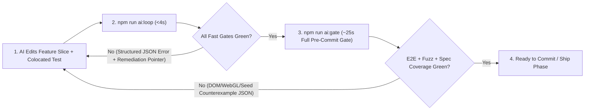

# 06 — Deterministic Quality Rules & Autonomous AI Self-Testing Loop

> **Scope**: Auditing static enforcement (`eslint.config.js`, `tsconfig*.json`, `scripts/check-folder-size.mjs`, `scripts/verify/*`, `tests/`, `e2e/`, GitHub Actions) and designing a **fast (`<4s`), deterministic, zero-human-intervention AI self-testing & self-correcting loop** capable of sustaining Phases 8–13 autonomously.

---

## Executive Summary

For autonomous AI coding agents and humans to scale DungeonCrawler2D from `<10%` to `100%` without regression spirals, **every architectural rule and gameplay invariant must fail fast, deterministically, and with machine-actionable diagnostics**.

The repository already has an impressive foundation: strict ESLint complexity/size caps (`complexity <= 8`, `cognitive-complexity <= 7`, `<= 35` lines/fn, `<= 250` lines/file), `check-folder-size.mjs`, Vitest, and a newly scaffolded 4-layer verification gate (`scripts/verify/*`, `tests/integration/contentIntegrity.test.ts`, `e2e/baseline-smoke.spec.ts`). However, auditing the actual implementation reveals **10 critical gaps and perverse incentives** that currently allow broken code, drifted predictions, black WebGL canvases, and architectural violations to pass `npm test` and `npm run lint` silently:

1. **Test-Penalizing Folder Cap (`RULE-01`)**: `check-folder-size.mjs` counts `*.test.ts` toward `MAX_DIRECT_FILES = 12`—actively punishing agents for writing unit tests in full folders (`client/src/net`, `engine/src/world`, `engine/src/combat`) while ignoring `.py` files (`tools/sprite-studio` has `31` flat `.py`/`.mjs` files!) and never enforcing `README.md` colocation (`39` `packages/*/src/**` folders lack `README.md`; `45+` repo-wide including `scripts/`, `tests/`, `e2e/`, `tools/`).
2. **Missing Exhaustiveness & Typechecked Tooling (`RULE-02`, `RULE-03`)**: `eslint.config.js` runs **without type-aware rules** (`switch-exhaustiveness-check` and `no-floating-promises` are off!), leaves `no-unused-vars` at `"warn"`, and `npm run typecheck` **completely ignores `tests/**`, `e2e/**`, `playwright.config.ts`, `scripts/**/*.mjs`, and `tools/**/*.py`**.
3. **Brittle Regex Scraping in `verify:content` (`RULE-05`)**: `scripts/verify/contentAuditHelpers.mjs` scrapes TypeScript files with non-nested `{...}` regexes across hardcoded 4-file arrays—truncating any `ItemDef` with nested objects (`visualLayer: { ... }`) and ignoring new item/icon files!
4. **False-Positive WebGL Visual Check (`RULE-09`)**: `e2e/helpers/gameHarness.ts` measures PNG pixel entropy across the **entire browser page** (including crisp HTML HUD overlays) rather than the WebGL `<canvas>`—so **a 100% solid-black broken WebGL shader passes `analyzePngEntropy`!**
5. **Missing `<4s` Headless Sim DSL & Prediction Parity Loop (`RULE-07`, `RULE-08`, `RULE-10`)**: E2E Playwright takes `~25s` per run, while fast headless tests lack a declarative multi-tick scenario DSL, property-based fuzzing (`fast-check`), conservation invariants, and an automated **Client-vs-Server Prediction Parity Gate** (which would have immediately caught the live speed-buff & heavy-swing rubber-banding bugs documented in `ARCH-04`).

---

## Deterministic Rules & AI-Loop Issue Matrix

| ID | Severity | Gap / Antipattern | Exact Location | Deterministic Fix |
| :--- | :--- | :--- | :--- | :--- |
| `RULE-01` | **Critical** | `check-folder-size.mjs` counts `*.test.ts` against the 12-file limit, ignores `.py` scripts (`31` files in `sprite-studio`), and ignores missing `README.md` (`39` `packages/*/src/**` folders; `45+` repo-wide) | [check-folder-size.mjs](file:///c:/repos/DungeonCrawler2D/scripts/check-folder-size.mjs#L9-L31) | Cap **production** files (`<= 10`), exempt colocated `*.test.ts`, count `.py`, require `README.md` |
| `RULE-02` | **High** | No type-aware ESLint (`switch-exhaustiveness-check`, `no-floating-promises`); `no-unused-vars` is `"warn"`; `!` allowed in server/client | [eslint.config.js](file:///c:/repos/DungeonCrawler2D/eslint.config.js#L29-L53) | Enable `projectService: true`, `switch-exhaustiveness-check: "error"`, promote warnings to `"error"` |
| `RULE-03` | **High** | `npm run typecheck` skips `tests/**`, `e2e/**`, `scripts/*.mjs`, `tools/*.mjs`; `23` Python scripts have zero lint/AST check; 4 cold `tsc` spawns | [package.json](file:///c:/repos/DungeonCrawler2D/package.json#L17), [tsconfig.base.json](file:///c:/repos/DungeonCrawler2D/tsconfig.base.json) | TypeScript Project References (`tsc -b`) covering `packages`, `tests`, `e2e`, `scripts` + `ruff check` for `.py` |
| `RULE-04` | **High** | `AGENTS.md` domain-naming rules (`frontier*`, `*Helpers.ts` sprawl) have zero automated lint enforcement | [eslint.config.js](file:///c:/repos/DungeonCrawler2D/eslint.config.js) | Custom ESLint filename & identifier rule banning milestone/version/grab-bag tokens |
| `RULE-05` | **High** | `verify:content` uses fragile `{[^}]*}` regexes & hardcoded file lists instead of live TypeScript imports | [contentAuditHelpers.mjs](file:///c:/repos/DungeonCrawler2D/scripts/verify/contentAuditHelpers.mjs#L17-L59), [content-integrity.mjs](file:///c:/repos/DungeonCrawler2D/scripts/verify/content-integrity.mjs#L20-L45) | Replace regex scraping with live Vitest/TSX catalog + exported client key-manifest assertions |
| `RULE-06` | **High** | `deploy-production.yml` skips `verify:content`/`e2e`/`spec`; `reportReader.mjs` single-layer Vitest bug; zero `knip` dead-code/asset gate | [deploy-production.yml](file:///c:/repos/DungeonCrawler2D/.github/workflows/deploy-production.yml#L56-L63), [reportReader.mjs](file:///c:/repos/DungeonCrawler2D/scripts/verify/reportReader.mjs#L19-L24) | Run full gate before prod deploy; support multi-layer Vitest tags; add `knip` + orphan-asset gate |
| `RULE-07` | **Critical** | No declarative `<50ms` headless gameplay scenario DSL for multi-tick combat, harvest, persistence, & dungeon testing | `packages/game-server/src/sim/*.test.ts` | Build `SimScenarioRunner` fluent DSL (`spawnHero`, `stepTicks`, `swing`, `saveAndReload`) |
| `RULE-08` | **Critical** | Zero property-based fuzzing or automated Client-vs-Server Prediction Parity invariant tests | `packages/client/src/net/worldPrediction.test.ts` | Add `fast-check` randomized input-stream parity, item conservation, no-`NaN`, & seed reachability suites |
| `RULE-09` | **High** | `captureQaScreenshot` checks full-page PNG entropy (HUD masks black WebGL canvas!) & lacks scene/VRAM/overlap telemetry | [gameHarness.ts](file:///c:/repos/DungeonCrawler2D/e2e/helpers/gameHarness.ts#L78-L92), [baseline-smoke.spec.ts](file:///c:/repos/DungeonCrawler2D/e2e/baseline-smoke.spec.ts) | Entropy-check HUD-masked `<canvas>` pixels + expose dev/test `window.__dc2dDiag` JSON telemetry + HUD overlap check |
| `RULE-10` | **High** | No unified `<4s` machine-readable `ai:loop` CLI emitting structured failure JSON + remediation pointers for autonomous agents | [package.json](file:///c:/repos/DungeonCrawler2D/package.json#L12-L26) | Add `npm run ai:loop` (incremental `<4s` inner loop) & `npm run ai:gate` outputting structured JSON diagnostics |

---

## Detailed Findings & Implementation Blueprints

### `RULE-01` (Critical) — `check-folder-size.mjs` Punishes Unit Tests, Ignores `.py` Files, and Ignores Missing `README.md`s

#### Evidence
1. **Perverse Anti-Testing Incentive**: [check-folder-size.mjs](file:///c:/repos/DungeonCrawler2D/scripts/check-folder-size.mjs#L9-L11) counts every `.ts` file equally toward `MAX_DIRECT_FILES = 12`. Today:
   - `packages/client/src/net` has `8` production modules + `4` `.test.ts` files = **`12/12`**. Adding unit tests for `localSwingTracker.ts` or `worldClient.ts` (`localSwingTracker.test.ts`) **breaks `npm run lint`!**
   - `packages/engine/src/world` (`8` prod + `4` test = **`12/12`**), `packages/engine/src/combat` (`6` prod + `5` test = **`11/12`**), and `packages/game-server/src/sim` (`5` prod + `5` test = **`10/12`**) suffer the exact same penalty.
   - When AI agents hit this cap, they either skip writing unit tests or dump functions into unrelated folders (which is why `tryExecutePlayerDodge` ended up inside `sim/frontier/poiInteractions.ts`!).
2. **Python Tooling Blind Spot**: Line `11` of [check-folder-size.mjs](file:///c:/repos/DungeonCrawler2D/scripts/check-folder-size.mjs#L11) sets `SOURCE_FILE = /\.(?:[cm]?[jt]sx?)$/`, counting only the `8` `.mjs` files in `tools/sprite-studio` while ignoring its `23` `.py` files—allowing `tools/sprite-studio` to accumulate **`31` direct `.py` and `.mjs` files** in one flat directory!
3. **Unenforced `AGENTS.md` Colocated `README.md` Rule**: `AGENTS.md` mandates colocated `README.md` files next to subsystem folders, yet **`39` of `68` `packages/*/src/**` folders** (`45+` code-bearing folders repo-wide when including `scripts/`, `tests/`, `e2e/`, and `tools/`—such as `packages/client/src/net`, `packages/client/src/render/textures`, `packages/content/src/items`, `packages/engine/src/net`, `packages/game-server/src/sim/combat`, and `packages/client/src/input`) have **no `README.md`**.

#### Proposed Fix: Upgrade `scripts/check-folder-size.mjs` -> `scripts/check-module-structure.mjs`
```js
const MAX_PROD_FILES = 10; // Production code files (.ts, .mjs, .py) excluding *.test.* / *.spec.*
const CODE_FILE = /\.(?:[cm]?[jt]sx?|py)$/;
const REQUIRE_README_MIN_PROD_FILES = 3; // Every folder with >= 3 prod files MUST have a README.md

function classifyDirectFiles(entries) {
  const prod = [];
  const tests = [];
  let hasReadme = false;
  for (const e of entries) {
    if (!e.isFile()) continue;
    if (e.name === "README.md") { hasReadme = true; continue; }
    if (!CODE_FILE.test(e.name)) continue;
    if (/\.(test|spec)\.[cm]?[jt]sx?$/.test(e.name)) tests.push(e.name);
    else prod.push(e.name);
  }
  return { prod, tests, hasReadme };
}
```
- Split `tools/sprite-studio` into `core/`, `actions/`, `creatures/`, and `player/` so `.py` + `.mjs` folders obey the exact same `<= 10` production-file cap.
- Result: Every production module in a 10-file folder can have its own colocated `*.test.ts` (`10` prod + `10` test = `20` files) **without ever triggering a folder-size violation**, while production bloat above `10` modules still fails deterministically!

---

### `RULE-02` (High) — Missing Type-Aware ESLint Rules (`switch-exhaustiveness-check`) & Weak Severities

#### Evidence
In [eslint.config.js](file:///c:/repos/DungeonCrawler2D/eslint.config.js#L29-L53):
1. Uses `tseslint.configs.recommended` (syntactic only) without `languageOptions.parserOptions.projectService: true`. Consequently:
   - **`@typescript-eslint/switch-exhaustiveness-check` is absent**: Adding a new `PropKind`, `PoiKind`, `EntityKind`, `ServerMessage["type"]`, or `ClientAction["kind"]` never flags incomplete `switch` statements unless the author manually remembered a `default: const _: never = x` guard!
   - **`@typescript-eslint/no-floating-promises` & `no-misused-promises` are absent**: Unawaited async calls in client asset loading, audio context resume, or E2E helpers pass silently.
2. `@typescript-eslint/no-unused-vars` is `"warn"` (`line 39`)—allowing dead variables, unused imports, and abandoned parameters to accumulate indefinitely without failing CI.
3. `@typescript-eslint/no-non-null-assertion` is `"off"` (`line 49`) everywhere outside `packages/engine`, and `@typescript-eslint/ban-ts-comment` is only `"warn"` (`line 50`).

#### Proposed Fix
Enable `typescript-eslint` v8's fast `projectService: true` and harden rule severities:
```js
languageOptions: {
  parserOptions: { projectService: true, tsconfigRootDir: import.meta.dirname },
},
rules: {
  "@typescript-eslint/no-unused-vars": ["error", { argsIgnorePattern: "^_", varsIgnorePattern: "^_" }],
  "@typescript-eslint/switch-exhaustiveness-check": ["error", { considerDefaultExhaustiveForUnions: false }],
  "@typescript-eslint/no-floating-promises": "error",
  "@typescript-eslint/no-misused-promises": "error",
  "@typescript-eslint/no-non-null-assertion": "error",
  "@typescript-eslint/ban-ts-comment": ["error", { "ts-expect-error": "allow-with-description", minimumDescriptionLength: 12 }],
}
```
Notice `considerDefaultExhaustiveForUnions: false`: even `switch` statements with a lazy `default:` must explicitly handle every union member (or explicitly opt in), eliminating `ARCH-03` forgotten-enum bugs at compile/lint time!

---

### `RULE-03` (High) — Unchecked Test/Script/Python Code & Slow Sequential `tsc` Invocations

#### Evidence
1. **Blind Spots in `npm run typecheck` ([package.json](file:///c:/repos/DungeonCrawler2D/package.json#L17))**:
   `npm run typecheck` executes 4 sequential workspace commands (`engine`, `content`, `game-server`, `client`).
   - `tests/integration/contentIntegrity.test.ts`, `e2e/**/*.ts`, `playwright.config.ts`, and `vitest.config.ts` are **not inside any `tsconfig.json`** and are **never typechecked**!
   - `scripts/**/*.mjs` (`10` scripts) and `tools/**/*.mjs` (`9` scripts) lack `// @ts-check` / `checkJs: true`.
   - `tools/sprite-studio/*.py` (`23` Blender Python scripts) have zero syntax, undefined-name, or style checks in CI (`ruff` is not configured).
2. **Cold Compiler Overhead**: Spawning 4 separate `node tsc --noEmit` processes re-parses `node_modules/@types` and workspace sources 4 times (~4–6s cold) instead of using incremental `.tsbuildinfo` caches.

#### Proposed Fix
1. Convert root `tsconfig.json` to **TypeScript Project References** (`"composite": true`, `"incremental": true`) referencing `packages/contracts`, `packages/content`, `packages/engine`, `packages/game-server`, `packages/client`, plus a new `tsconfig.qa.json` covering `tests/**`, `e2e/**`, `scripts/**/*.mjs` (`allowJs: true, checkJs: true`), and `playwright.config.ts`.
2. Replace `"typecheck"` with `"tsc --build"` (`< 0.6s` warm incremental rebuilds!).
3. Add `ruff check tools/` (`select = ["E", "F", "B", "W"]`) to `lint` and `.github/workflows/quality.yml` to catch Python syntax/name bugs before headless Blender runs.

---

### `RULE-04` (High) — Deterministic Lint Gate for `AGENTS.md` Domain Naming & Layer Boundaries

#### Evidence
`AGENTS.md` bans milestone/pipeline/renderer/version tokens (`terrain4`, `phaser4`, `frontier*`, `phase8*`, `v2`) in shared identifiers and filenames, yet nothing enforces it automatically—which is how `10` `frontier*` files/folders and `7` `*Helpers.ts` sidecar files entered the repo.

#### Proposed Fix
Add a lightweight local ESLint plugin rule (`scripts/eslint-rules/domain-naming.mjs`) wired into `eslint.config.js`:
- **Filename check**: Reject new files/folders matching `/(?:frontier|phase\d+|terrain\d+|phaser\d+|_old|_v\d+|temp|misc|utils2|helpers2)/i` (with an explicit zero-growth allowlist if migrating incrementally, or zero allowlist once `ARCH-06` renames land).
- **Identifier check (`no-restricted-syntax`)**: Flag exported symbols containing banned milestone prefixes (`Frontier*`, `Phase8*`, `V2*`).

---

### `RULE-05` (High) — Fragile Regex Source Scraping in `scripts/verify/content-integrity.mjs`

#### Evidence
Inspecting [contentAuditHelpers.mjs](file:///c:/repos/DungeonCrawler2D/scripts/verify/contentAuditHelpers.mjs#L17-L59) and [content-integrity.mjs](file:///c:/repos/DungeonCrawler2D/scripts/verify/content-integrity.mjs#L20-L45) reveals four deterministic verification bugs waiting to misfire as content scales:
1. **Broken Non-Nested `{...}` Regex (`contentAuditHelpers.mjs:21`)**:
   ```js
   const re = /\{\s*id:\s*"([^"]+)"[^}]*?\}/gs;
   ```
   `[^}]*?` halts at the **first closing brace `}`** inside an item literal! For any `ItemDef` containing a nested object (such as `visualLayer: { slot: "head", ... }` or Phase 13 `effects: [{ ... }]`), `m[0]` is truncated immediately after the nested `}`, **dropping all fields declared below it** (e.g., `weaponArchetype` or `armorSlot: "offhand"`), causing `checkHeldGearCoverage` to silently skip that item!
2. **Hardcoded File Arrays (`lines 19, 37`, `content-integrity.mjs:21-22, 35-39`)**:
   - `extractItemCatalogDefs` only reads `["catalog.ts", "frontierWeapons.ts", "frontierArmor.ts", "frontierMaterials.ts"]`. Any item placed in a new file (`potions.ts`, `campItems.ts`, `bossDrops.ts`) is **100% invisible** to `verify:content`!
   - `extractIconKeys` only reads `4` of the `5` files in `packages/client/src/ui/icons/` (`itemIcons.ts`, `campItemIcons.ts`, `weaponItemIcons.ts`, `frontierItemIcons.ts`) and uses `/(?:"([a-z0-9-]+)"|([a-z][a-zA-Z0-9]*))\s*:/g`, which matches **every internal JS object key** in those files (e.g. `color:`, `stroke:`, `fill:`, `handle:`, `blade:`)! An item with `id: "blade"` or `id: "crown"` would falsely pass even with no icon painter!
3. **Comment-Vulnerable Substring Check (`content-integrity.mjs:43`)**: `checkAcquisitionPaths` checks `!sources.includes(\`"${item.id}"\`)`—so an item ID mentioned inside a comment or negative test assertion passes as "acquirable".
4. **Incomplete `PropKind` Mount Check (`contentAuditHelpers.mjs:52-59`)**: Only checks `chunkProps.ts` and `propTextures.ts`—missing `worldDeltaSchemas.ts` (`RUNTIME_PROP_KINDS`), `propFootprints.ts`, `aiSensing.ts`, and `stealthRules.ts`.

#### Proposed Fix: Replace Regex Scraping with Live TypeScript Registry Exports in Vitest
Never parse TypeScript data catalogs with regexes! Export pure, side-effect-free key sets from client visual registries (`export const REGISTERED_ITEM_ICON_IDS: ReadonlySet<string>`, `export const REGISTERED_HELD_VISUAL_IDS: ReadonlySet<string>`, `export const REGISTERED_PROP_RENDER_KINDS: ReadonlySet<PropKind>`) and validate everything inside `tests/integration/contentIntegrity.test.ts` using **real TypeScript imports**:
- Every item in `ITEM_CATALOG` (regardless of which subfolder/file defined it!) is checked against `REGISTERED_ITEM_ICON_IDS`, `REGISTERED_HELD_VISUAL_IDS`, and structured `RECIPE_CATALOG` / `LOOT_TABLES` / `HARVEST_NODE_SPECS` / `CREATURE_LOOT_TABLES` data structures—zero regexes, zero hardcoded file arrays, 100% immune to formatting or nested braces!

---

### `RULE-06` (High) — Spec Traceability, Production CI Gate & Dead-Code (`knip`) Gaps

#### Evidence
1. **Production Deploy Skips Verification Gates**: Compare [quality.yml](file:///c:/repos/DungeonCrawler2D/.github/workflows/quality.yml#L32-L35) (`pull_request` only) with [deploy-production.yml](file:///c:/repos/DungeonCrawler2D/.github/workflows/deploy-production.yml#L56-L63) (`push` to `main`). Direct pushes to `main` deploy straight to Fly.io and AWS S3/CloudFront **without running `verify:content`, `verify:e2e`, or `verify:spec`**!
2. **Single-Layer Vitest Classification Bug ([reportReader.mjs](file:///c:/repos/DungeonCrawler2D/scripts/verify/reportReader.mjs#L19-L24))**:
   `classifyVitestLayer` hardcodes `packages/game-server/` -> `"sim"` and everything else -> `"unit"`. A single Vitest integration test cannot satisfy both `unit` and `sim` (or `sim` inside `tests/integration/`), and [spec-coverage.mjs](file:///c:/repos/DungeonCrawler2D/scripts/verify/spec-coverage.mjs#L25) treats `"static"` as globally passed for *every* `REQ-P*-*` whenever `content.json` has `ok: true`, even if no static check verified that requirement!
3. **Zero Phase-Tagged Baseline E2E Tests Yet**: [baseline-smoke.spec.ts](file:///c:/repos/DungeonCrawler2D/e2e/baseline-smoke.spec.ts#L21-L39) passes synthetic `reqId: "gameplay" | "map" | "inventory"` strings rather than `[REQ-P*-*]` tags, and `verify:spec` defaults to `--check-specs` (table syntax only) unless explicitly invoked with `all-completed` or `phase-8`.
4. **No Automated Dead-Export / Orphan-Asset Detector**: Unused exported functions, orphan files, unused `package.json` dependencies, and unreferenced megabytes under `packages/client/public/assets/` are not gated in CI.

#### Proposed Fix
1. Add [`knip`](https://knip.dev/) (`npm run verify:deadcode`) configured for the 4 workspaces + `playwright.config.ts` + `vitest.config.ts` so any unused file, unused export, or unused dependency fails CI immediately.
2. Add an `assertNoOrphanPublicAssets()` check in `tests/integration/contentIntegrity.test.ts` verifying every file under `packages/client/public/assets/` is referenced by `sprite-manifest.json`, `player-rig.json`, or an explicit runtime asset manifest.
3. Update `reportReader.mjs` to parse explicit layer tags (`[REQ-P8-01][sim]` or `[REQ-P8-01][static]`) when present, falling back to path heuristics, and run `verify:content` + `verify:e2e` + `verify:spec -- all-completed` inside `deploy-production.yml` before AWS/Fly deployment steps.

---

### `RULE-07` (Critical) — Tier-2 (`<50ms`) Declarative Headless Gameplay Scenario Harness (`SimScenarioRunner`)

#### Why Autonomous AI Needs This
Currently, `packages/game-server/src/sim/*.test.ts` constructs `WorldSim` and manually builds raw `SimPlayer` objects, steps magic `0.05s` loops, and inspects internal private-ish structures. Writing a multi-step test (e.g., *"Player harvests 3 pine trees, builds a campfire and bedroll, sleeps at dusk, enters dungeon portal, fights elite skeleton, dies, respawns at bedroll, server restarts from SQLite, verify inventory and bedroll cooldown persist"*) takes ~120 lines of fragile boilerplate.

#### Proposed Design: `packages/game-server/src/testing/simScenario.ts`
Provide a fluent, deterministic **Headless Scenario DSL** that runs **1,000 ticks (50 simulated seconds) in `< 25ms`** with seeded RNG and in-memory SQLite persistence:

```ts
export class SimScenario {
  static create(opts?: { seed?: number; timeOfDay?: number }): SimScenario;

  spawnHero(id: string, opts?: { x?: number; y?: number; loadout?: string[] }): HeroHandle;
  spawnCreature(species: CreatureKind, opts: { x: number; y: number; elite?: boolean }): CreatureHandle;
  placeProp(kind: PropKind, x: number, y: number): string;

  // High-level deterministic agent actions:
  moveHeroToward(id: string, targetX: number, targetY: number, maxSec?: number): this;
  performMelee(id: string, kind: "light" | "heavy", aimAngle: number): this;
  shootBow(id: string, chargeSec: number, aimAngle: number): this;
  harvestNearest(id: string, propKind?: PropKind): this;
  craft(id: string, recipeId: string): this;
  advanceSec(seconds: number): this; // Steps in exact 50ms (20 Hz) increments, checking global invariants every tick!

  // Persistence round-trip in 2ms (catches serialization omissions automatically!):
  rebootServerFromPersistence(): this;

  // Structured snapshot diffing for AI debugging:
  dumpStateSummary(): ScenarioDiagnosticSnapshot;
}
```
With `SimScenario`, an AI agent implementing a Phase 8–13 feature can write comprehensive end-to-end gameplay + save/reload tests in **15 lines of readable code** that execute in **milliseconds** without spinning up Vite or Chromium!

---

### `RULE-08` (Critical) — Property-Based Fuzzing (`fast-check`) & Client-vs-Server Prediction Parity Gate

#### Why Autonomous AI Needs This
Example-based unit tests only test inputs the author thought of. Autonomous AI agents occasionally introduce subtle edge cases (division by zero on zero-length knockback vectors, item duplication when swapping a stack onto itself, or forgetting to mirror a new server speed buff in client prediction). **Property-based fuzz tests catch these automatically.**

#### Four Mandatory Property Suites (`tests/properties/*.property.test.ts` via `fast-check`)

1. **Client-vs-Server Prediction Parity Invariant (`predictionParity.property.test.ts`)**:
   - Generates arbitrary 200-tick sequences of `StepInputFrame` (`moveX`, `moveY`, `sprint`, `crouch`, `jump`, `shieldRaise`, `bowDraw`, `meleeSwing`) across randomized gear loadouts (`Swift` daggers, heavy plate, speed buffs, shallow water, mud).
   - Feeds the exact same command stream to `WorldSim` (server) and `predictLocalPlayerMove` + `LocalSwingTracker` (client) with `0ms` simulated jitter.
   - **Asserts**: `Math.hypot(client.x - server.x, client.y - server.y) < 0.02` tiles and `Math.abs(client.stamina - server.stamina) < 0.5` on every tick!
   - *Impact*: Immediately catches the `ARCH-04` `moveSpeedMult` / heavy-windup / spear-poke desyncs and guarantees client prediction can never silently drift again across Phases 8–13.
2. **Item Conservation Law (`inventoryConservation.property.test.ts`)**:
   - Generates arbitrary sequences of `inventoryMove`, `splitStack`, `equipArmor`, `unequipArmor`, `chestTransfer`, `dropItem`, and `pickupLoot`.
   - **Asserts**: Total item count across `(playerSlots + armorSlots + chestSlots + groundBags)` for every `itemId` and unique rolled `instanceId` is **strictly invariant** (zero duplication, zero item loss), and `0 < slot.count <= def.maxStack`.
3. **Simulation Finiteness & Collision Unstuck Law (`simFuzz.property.test.ts`)**:
   - Runs 300 ticks of random chaotic combat, dodge-rolls, explosions, knockbacks, and harvests.
   - **Asserts after EVERY tick**: Every player/creature coordinate, velocity, HP (`0 <= hp <= maxHp`), and stamina is `Number.isFinite(...)`, and no live actor remains embedded inside a solid `PropKind` or cliff collider for `> 2` consecutive ticks.
4. **Multi-Seed Worldgen & Dungeon Connectivity Law (`worldgenReachability.property.test.ts`)**:
   - Across `50` seeds, asserts spawn `(0, 0)` is dry & walkable, every stamped POI chest/portal is reachable via A* from the chunk border without harvesting locked props, and every Phase 10/11 generated dungeon floor has a valid walkable path from `Entrance` -> `Key/Lever` -> `Stairwell/Boss`.

---

### `RULE-09` (High) — Fixing the False-Positive E2E Visual Check & Exposing WebGL/HUD Telemetry to AI

#### Evidence of the Current Bug
In [gameHarness.ts](file:///c:/repos/DungeonCrawler2D/e2e/helpers/gameHarness.ts#L84-L86):
```ts
const buf = await page.screenshot({ path: resolve(outDir, file) });
const stats = analyzePngEntropy(buf);
expect(stats.nonBlank, ...).toBe(true);
```
`page.screenshot()` captures the **full DOM composite** (WebGL `<canvas>` + HTML `.ow-vitals` + `.ow-hotbar` + `.ow-minimap`). Because the HTML HUD contains bright red/green bars, gold borders, item icons, and crisp text, `lumaStdDev >= 6` and `colors.size >= 12` **pass even if the PixiJS WebGL `<canvas>` rendered 100% solid black** due to a broken GLSL shader or missing texture!

Furthermore, when a visual or layout bug *does* occur (e.g., mobile touch buttons overlapping the hotbar at `390×844`, or VRAM spiking to `600 MB`), Playwright only captures a PNG—forcing a human or multimodal vision pass instead of giving the coding agent exact numeric coordinates.

#### Proposed Fix
1. **Isolate WebGL Canvas Entropy**: Capture pixels directly from the `<canvas>` center playfield region (excluding HUD bounding boxes, or calling `canvas.locator.screenshot()` while temporarily toggling `document.body.dataset.hideHud = "1"` for 1 frame) and assert both `lumaStdDev >= 8` and `uniqueColors >= 24` (with calibrated dark-palette thresholds for Phase 11 pitch-black dungeons where torchlight ring > darkness background).
2. **Test-Only `window.__dc2dDiag` Telemetry Bridge** (enabled only when `import.meta.env.DEV || window.location.search.includes("qaDiag=1")` in non-prod preview):
   ```ts
   export interface ClientQaDiagnostics {
     readonly rendererReady: boolean;
     readonly webglContextLost: boolean;
     readonly compiledShadersOk: boolean;
     readonly activeSpriteCount: number;
     readonly gpuTextureCount: number;
     readonly estimatedTextureBytes: number; // Fail E2E if > 256 MB!
     readonly activeAudioNodes: number;      // Fail E2E if leaking nodes > 64!
     readonly localPlayer: { readonly x: number; readonly y: number; readonly hp: number; readonly zoneId: string } | null;
     readonly visibleEntityCount: number;
   }
   ```
3. **Automated HUD Bounding-Box Collision Gate (`assertNoHudOverlap(page)`)**:
   Query `getBoundingClientRect()` for all visible interactive HUD controls (`.ow-vitals`, `.ow-hotbar`, `.ow-map-btn`, `.ow-mobile-joy`, `.ow-mobile-actions`, `.ow-party-frame`) on both `desktop (1280×720)` and `mobile (390×844)` and fail with exact `{ elementA, rectA, elementB, rectB, overlapPx }` JSON if any two controls intersect by `> 2px`!

---

### `RULE-10` (High) — Unified Closed-Loop Autonomous AI Workflow (`npm run ai:loop` & `npm run ai:gate`)

#### Designing for Zero-Human-Intervention Self-Correction
An autonomous AI loop works best when inner-loop verification runs in **`< 4 seconds`** and outputs **compact, token-efficient JSON diagnostics** rather than 500 lines of ANSI terminal noise.



#### Concrete Two-Tier Command Specification

1. **`npm run ai:loop` (`scripts/verify/ai-loop.mjs` — Target `< 3.5s`, Safe for Every Iteration)**:
   Executes in parallel/pipelined stages over changed + affected files:
   - `tsc --build` (incremental `.tsbuildinfo` across all packages + `tests` + `e2e`: `~0.5s`)
   - `lint:working-tree` + `check-module-structure --changed` (`~0.8s`)
   - `vitest related <changed-files> --run` + `tests/integration/contentIntegrity.test.ts` + fast 25-run `predictionParity` smoke (`~1.8s`)
   - **Note on `AGENTS.md` Validation Rule**: Keep `npm run lint:working-tree` for pure syntax/lint checks during mid-edit steps, and provide `npm run ai:gate` for the final pre-commit validation checkpoint so agents validate end-to-end deterministically before finishing!

2. **`npm run ai:gate` (`scripts/verify/run-phase-gate.mjs` — Target `~25s`, Final Checkpoint)**:
   Runs `tsc --build` -> `eslint .` + `ruff check tools/` + `check-module-structure` -> `knip` (dead code/exports) -> full `vitest run` (unit + `SimScenario` + 200-seed `fast-check` properties) -> `npm run build` -> `playwright test` (Desktop + Mobile WebGL canvas entropy, VRAM budget, HUD non-overlap, FPS cliff guard) -> `verify:spec -- all-completed`.

3. **Structured Machine-Readable Diagnostic Output (`.verify-reports/ai-feedback.json`)**:
   Whenever any step fails, emit a compact JSON summary tailored for LLM self-correction:
   ```json
   {
     "ok": false,
     "failedStage": "property-invariant",
     "failures": [
       {
         "code": "PREDICTION_PARITY_DRIFT",
         "reqId": "REQ-P8-04",
         "file": "packages/client/src/net/worldPrediction.ts",
         "line": 123,
         "counterexample": { "seed": 918273, "tick": 14, "gear": ["hunters-boots"], "serverPos": [4.82, 0.0], "clientPos": [4.41, 0.0] },
         "hint": "Client movement prediction diverged from server kinematics (> 0.02 tiles). Ensure shared stepCharacterKinematics() in @dc2d/engine handles all speed modifiers identically.",
         "docRef": "packages/engine/src/kinematics/README.md"
       }
     ]
   }
   ```
   With exact counterexamples (shrunk automatically by `fast-check`), file/line coordinates, and pointers to the colocated `README.md`, an AI agent can reproduce any failure in a 5-line unit test, patch the root cause, and verify convergence without human intervention.
