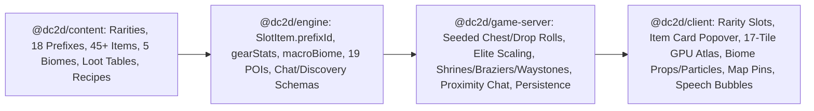

# Frontier Overhaul — Master Plan

> **Status**: ✅ Complete & Live-Verified (commits `cdb79366`..`cb94d6db`; see [BUG-FIX-LOG.md](BUG-FIX-LOG.md))
> **Scope**: Item Rarities & Prefixes, Tap-to-Inspect Item Cards, Dynamic Frontier Loot & Elites (5 Danger Tiers), 5 Overworld Biomes, 18 New POIs (20 Total), Discovery Banners/Map Pins, and Proximity Chat Speech Bubbles.

---

## 1. Vision & Player Journey

Stepping out of the Spawn Glade should feel like entering an untamed, rewarding frontier rather than walking through an endless identical forest:

1. **Out of the Glade**: Around spawn (`r < 28` tiles) lies the welcoming **Verdant Forest** (Danger I). Venturing farther reveals **Autumn Woods** (Tier II), **Misty Bog** (Tier II), **Craggy Highlands** (Tier III), and **Cursed Ruinlands** (Tier IV), each with its own ground palette, foliage, wildlife packs, weather/particles, and harvestable frontier materials.
2. **Meaningful Exploration & "Wow" Moments**: Every few chunks holds something memorable — a glowing **Shrine of Swiftness**, an **Ancient Waystone** pulsing to reveal nearby `?` beacons on your `[M]` map, a **Fallen Knight's Grave**, a **Fairy Ring**, a **Brazier Puzzle Vault** you unlock with your Torch, or a dangerous **Broodmother Hollow** guarded by an Elite boss.
3. **Loot Worth Chasing**: Hardcoded 6-item chests are gone. Distance and biome Danger Tier drive seeded loot tables rolling **5 Rarity Tiers** (`Common` -> `Legendary`) and **18 Rolled Prefixes** (`Keen`, `Vampiric`, `Shadow-Woven`, `Blazing`, `Thorny`, etc.) with real stats and perks wired straight into combat and stealth math.
4. **Tactile Inspection & Co-op**: Tapping any item in your hotbar, backpack, armor, or chest opens a crisp **Item Card** with a large pixel icon, lore, perk badges, and green/red comparison deltas against your equipped gear. Talking with nearby friends pops pixel **Speech Bubbles** right above your hero's head.

---

## 2. System Architecture & Data Flow

---

## 3. Feature Specification Index

| # | Spec Sheet | Scope Summary | Primary Packages |
| --- | --- | --- | --- |
| 01 | [Item Stats, Rarity & Prefixes](01-item-stats-rarity-and-prefixes.md) | 5 rarities, 45+ items, 4 recolored armor sets, 18 prefixes, 6 perks, real engine stat math | `@dc2d/content`, `@dc2d/engine`, `@dc2d/game-server` |
| 02 | [Item Card & Inspection UI](02-item-card-and-inspection-ui.md) | Tap-to-inspect popover, 64px pixel preview, green/red equip diff, rarity slot borders | `@dc2d/client` |
| 03 | [Dynamic Loot Tables & Frontier Scaling](03-dynamic-loot-tables-and-frontier-scaling.md) | DangerTier (I–IV), seeded chest & mob loot rolls, Elite mini-bosses, frontier recipes | `@dc2d/content`, `@dc2d/game-server`, `@dc2d/client` |
| 04 | [Five Biomes Overworld Generation](04-five-biomes-overworld-generation.md) | 5 macro-biomes, 17-row GPU terrain atlas, biome props, ambient particles, biome wildlife | `@dc2d/content`, `@dc2d/engine`, `@dc2d/client`, `@dc2d/game-server` |
| 05 | [Diverse POIs, Shrines, Puzzles & Lairs](05-diverse-pois-shrines-puzzles-and-lairs.md) | 17 new POIs (19 total): shrines, waystones, micro-scenes, elite lairs, brazier vaults, friendly camps | `@dc2d/engine`, `@dc2d/game-server`, `@dc2d/client` |
| 06 | [Discovery Banners, Map Pins & Log](06-discovery-banners-map-pins-and-log.md) | Biome entry banners, POI discovery toasts, `[M]` color-coded pins, Waystone `?` beacons, `X/19` counter | `@dc2d/engine`, `@dc2d/game-server`, `@dc2d/client` |
| 07 | [Proximity Chat & Speech Bubbles](07-proximity-chat-and-speech-bubbles.md) | Distance-filtered chat (`16`/`34` tiles), PixiJS overhead bubbles, compact input & fading ticker | `@dc2d/engine`, `@dc2d/game-server`, `@dc2d/client` |

---

## 4. Shared Cross-Feature Contracts

- **`ItemRarity`**: `"common" | "uncommon" | "rare" | "epic" | "legendary"`
- **`SlotItem`**: `{ readonly itemId: string; readonly count: number; readonly prefixId?: string | undefined }`
- **`PlayerInventoryState.armorPrefixes`**: `Partial<Record<ArmorSlotKey, string>>` (keeps `ArmorEquipment` as `Record<ArmorSlotKey, string | null>` for 3D rig appearance compatibility).
- **`BiomeKind`**: `"verdant-forest" | "autumn-woods" | "misty-bog" | "craggy-highlands" | "cursed-ruinlands"`
- **`DangerTier`**: `1 | 2 | 3 | 4`
- **`PoiKind`**: 19 literal kinds (`bandit-camp`, `ancient-ruins`, 4 shrines/waystones, 6 micro-scenes, 4 elite lairs, 2 puzzle vaults, 2 friendly spots).
- **`DiscoverySnapshot`**: `{ discoveredPoiKinds: PoiKind[]; discoveredPois: DiscoveredPin[]; revealedPois: RevealedPin[] }`
- **`ChatEntry`**: `{ id: string; senderId: string; senderName: string; text: string; shout: boolean; x: number; y: number; sentAtTick: number }`

---

## 5. Folder-Size & Code Quality Guardrails

`scripts/check-folder-size.mjs` enforces `<= 12` direct source files per folder, and `eslint.config.js` enforces `<= 250` lines/file and `<= 35` lines/function:

| Saturated Folder (Do Not Add Direct Files) | Dedicated Subfolder for New Modules |
| --- | --- |
| `packages/engine/src/world/` (12) | `world/biomes/`, `world/pois/` |
| `packages/game-server/src/sim/wildlife/` (12) | `sim/frontier/`, `sim/wildlife/loot/` |
| `packages/client/src/ui/hud/` (12) | `ui/hud/itemCard/`, `ui/chat/`, `ui/discovery/` |
| `packages/client/src/render/textures/` (12) | `render/textures/biomes/`, `render/textures/pois/` |
| `packages/client/src/render/world/` (13) | `render/world/chat/` |

---

## 6. Phased Delivery & Verification Milestones

1. **Milestone A (Loot Depth, Item Cards & Social)**: Implement Specs `01`, `02`, and `07`. Verify `typecheck` + `lint:working-tree`.
2. **Milestone B (5 Biomes & Dynamic Frontier Scaling)**: Implement Specs `03` and `04`. Verify `typecheck` + `lint:working-tree`.
3. **Milestone C (17 New POIs & Discovery Loop)**: Implement Specs `05` and `06`, offline local preview parity, colocated READMEs, and unit/integration tests.
4. **Final Gate**: Run `npm run typecheck`, `npm run lint`, `npm test`, and `npm run build` — all must pass cleanly.
